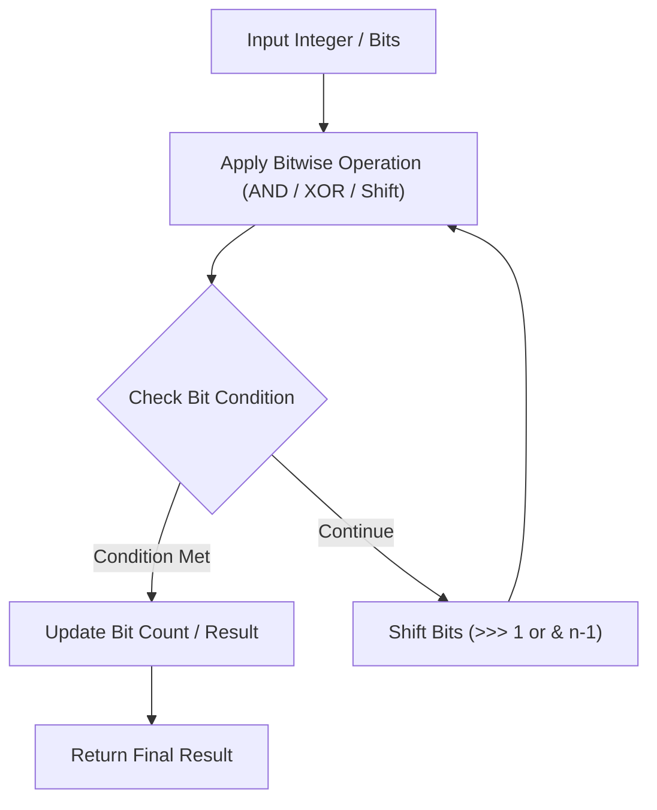

# Number of 1 Bits

<div style="display:flex; gap:0.5rem; margin-bottom:1.5rem; align-items:center;">
  <span style="background:#22c55e22; color:#22c55e; padding:2px 10px; borderRadius:12px; fontWeight:600; fontSize:0.85rem;">Easy</span>
  <span style="color:#64748b; fontSize:0.85rem;">Day 3 • Striver Blind 75</span>
</div>

## 📌 Problem Overview

Given a positive integer `n`, write a function that returns the number of set bits it has (also known as Hamming weight).

### Examples & Constraints
**Example 1:**
- **Input:** `n = 11`
- **Output:** `3`
- **Explanation:** 11 in binary is 1011 (3 set bits)

**Constraints:**
- `1 <= n <= 2^31 - 1`

---

## 💡 Approach & Intuition

`n & (n - 1)` clears the lowest set bit.

### 🎯 Pattern Recognition
Brian Kernighan's Bit Counting Algorithm

---

## 📊 Step-by-Step Execution (Mermaid Diagram)



---

## 🐢 Brute Force Solution

### Code
```javascript
function hammingWeight(n) {
  let count = 0;
  while (n > 0) {
    count += (n & 1);
    n >>>= 1;
  }
  return count;
}
```

- **Time Complexity:** `O(32)`
- **Space Complexity:** `O(1)`
- **Explanation:** Shift bits right 32 times.

---

## ⚡ Optimized Solution

### Code
```javascript
function hammingWeight(n) {
  let count = 0;
  while (n !== 0) {
    n &= (n - 1);
    count++;
  }
  return count;
}
```

- **Time Complexity:** `O(set bits)`
- **Space Complexity:** `O(1)`
- **Explanation:** Clears lowest set bit in each iteration.

---

## 🐾 Step-by-Step Walkthrough

1. **Initialize State:** Setup necessary pointers, dynamic programming arrays, or hash maps.
2. **Iterate & Evaluate:** Process the input according to the boundary conditions.
3. **Update & Return:** Compute the optimal answer and return early or at termination.

### 🎙️ FAANG Interview Pitch
n & (n - 1) removes the least significant 1-bit in O(k) operations.

---

## 💡 Progressive Hints

1. Use n & (n - 1) to clear bits one by one.

---

## ⚡ Interactive Practice
👉 **[Solve this problem interactively in the DSA Lab](/DSA-Notes-Problems/dsa/problems/number-of-1-bits)**
