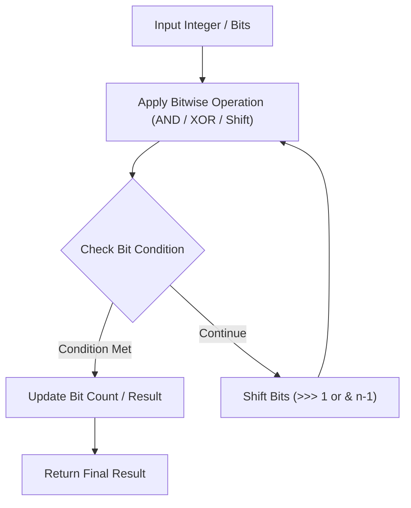

# Reverse Bits

<div style="display:flex; gap:0.5rem; margin-bottom:1.5rem; align-items:center;">
  <span style="background:#22c55e22; color:#22c55e; padding:2px 10px; borderRadius:12px; fontWeight:600; fontSize:0.85rem;">Easy</span>
  <span style="color:#64748b; fontSize:0.85rem;">Day 3 • Striver Blind 75</span>
</div>

## 📌 Problem Overview

Reverse bits of a given 32-bits unsigned integer.

### Examples & Constraints
**Example 1:**
- **Input:** `n = 43261596`
- **Output:** `964176192`


**Constraints:**
- `Input must be a 32-bit unsigned integer`

---

## 💡 Approach & Intuition

Extract last bit of n, shift result left, shift n right, 32 times.

### 🎯 Pattern Recognition
Bit Shifting Loop

---

## 📊 Step-by-Step Execution (Mermaid Diagram)



---

## 🐢 Brute Force Solution

### Code
```javascript
function reverseBits(n) {
  let res = 0;
  for (let i = 0; i < 32; i++) {
    res = (res << 1) | (n & 1);
    n >>>= 1;
  }
  return res >>> 0;
}
```

- **Time Complexity:** `O(32)`
- **Space Complexity:** `O(1)`
- **Explanation:** 32 bit shifts.

---

## ⚡ Optimized Solution

### Code
```javascript
function reverseBits(n) {
  let res = 0;
  for (let i = 0; i < 32; i++) {
    res = (res << 1) | (n & 1);
    n >>>= 1;
  }
  return res >>> 0;
}
```

- **Time Complexity:** `O(32)`
- **Space Complexity:** `O(1)`
- **Explanation:** Bitwise reverse using bit shift.

---

## 🐾 Step-by-Step Walkthrough

1. **Initialize State:** Setup necessary pointers, dynamic programming arrays, or hash maps.
2. **Iterate & Evaluate:** Process the input according to the boundary conditions.
3. **Update & Return:** Compute the optimal answer and return early or at termination.

### 🎙️ FAANG Interview Pitch
Iterate 32 times, extracting lowest bit of n and adding it to res.

---

## 💡 Progressive Hints

1. Process all 32 bits from right to left.

---

## ⚡ Interactive Practice
👉 **[Solve this problem interactively in the DSA Lab](/DSA-Notes-Problems/dsa/problems/reverse-bits)**
