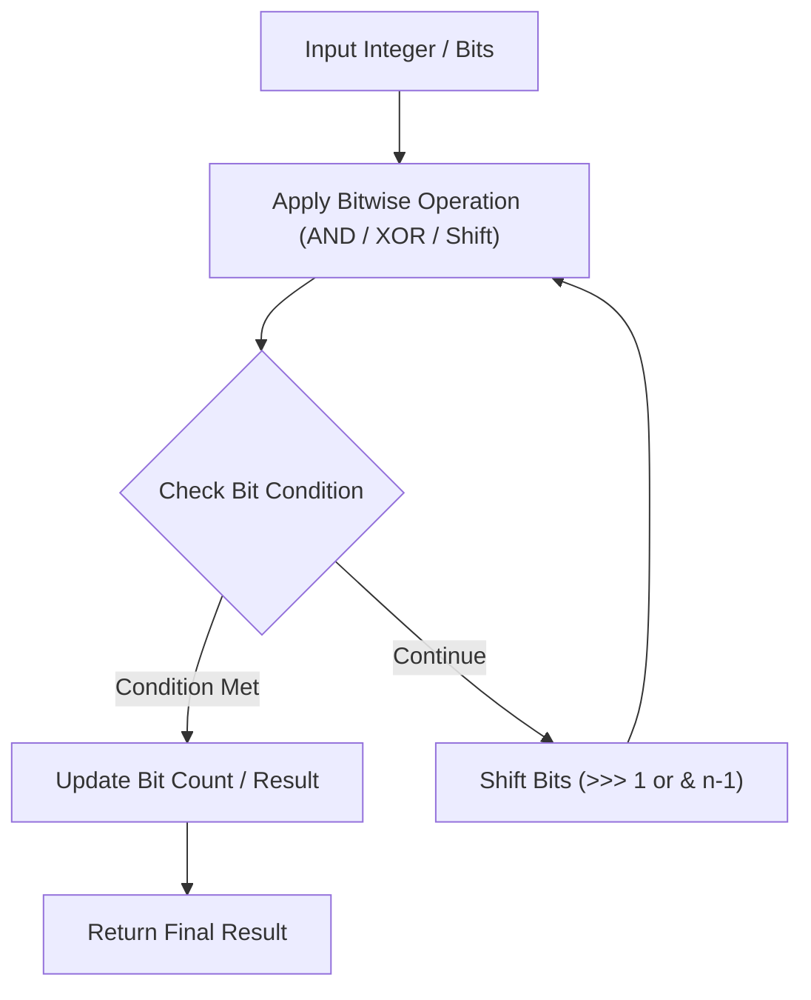

# Sum of Two Integers

<div style="display:flex; gap:0.5rem; margin-bottom:1.5rem; align-items:center;">
  <span style="background:#f59e0b22; color:#f59e0b; padding:2px 10px; borderRadius:12px; fontWeight:600; fontSize:0.85rem;">Medium</span>
  <span style="color:#64748b; fontSize:0.85rem;">Day 3 • Striver Blind 75</span>
</div>

## 📌 Problem Overview

Given two integers `a` and `b`, return the sum of the two integers without using the operators `+` and `-`.

### Examples & Constraints
**Example 1:**
- **Input:** `a = 1, b = 2`
- **Output:** `3`


**Example 2:**
- **Input:** `a = 2, b = 3`
- **Output:** `5`


**Constraints:**
- `-1000 <= a, b <= 1000`

---

## 💡 Approach & Intuition

Bitwise XOR calculates addition without carry; bitwise AND shifted left calculates carry.

### 🎯 Pattern Recognition
Bitwise Operations (XOR + AND)

---

## 📊 Step-by-Step Execution (Mermaid Diagram)



---

## 🐢 Brute Force Solution

### Code
```javascript
function getSum(a, b) {
  while (b !== 0) {
    let carry = (a & b) << 1;
    a = a ^ b;
    b = carry;
  }
  return a;
}
```

- **Time Complexity:** `O(1)`
- **Space Complexity:** `O(1)`
- **Explanation:** Iterative bitwise carry.

---

## ⚡ Optimized Solution

### Code
```javascript
function getSum(a, b) {
  while (b !== 0) {
    let carry = (a & b) << 1;
    a = a ^ b;
    b = carry;
  }
  return a;
}
```

- **Time Complexity:** `O(1)`
- **Space Complexity:** `O(1)`
- **Explanation:** Bitwise sum using XOR and shift.

---

## 🐾 Step-by-Step Walkthrough

1. **Initialize State:** Setup necessary pointers, dynamic programming arrays, or hash maps.
2. **Iterate & Evaluate:** Process the input according to the boundary conditions.
3. **Update & Return:** Compute the optimal answer and return early or at termination.

### 🎙️ FAANG Interview Pitch
Use XOR for bitwise sum and AND shifted for carry until carry becomes zero.

---

## 💡 Progressive Hints

1. XOR gives sum without carry.
2. AND left shifted by 1 gives carry.

---

## ⚡ Interactive Practice
👉 **[Solve this problem interactively in the DSA Lab](/DSA-Notes-Problems/dsa/problems/sum-of-two-integers)**
