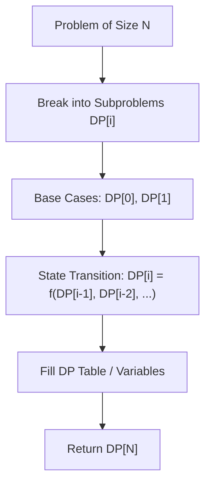

# Climbing Stairs

<div style="display:flex; gap:0.5rem; margin-bottom:1.5rem; align-items:center;">
  <span style="background:#22c55e22; color:#22c55e; padding:2px 10px; borderRadius:12px; fontWeight:600; fontSize:0.85rem;">Easy</span>
  <span style="color:#64748b; fontSize:0.85rem;">Day 4 • Striver Blind 75</span>
</div>

## 📌 Problem Overview

You are climbing a staircase. It takes `n` steps to reach the top.

Each time you can either climb 1 or 2 steps. In how many distinct ways can you climb to the top?

### Examples & Constraints
**Example 1:**
- **Input:** `n = 2`
- **Output:** `2`
- **Explanation:** 1. 1 step + 1 step, 2. 2 steps

**Example 2:**
- **Input:** `n = 3`
- **Output:** `3`
- **Explanation:** 1. 1+1+1, 2. 1+2, 3. 2+1

**Constraints:**
- `1 ≤ n ≤ 45`

---

## 💡 Approach & Intuition

**Why this problem exists:**
Climbing Stairs is the "Hello World" of dynamic programming. It teaches the fundamental DP concept of optimal substructure and overlapping subproblems.

**What it teaches:**
• Dynamic programming fundamentals
• Fibonacci-like recurrence relation
• Tabulation vs memoization
• Space optimization

**Interview relevance:**
The first DP problem most people learn. Master the thought process here for all DP problems.

### 🎯 Pattern Recognition
**Pattern: Fibonacci DP**

When a problem asks "how many ways to reach a goal with a fixed set of moves", the answer is often a Fibonacci-like recurrence: ways(n) = ways(n-1) + ways(n-2).

**When to use this pattern:**
• Counting ways to reach a target
• Problems with 1 or 2-step moves
• Grid path counting problems
• Problems with simple recurrence relations

---

## 📊 Step-by-Step Execution (Mermaid Diagram)



---

## 🐢 Brute Force Solution

### Code
```javascript
function climbStairs(n) {
  if (n <= 1) return 1;
  if (n === 2) return 2;
  return climbStairs(n - 1) + climbStairs(n - 2);
}
```

- **Time Complexity:** `O(2ⁿ)`
- **Space Complexity:** `O(n)`
- **Explanation:** Pure recursion — exponential due to repeated calculations. Visualize the recursion tree.

---

## ⚡ Optimized Solution

### Code
```javascript
function climbStairs(n) {
  if (n <= 2) return n;
  let oneStepBefore = 2;
  let twoStepsBefore = 1;
  let allWays = 0;
  
  for (let i = 3; i <= n; i++) {
    allWays = oneStepBefore + twoStepsBefore;
    twoStepsBefore = oneStepBefore;
    oneStepBefore = allWays;
  }
  
  return allWays;
}
```

- **Time Complexity:** `O(n)`
- **Space Complexity:** `O(1)`
- **Explanation:** Bottom-up DP with O(1) space using two variables. ways[i] = ways[i-1] + ways[i-2]. Iterate from 3 to n, keeping only the last two values.

---

## 🐾 Step-by-Step Walkthrough

1. **Initialize State:** Setup necessary pointers, dynamic programming arrays, or hash maps.
2. **Iterate & Evaluate:** Process the input according to the boundary conditions.
3. **Update & Return:** Compute the optimal answer and return early or at termination.

### 🎙️ FAANG Interview Pitch
**How to explain:**
1. Think in terms of "how many ways to reach step k"
2. At step k, you could have come from step k-1 (1 step) or step k-2 (2 steps)
3. So ways(k) = ways(k-1) + ways(k-2)
4. Base: 1 way for step 1, 2 ways for step 2
5. Recognize this as Fibonacci

**Follow-ups:**
• "What if you can take 1, 2, or 3 steps?" → ways(n) = ways(n-1) + ways(n-2) + ways(n-3)
• "What if certain steps are broken?" → Skip those steps by setting ways(broken) = 0
• "Minimum cost to climb stairs?" → Each step has a cost, find min cost path (another classic DP)

---

## 💡 Progressive Hints

1. Think about how many ways there are to reach step i.
2. The number of ways to reach step i equals ways to reach step i-1 (take 1 step) plus ways to reach step i-2 (take 2 steps).
3. This is the Fibonacci sequence! Start with base cases: 1 way to reach step 1, 2 ways to reach step 2.

---

## ⚡ Interactive Practice
👉 **[Solve this problem interactively in the DSA Lab](/DSA-Notes-Problems/dsa/problems/climbing-stairs)**
