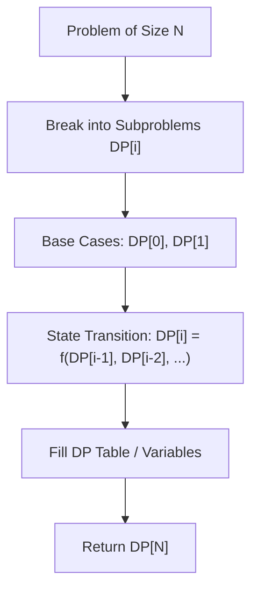

# Coin Change

<div style="display:flex; gap:0.5rem; margin-bottom:1.5rem; align-items:center;">
  <span style="background:#f59e0b22; color:#f59e0b; padding:2px 10px; borderRadius:12px; fontWeight:600; fontSize:0.85rem;">Medium</span>
  <span style="color:#64748b; fontSize:0.85rem;">Day 4 • Striver Blind 75</span>
</div>

## 📌 Problem Overview

You are given an integer array `coins` representing coins of different denominations and an integer `amount` representing a total amount of money.

Return the **fewest number of coins** that you need to make up that amount. If that amount of money cannot be made up by any combination of the coins, return `-1`.

You may assume that you have an infinite number of each kind of coin.

### Examples & Constraints
**Example 1:**
- **Input:** `coins = [1,2,5], amount = 11`
- **Output:** `3`
- **Explanation:** 11 = 5 + 5 + 1

**Example 2:**
- **Input:** `coins = [2], amount = 3`
- **Output:** `-1`


**Example 3:**
- **Input:** `coins = [1], amount = 0`
- **Output:** `0`


**Constraints:**
- `1 ≤ coins.length ≤ 12`
- `1 ≤ coins[i] ≤ 2³¹ - 1`
- `0 ≤ amount ≤ 10⁴`

---

## 💡 Approach & Intuition

**Why this problem exists:**
Coin Change is the classic unbounded knapsack problem. It tests your ability to solve optimization problems with overlapping subproblems.

**What it teaches:**
• Unbounded knapsack pattern
• DP with 1D array optimization
• Infinite supply of items
• Handling unreachable states

**Interview relevance:**
One of the most important DP problems. The pattern appears in many variations (minimum/maximum ways, combination sum).

### 🎯 Pattern Recognition
**Pattern: Unbounded Knapsack**

When you can use unlimited copies of each item, the DP array is filled from left to right (so each coin can be reused). dp[i] = min(dp[i], dp[i - coin] + 1).

**When to use this pattern:**
• Minimum coins to make an amount
• Number of ways to make change (combination sum)
• Problems with unlimited item usage
• Unbounded knapsack problems

---

## 📊 Step-by-Step Execution (Mermaid Diagram)



---

## 🐢 Brute Force Solution

### Code
```javascript
function coinChange(coins, amount) {
  if (amount === 0) return 0;
  let minCoins = Infinity;
  for (const coin of coins) {
    if (amount >= coin) {
      const result = coinChange(coins, amount - coin);
      if (result !== -1) minCoins = Math.min(minCoins, result + 1);
    }
  }
  return minCoins === Infinity ? -1 : minCoins;
}
```

- **Time Complexity:** `O(coins.length ^ amount)`
- **Space Complexity:** `O(amount)`
- **Explanation:** Pure recursion — extremely slow due to exponential branching and repeated subproblems.

---

## ⚡ Optimized Solution

### Code
```javascript
function coinChange(coins, amount) {
  const dp = new Array(amount + 1).fill(Infinity);
  dp[0] = 0;
  
  for (const coin of coins) {
    for (let i = coin; i <= amount; i++) {
      dp[i] = Math.min(dp[i], dp[i - coin] + 1);
    }
  }
  
  return dp[amount] === Infinity ? -1 : dp[amount];
}
```

- **Time Complexity:** `O(coins.length × amount)`
- **Space Complexity:** `O(amount)`
- **Explanation:** Bottom-up DP with 1D array. For each coin, iterate through all amounts from coin to target. dp[i] represents the minimum coins needed to make amount i. Initialize with Infinity, dp[0] = 0.

---

## 🐾 Step-by-Step Walkthrough

1. **Initialize State:** Setup necessary pointers, dynamic programming arrays, or hash maps.
2. **Iterate & Evaluate:** Process the input according to the boundary conditions.
3. **Update & Return:** Compute the optimal answer and return early or at termination.

### 🎙️ FAANG Interview Pitch
**How to explain:**
1. Start with brute force recursion — show the exponential explosion
2. Identify overlapping subproblems: making amount 6 with [1,2,5] recalculates subproblems many times
3. Introduce DP: dp[i] = minimum coins for amount i
4. For each coin, try using it: dp[i] = min(dp[i], dp[i - coin] + 1)
5. Iterate coins outer loop (unbounded knapsack pattern — allows reuse)

**Follow-ups:**
• "What if each coin can only be used once?" → Iterate amount from largest to smallest (0/1 knapsack)
• "What if you need the number of ways instead of minimum?" → dp[i] += dp[i - coin] (combination sum)
• "What if coins have different values and you want to minimize the number of coins with limited supply?" → Bounded knapsack variation

---

## 💡 Progressive Hints

1. Use a DP array where dp[i] = minimum coins needed to make amount i.
2. Initialize dp[0] = 0 and all others to Infinity (or a large number).
3. For each coin, for each amount from coin to target, update: dp[i] = min(dp[i], dp[i - coin] + 1).

---

## ⚡ Interactive Practice
👉 **[Solve this problem interactively in the DSA Lab](/DSA-Notes-Problems/dsa/problems/coin-change)**
