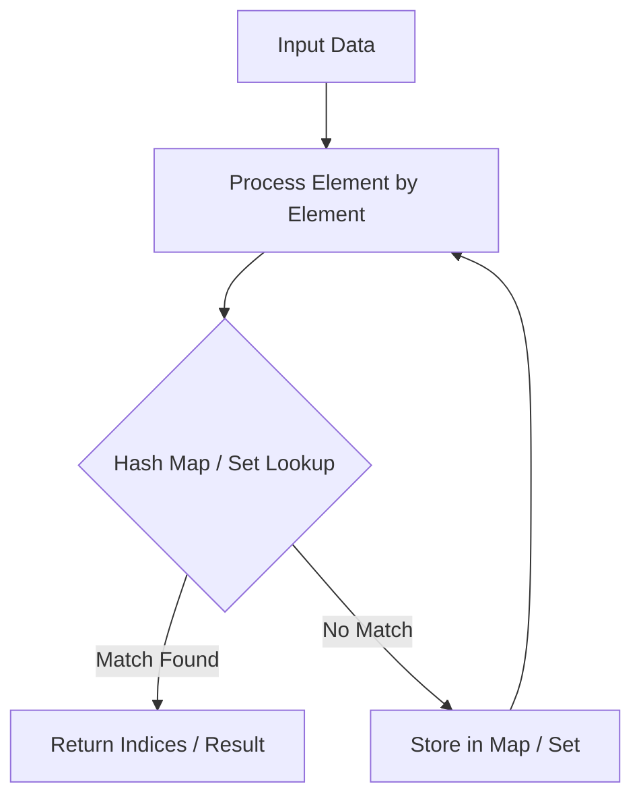

# Combination Sum

<div style="display:flex; gap:0.5rem; margin-bottom:1.5rem; align-items:center;">
  <span style="background:#f59e0b22; color:#f59e0b; padding:2px 10px; borderRadius:12px; fontWeight:600; fontSize:0.85rem;">Medium</span>
  <span style="color:#64748b; fontSize:0.85rem;">Day 5 • Striver Blind 75</span>
</div>

## 📌 Problem Overview

Given an array of **distinct** integers `candidates` and a target integer `target`, return a list of all **unique combinations** of `candidates` where the chosen numbers sum to `target`.

### Examples & Constraints
**Example 1:**
- **Input:** `candidates = [2,3,6,7], target = 7`
- **Output:** `[[2,2,3],[7]]`


**Constraints:**
- `1 <= candidates.length <= 30`

---

## 💡 Approach & Intuition

Backtracking pick or skip decisions allowing unlimited reuse of elements.

### 🎯 Pattern Recognition
Backtracking with Element Reuse

---

## 📊 Step-by-Step Execution (Mermaid Diagram)



---

## 🐢 Brute Force Solution

### Code
```javascript
function combinationSum(candidates, target) {
  const res = [];
  function dfs(i, cur, total) {
    if (total === target) { res.push([...cur]); return; }
    if (i >= candidates.length || total > target) return;
    cur.push(candidates[i]);
    dfs(i, cur, total + candidates[i]);
    cur.pop();
    dfs(i + 1, cur, total);
  }
  dfs(0, [], 0);
  return res;
}
```

- **Time Complexity:** `O(2^t)`
- **Space Complexity:** `O(t)`
- **Explanation:** Backtracking tree.

---

## ⚡ Optimized Solution

### Code
```javascript
function combinationSum(candidates, target) {
  const res = [];
  function dfs(i, cur, total) {
    if (total === target) { res.push([...cur]); return; }
    if (i >= candidates.length || total > target) return;
    cur.push(candidates[i]);
    dfs(i, cur, total + candidates[i]);
    cur.pop();
    dfs(i + 1, cur, total);
  }
  dfs(0, [], 0);
  return res;
}
```

- **Time Complexity:** `O(2^target)`
- **Space Complexity:** `O(target)`
- **Explanation:** Depth-first search backtracking.

---

## 🐾 Step-by-Step Walkthrough

1. **Initialize State:** Setup necessary pointers, dynamic programming arrays, or hash maps.
2. **Iterate & Evaluate:** Process the input according to the boundary conditions.
3. **Update & Return:** Compute the optimal answer and return early or at termination.

### 🎙️ FAANG Interview Pitch
At each step, either include candidate[i] again or advance to candidate[i+1].

---

## 💡 Progressive Hints

1. Recursive backtracking maintaining current index.

---

## ⚡ Interactive Practice
👉 **[Solve this problem interactively in the DSA Lab](/DSA-Notes-Problems/dsa/problems/combination-sum)**
