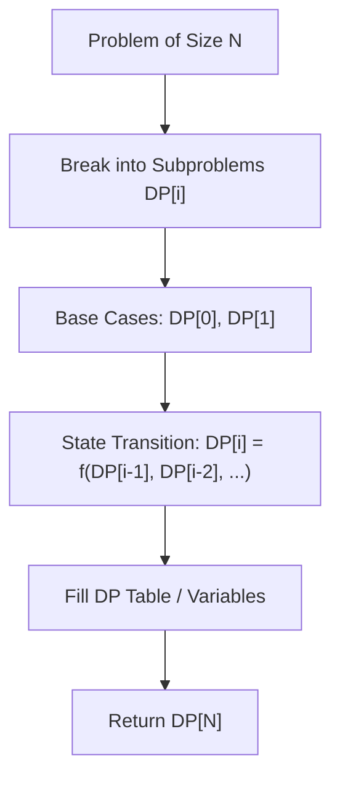

# Decode Ways

<div style="display:flex; gap:0.5rem; margin-bottom:1.5rem; align-items:center;">
  <span style="background:#f59e0b22; color:#f59e0b; padding:2px 10px; borderRadius:12px; fontWeight:600; fontSize:0.85rem;">Medium</span>
  <span style="color:#64748b; fontSize:0.85rem;">Day 5 • Striver Blind 75</span>
</div>

## 📌 Problem Overview

Return the number of ways to decode a numeric string into letters (1 -> 'A', 26 -> 'Z').

### Examples & Constraints
**Example 1:**
- **Input:** `s = "226"`
- **Output:** `3`


**Constraints:**
- `1 <= s.length <= 100`

---

## 💡 Approach & Intuition

Single digit valid if '1'-'9'; two digits valid if '10'-'26'.

### 🎯 Pattern Recognition
1D Dynamic Programming String Partitioning

---

## 📊 Step-by-Step Execution (Mermaid Diagram)



---

## 🐢 Brute Force Solution

### Code
```javascript
function numDecodings(s) {
  if (!s || s[0] === '0') return 0;
  const dp = new Array(s.length + 1).fill(0);
  dp[0] = 1; dp[1] = 1;
  for (let i = 2; i <= s.length; i++) {
    const one = parseInt(s.substring(i - 1, i));
    const two = parseInt(s.substring(i - 2, i));
    if (one >= 1 && one <= 9) dp[i] += dp[i - 1];
    if (two >= 10 && two <= 26) dp[i] += dp[i - 2];
  }
  return dp[s.length];
}
```

- **Time Complexity:** `O(n)`
- **Space Complexity:** `O(n)`
- **Explanation:** 1D DP decoding table.

---

## ⚡ Optimized Solution

### Code
```javascript
function numDecodings(s) {
  if (!s || s[0] === '0') return 0;
  const dp = new Array(s.length + 1).fill(0);
  dp[0] = 1; dp[1] = 1;
  for (let i = 2; i <= s.length; i++) {
    const one = parseInt(s.substring(i - 1, i));
    const two = parseInt(s.substring(i - 2, i));
    if (one >= 1 && one <= 9) dp[i] += dp[i - 1];
    if (two >= 10 && two <= 26) dp[i] += dp[i - 2];
  }
  return dp[s.length];
}
```

- **Time Complexity:** `O(n)`
- **Space Complexity:** `O(n)`
- **Explanation:** DP single & double digit lookback.

---

## 🐾 Step-by-Step Walkthrough

1. **Initialize State:** Setup necessary pointers, dynamic programming arrays, or hash maps.
2. **Iterate & Evaluate:** Process the input according to the boundary conditions.
3. **Update & Return:** Compute the optimal answer and return early or at termination.

### 🎙️ FAANG Interview Pitch
Check valid 1-digit and 2-digit encodings at each index to transition DP values.

---

## 💡 Progressive Hints

1. dp[i] depends on single digit valid check and double digit valid check.

---

## ⚡ Interactive Practice
👉 **[Solve this problem interactively in the DSA Lab](/DSA-Notes-Problems/dsa/problems/decode-ways)**
