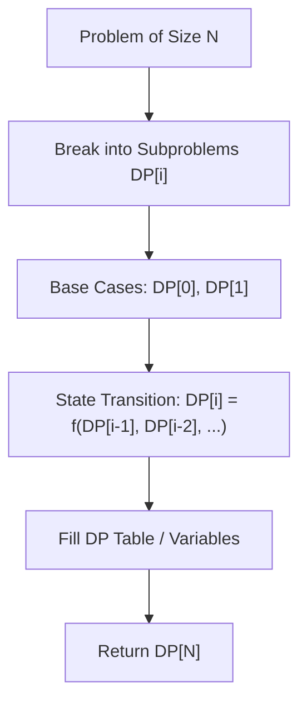

# House Robber II

<div style="display:flex; gap:0.5rem; margin-bottom:1.5rem; align-items:center;">
  <span style="background:#f59e0b22; color:#f59e0b; padding:2px 10px; borderRadius:12px; fontWeight:600; fontSize:0.85rem;">Medium</span>
  <span style="color:#64748b; fontSize:0.85rem;">Day 5 • Striver Blind 75</span>
</div>

## 📌 Problem Overview

Houses are arranged in a **circle**. Return the maximum money you can rob without alerting police.

### Examples & Constraints
**Example 1:**
- **Input:** `nums = [2,3,2]`
- **Output:** `3`


**Constraints:**
- `1 <= nums.length <= 100`

---

## 💡 Approach & Intuition

Run House Robber I twice: once for `nums[0...n-2]` and once for `nums[1...n-1]`.

### 🎯 Pattern Recognition
Circular DP Decomposition

---

## 📊 Step-by-Step Execution (Mermaid Diagram)



---

## 🐢 Brute Force Solution

### Code
```javascript
function rob(nums) {
  if (nums.length === 1) return nums[0];
  function helper(arr) {
    let r1 = 0, r2 = 0;
    for (let n of arr) { let t = Math.max(n + r1, r2); r1 = r2; r2 = t; }
    return r2;
  }
  return Math.max(helper(nums.slice(0, nums.length - 1)), helper(nums.slice(1)));
}
```

- **Time Complexity:** `O(n)`
- **Space Complexity:** `O(1)`
- **Explanation:** Splits circle into two linear ranges.

---

## ⚡ Optimized Solution

### Code
```javascript
function rob(nums) {
  if (nums.length === 1) return nums[0];
  function helper(arr) {
    let r1 = 0, r2 = 0;
    for (let n of arr) { let t = Math.max(n + r1, r2); r1 = r2; r2 = t; }
    return r2;
  }
  return Math.max(helper(nums.slice(0, nums.length - 1)), helper(nums.slice(1)));
}
```

- **Time Complexity:** `O(n)`
- **Space Complexity:** `O(1)`
- **Explanation:** Linear DP on two slices.

---

## 🐾 Step-by-Step Walkthrough

1. **Initialize State:** Setup necessary pointers, dynamic programming arrays, or hash maps.
2. **Iterate & Evaluate:** Process the input according to the boundary conditions.
3. **Update & Return:** Compute the optimal answer and return early or at termination.

### 🎙️ FAANG Interview Pitch
Since house 0 and house n-1 are adjacent, take max of robbing houses 0..n-2 and 1..n-1.

---

## 💡 Progressive Hints

1. First and last house cannot be robbed together.

---

## ⚡ Interactive Practice
👉 **[Solve this problem interactively in the DSA Lab](/DSA-Notes-Problems/dsa/problems/house-robber-ii)**
