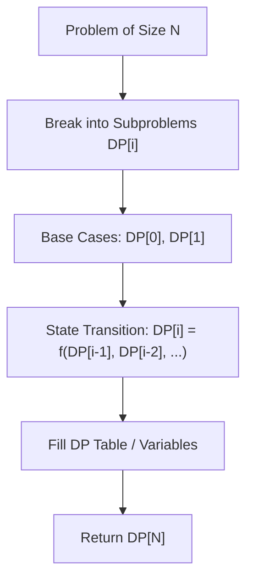

# House Robber

<div style="display:flex; gap:0.5rem; margin-bottom:1.5rem; align-items:center;">
  <span style="background:#f59e0b22; color:#f59e0b; padding:2px 10px; borderRadius:12px; fontWeight:600; fontSize:0.85rem;">Medium</span>
  <span style="color:#64748b; fontSize:0.85rem;">Day 5 • Striver Blind 75</span>
</div>

## 📌 Problem Overview

Return the maximum amount of money you can rob tonight without alerting police (cannot rob adjacent houses).

### Examples & Constraints
**Example 1:**
- **Input:** `nums = [1,2,3,1]`
- **Output:** `4`


**Constraints:**
- `1 <= nums.length <= 100`

---

## 💡 Approach & Intuition

`rob[i] = max(rob[i-1], rob[i-2] + nums[i])`.

### 🎯 Pattern Recognition
1D Dynamic Programming (Skip Adjacent)

---

## 📊 Step-by-Step Execution (Mermaid Diagram)



---

## 🐢 Brute Force Solution

### Code
```javascript
function rob(nums) {
  let rob1 = 0, rob2 = 0;
  for (const n of nums) {
    let temp = Math.max(n + rob1, rob2);
    rob1 = rob2;
    rob2 = temp;
  }
  return rob2;
}
```

- **Time Complexity:** `O(n)`
- **Space Complexity:** `O(1)`
- **Explanation:** Two variable DP.

---

## ⚡ Optimized Solution

### Code
```javascript
function rob(nums) {
  let rob1 = 0, rob2 = 0;
  for (const n of nums) {
    let temp = Math.max(n + rob1, rob2);
    rob1 = rob2;
    rob2 = temp;
  }
  return rob2;
}
```

- **Time Complexity:** `O(n)`
- **Space Complexity:** `O(1)`
- **Explanation:** Constant space DP.

---

## 🐾 Step-by-Step Walkthrough

1. **Initialize State:** Setup necessary pointers, dynamic programming arrays, or hash maps.
2. **Iterate & Evaluate:** Process the input according to the boundary conditions.
3. **Update & Return:** Compute the optimal answer and return early or at termination.

### 🎙️ FAANG Interview Pitch
Maintain two pointers rob1 and rob2 representing max loot skipping current vs taking current.

---

## 💡 Progressive Hints

1. Track max profit up to house i-1 and house i-2.

---

## ⚡ Interactive Practice
👉 **[Solve this problem interactively in the DSA Lab](/DSA-Notes-Problems/dsa/problems/house-robber)**
