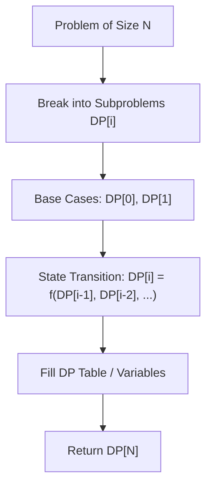

# Jump Game

<div style="display:flex; gap:0.5rem; margin-bottom:1.5rem; align-items:center;">
  <span style="background:#f59e0b22; color:#f59e0b; padding:2px 10px; borderRadius:12px; fontWeight:600; fontSize:0.85rem;">Medium</span>
  <span style="color:#64748b; fontSize:0.85rem;">Day 5 • Striver Blind 75</span>
</div>

## 📌 Problem Overview

Return `true` if you can reach the last index starting from index 0 with maximum jump lengths given by `nums[i]`.

### Examples & Constraints
**Example 1:**
- **Input:** `nums = [2,3,1,1,4]`
- **Output:** `true`


**Constraints:**
- `1 <= nums.length <= 10^4`

---

## 💡 Approach & Intuition

Greedy backward goal post shift.

### 🎯 Pattern Recognition
Greedy Reachability

---

## 📊 Step-by-Step Execution (Mermaid Diagram)



---

## 🐢 Brute Force Solution

### Code
```javascript
function canJump(nums) {
  let goal = nums.length - 1;
  for (let i = nums.length - 1; i >= 0; i--) {
    if (i + nums[i] >= goal) goal = i;
  }
  return goal === 0;
}
```

- **Time Complexity:** `O(n)`
- **Space Complexity:** `O(1)`
- **Explanation:** Backward greedy goal post update.

---

## ⚡ Optimized Solution

### Code
```javascript
function canJump(nums) {
  let goal = nums.length - 1;
  for (let i = nums.length - 1; i >= 0; i--) {
    if (i + nums[i] >= goal) goal = i;
  }
  return goal === 0;
}
```

- **Time Complexity:** `O(n)`
- **Space Complexity:** `O(1)`
- **Explanation:** Greedy single pass.

---

## 🐾 Step-by-Step Walkthrough

1. **Initialize State:** Setup necessary pointers, dynamic programming arrays, or hash maps.
2. **Iterate & Evaluate:** Process the input according to the boundary conditions.
3. **Update & Return:** Compute the optimal answer and return early or at termination.

### 🎙️ FAANG Interview Pitch
Iterate backwards starting from end; if current index plus jump distance reaches goal, shift goal to current index.

---

## 💡 Progressive Hints

1. Track target goal from right to left.

---

## ⚡ Interactive Practice
👉 **[Solve this problem interactively in the DSA Lab](/DSA-Notes-Problems/dsa/problems/jump-game)**
