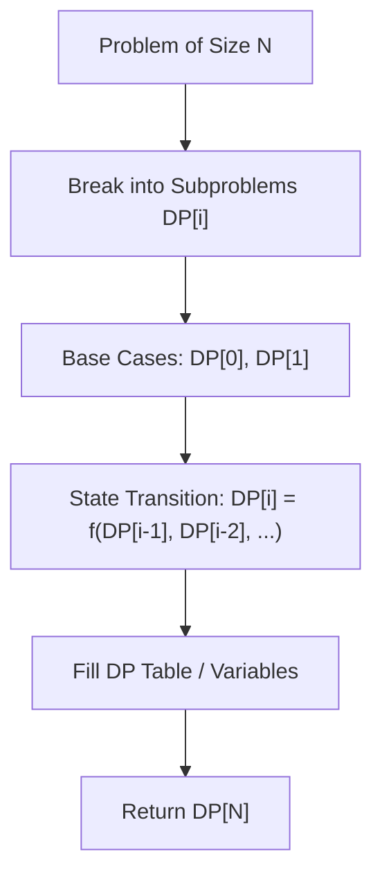

# Longest Common Subsequence

<div style="display:flex; gap:0.5rem; margin-bottom:1.5rem; align-items:center;">
  <span style="background:#f59e0b22; color:#f59e0b; padding:2px 10px; borderRadius:12px; fontWeight:600; fontSize:0.85rem;">Medium</span>
  <span style="color:#64748b; fontSize:0.85rem;">Day 4 • Striver Blind 75</span>
</div>

## 📌 Problem Overview

Given two strings `text1` and `text2`, return the length of their longest common subsequence.

### Examples & Constraints
**Example 1:**
- **Input:** `text1 = "abcde", text2 = "ace"`
- **Output:** `3`


**Constraints:**
- `1 <= text1.length, text2.length <= 1000`

---

## 💡 Approach & Intuition

2D DP grid where matching characters add 1 to `dp[i-1][j-1]`.

### 🎯 Pattern Recognition
2D Dynamic Programming Grid

---

## 📊 Step-by-Step Execution (Mermaid Diagram)



---

## 🐢 Brute Force Solution

### Code
```javascript
function longestCommonSubsequence(text1, text2) {
  const m = text1.length, n = text2.length;
  const dp = Array.from({length: m + 1}, () => new Array(n + 1).fill(0));
  for (let i = 1; i <= m; i++) {
    for (let j = 1; j <= n; j++) {
      if (text1[i-1] === text2[j-1]) dp[i][j] = 1 + dp[i-1][j-1];
      else dp[i][j] = Math.max(dp[i-1][j], dp[i][j-1]);
    }
  }
  return dp[m][n];
}
```

- **Time Complexity:** `O(m*n)`
- **Space Complexity:** `O(m*n)`
- **Explanation:** Standard 2D DP.

---

## ⚡ Optimized Solution

### Code
```javascript
function longestCommonSubsequence(text1, text2) {
  const m = text1.length, n = text2.length;
  const dp = Array.from({length: m + 1}, () => new Array(n + 1).fill(0));
  for (let i = 1; i <= m; i++) {
    for (let j = 1; j <= n; j++) {
      if (text1[i-1] === text2[j-1]) dp[i][j] = 1 + dp[i-1][j-1];
      else dp[i][j] = Math.max(dp[i-1][j], dp[i][j-1]);
    }
  }
  return dp[m][n];
}
```

- **Time Complexity:** `O(m*n)`
- **Space Complexity:** `O(m*n)`
- **Explanation:** 2D DP matrix.

---

## 🐾 Step-by-Step Walkthrough

1. **Initialize State:** Setup necessary pointers, dynamic programming arrays, or hash maps.
2. **Iterate & Evaluate:** Process the input according to the boundary conditions.
3. **Update & Return:** Compute the optimal answer and return early or at termination.

### 🎙️ FAANG Interview Pitch
Compare char by char; if matched move diagonally, else take max of left or top DP cell.

---

## 💡 Progressive Hints

1. If text1[i] == text2[j], dp[i][j] = 1 + dp[i-1][j-1].

---

## ⚡ Interactive Practice
👉 **[Solve this problem interactively in the DSA Lab](/DSA-Notes-Problems/dsa/problems/longest-common-subsequence)**
