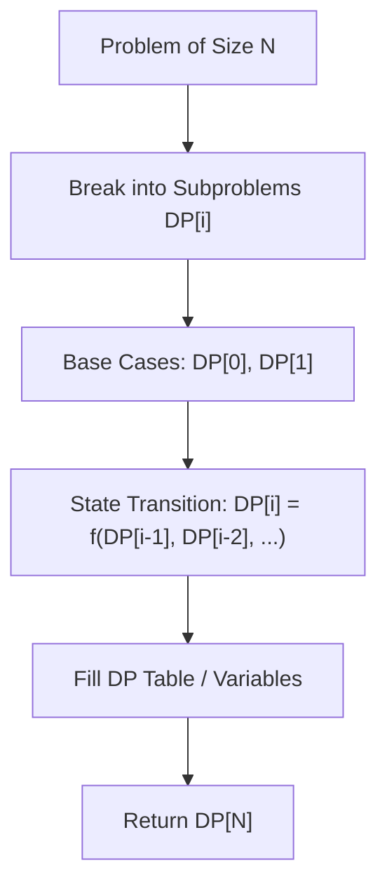

# Longest Increasing Subsequence

<div style="display:flex; gap:0.5rem; margin-bottom:1.5rem; align-items:center;">
  <span style="background:#f59e0b22; color:#f59e0b; padding:2px 10px; borderRadius:12px; fontWeight:600; fontSize:0.85rem;">Medium</span>
  <span style="color:#64748b; fontSize:0.85rem;">Day 4 • Striver Blind 75</span>
</div>

## 📌 Problem Overview

Given an integer array `nums`, return the length of the longest strictly increasing subsequence.

### Examples & Constraints
**Example 1:**
- **Input:** `nums = [10,9,2,5,3,7,101,18]`
- **Output:** `4`


**Constraints:**
- `1 <= nums.length <= 2500`

---

## 💡 Approach & Intuition

Patience sorting / binary search build `tails` array in O(n log n) time.

### 🎯 Pattern Recognition
Binary Search Patience Sorting / DP

---

## 📊 Step-by-Step Execution (Mermaid Diagram)



---

## 🐢 Brute Force Solution

### Code
```javascript
function lengthOfLIS(nums) {
  const tails = [];
  for (const x of nums) {
    let l = 0, r = tails.length;
    while (l < r) {
      let m = (l + r) >> 1;
      if (tails[m] < x) l = m + 1;
      else r = m;
    }
    tails[l] = x;
  }
  return tails.length;
}
```

- **Time Complexity:** `O(n log n)`
- **Space Complexity:** `O(n)`
- **Explanation:** Patience sorting.

---

## ⚡ Optimized Solution

### Code
```javascript
function lengthOfLIS(nums) {
  const tails = [];
  for (const x of nums) {
    let l = 0, r = tails.length;
    while (l < r) {
      let m = (l + r) >> 1;
      if (tails[m] < x) l = m + 1;
      else r = m;
    }
    tails[l] = x;
  }
  return tails.length;
}
```

- **Time Complexity:** `O(n log n)`
- **Space Complexity:** `O(n)`
- **Explanation:** Binary search tails array.

---

## 🐾 Step-by-Step Walkthrough

1. **Initialize State:** Setup necessary pointers, dynamic programming arrays, or hash maps.
2. **Iterate & Evaluate:** Process the input according to the boundary conditions.
3. **Update & Return:** Compute the optimal answer and return early or at termination.

### 🎙️ FAANG Interview Pitch
Build tails array of smallest tail of all increasing subsequences of length i.

---

## 💡 Progressive Hints

1. dp[i] is length of LIS ending at index i.
2. O(n log n) with patience sorting.

---

## ⚡ Interactive Practice
👉 **[Solve this problem interactively in the DSA Lab](/DSA-Notes-Problems/dsa/problems/longest-increasing-subsequence)**
