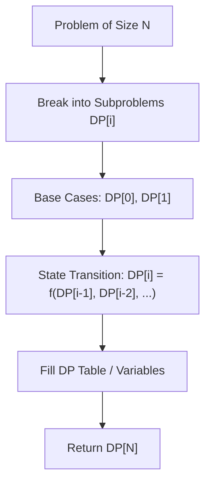

# Unique Paths

<div style="display:flex; gap:0.5rem; margin-bottom:1.5rem; align-items:center;">
  <span style="background:#f59e0b22; color:#f59e0b; padding:2px 10px; borderRadius:12px; fontWeight:600; fontSize:0.85rem;">Medium</span>
  <span style="color:#64748b; fontSize:0.85rem;">Day 5 • Striver Blind 75</span>
</div>

## 📌 Problem Overview

Return the number of unique paths from top-left to bottom-right of an `m x n` grid moving only right or down.

### Examples & Constraints
**Example 1:**
- **Input:** `m = 3, n = 7`
- **Output:** `28`


**Constraints:**
- `1 <= m, n <= 100`

---

## 💡 Approach & Intuition

`dp[i][j] = dp[i-1][j] + dp[i][j-1]`.

### 🎯 Pattern Recognition
2D Grid Combinatorics / DP

---

## 📊 Step-by-Step Execution (Mermaid Diagram)



---

## 🐢 Brute Force Solution

### Code
```javascript
function uniquePaths(m, n) {
  const row = new Array(n).fill(1);
  for (let i = 1; i < m; i++) {
    for (let j = 1; j < n; j++) {
      row[j] += row[j - 1];
    }
  }
  return row[n - 1];
}
```

- **Time Complexity:** `O(m*n)`
- **Space Complexity:** `O(n)`
- **Explanation:** Space-optimized 1D row DP.

---

## ⚡ Optimized Solution

### Code
```javascript
function uniquePaths(m, n) {
  const row = new Array(n).fill(1);
  for (let i = 1; i < m; i++) {
    for (let j = 1; j < n; j++) {
      row[j] += row[j - 1];
    }
  }
  return row[n - 1];
}
```

- **Time Complexity:** `O(m*n)`
- **Space Complexity:** `O(n)`
- **Explanation:** Single row array cumulative summation.

---

## 🐾 Step-by-Step Walkthrough

1. **Initialize State:** Setup necessary pointers, dynamic programming arrays, or hash maps.
2. **Iterate & Evaluate:** Process the input according to the boundary conditions.
3. **Update & Return:** Compute the optimal answer and return early or at termination.

### 🎙️ FAANG Interview Pitch
The number of ways to reach cell (i, j) is the sum of ways from above cell and left cell.

---

## 💡 Progressive Hints

1. Base case: row 0 and col 0 are all 1.

---

## ⚡ Interactive Practice
👉 **[Solve this problem interactively in the DSA Lab](/DSA-Notes-Problems/dsa/problems/unique-paths)**
