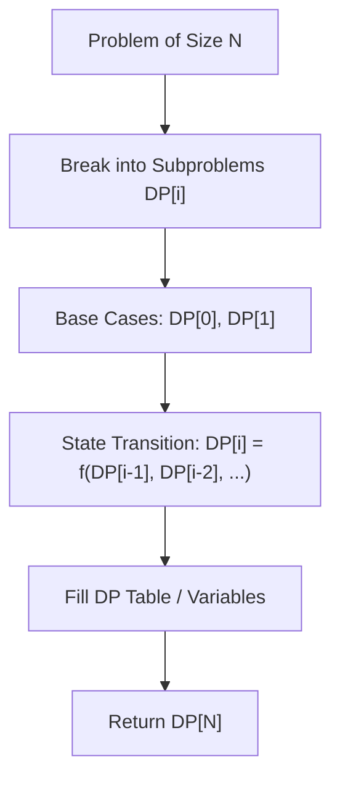

# Word Break

<div style="display:flex; gap:0.5rem; margin-bottom:1.5rem; align-items:center;">
  <span style="background:#f59e0b22; color:#f59e0b; padding:2px 10px; borderRadius:12px; fontWeight:600; fontSize:0.85rem;">Medium</span>
  <span style="color:#64748b; fontSize:0.85rem;">Day 4 • Striver Blind 75</span>
</div>

## 📌 Problem Overview

Given a string `s` and a dictionary of strings `wordDict`, return `true` if `s` can be segmented into a space-separated sequence of one or more dictionary words.

### Examples & Constraints
**Example 1:**
- **Input:** `s = "leetcode", wordDict = ["leet","code"]`
- **Output:** `true`


**Constraints:**
- `1 <= s.length <= 300`

---

## 💡 Approach & Intuition

`dp[i]` indicates if substring `s[0...i-1]` can be segmented.

### 🎯 Pattern Recognition
1D Dynamic Programming Substring Matching

---

## 📊 Step-by-Step Execution (Mermaid Diagram)



---

## 🐢 Brute Force Solution

### Code
```javascript
function wordBreak(s, wordDict) {
  const set = new Set(wordDict);
  const dp = new Array(s.length + 1).fill(false);
  dp[0] = true;
  for (let i = 1; i <= s.length; i++) {
    for (let j = 0; j < i; j++) {
      if (dp[j] && set.has(s.substring(j, i))) {
        dp[i] = true;
        break;
      }
    }
  }
  return dp[s.length];
}
```

- **Time Complexity:** `O(n^2)`
- **Space Complexity:** `O(n)`
- **Explanation:** 1D DP table.

---

## ⚡ Optimized Solution

### Code
```javascript
function wordBreak(s, wordDict) {
  const set = new Set(wordDict);
  const dp = new Array(s.length + 1).fill(false);
  dp[0] = true;
  for (let i = 1; i <= s.length; i++) {
    for (let j = 0; j < i; j++) {
      if (dp[j] && set.has(s.substring(j, i))) {
        dp[i] = true;
        break;
      }
    }
  }
  return dp[s.length];
}
```

- **Time Complexity:** `O(n^2)`
- **Space Complexity:** `O(n)`
- **Explanation:** DP boolean array.

---

## 🐾 Step-by-Step Walkthrough

1. **Initialize State:** Setup necessary pointers, dynamic programming arrays, or hash maps.
2. **Iterate & Evaluate:** Process the input according to the boundary conditions.
3. **Update & Return:** Compute the optimal answer and return early or at termination.

### 🎙️ FAANG Interview Pitch
Use 1D DP where dp[i] represents whether prefix s[0..i] can be formed using dictionary words.

---

## 💡 Progressive Hints

1. dp[i] is true if s[j...i-1] in dict and dp[j] is true.

---

## ⚡ Interactive Practice
👉 **[Solve this problem interactively in the DSA Lab](/DSA-Notes-Problems/dsa/problems/word-break)**
