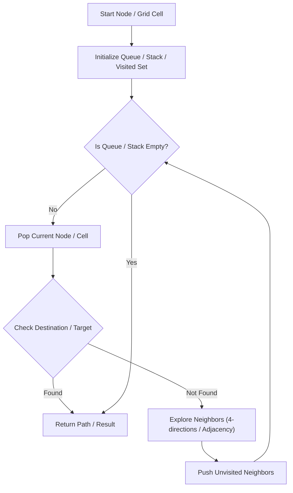

# Alien Dictionary

<div style="display:flex; gap:0.5rem; margin-bottom:1.5rem; align-items:center;">
  <span style="background:#ef444422; color:#ef4444; padding:2px 10px; borderRadius:12px; fontWeight:600; fontSize:0.85rem;">Hard</span>
  <span style="color:#64748b; fontSize:0.85rem;">Day 7 • Striver Blind 75</span>
</div>

## 📌 Problem Overview

Given a sorted dictionary of alien words, return the order of letters in the alien language.

### Examples & Constraints
**Example 1:**
- **Input:** `words = ["wrt","wrf","er","ett","rftt"]`
- **Output:** `"wertf"`


**Constraints:**
- `1 <= words.length <= 100`

---

## 💡 Approach & Intuition

Compare adjacent words to build directed character dependencies, then run Kahn's algorithm topological sort.

### 🎯 Pattern Recognition
Graph Topological Ordering

---

## 📊 Step-by-Step Execution (Mermaid Diagram)



---

## 🐢 Brute Force Solution

### Code
```javascript
function alienOrder(words) {
  const adj = {}; const inDegree = {};
  for (let w of words) for (let c of w) { adj[c] = new Set(); inDegree[c] = 0; }
  for (let i = 0; i < words.length - 1; i++) {
    let w1 = words[i], w2 = words[i+1];
    if (w1.length > w2.length && w1.startsWith(w2)) return "";
    for (let j = 0; j < Math.min(w1.length, w2.length); j++) {
      if (w1[j] !== w2[j]) {
        if (!adj[w1[j]].has(w2[j])) {
          adj[w1[j]].add(w2[j]); inDegree[w2[j]]++;
        }
        break;
      }
    }
  }
  const queue = Object.keys(inDegree).filter(c => inDegree[c] === 0);
  let res = "";
  while (queue.length) {
    let char = queue.shift(); res += char;
    for (let next of adj[char]) {
      inDegree[next]--;
      if (inDegree[next] === 0) queue.push(next);
    }
  }
  return res.length === Object.keys(inDegree).length ? res : "";
}
```

- **Time Complexity:** `O(C)`
- **Space Complexity:** `O(1)`
- **Explanation:** Kahn's topological sort.

---

## ⚡ Optimized Solution

### Code
```javascript
function alienOrder(words) {
  const adj = {}; const inDegree = {};
  for (let w of words) for (let c of w) { adj[c] = new Set(); inDegree[c] = 0; }
  for (let i = 0; i < words.length - 1; i++) {
    let w1 = words[i], w2 = words[i+1];
    if (w1.length > w2.length && w1.startsWith(w2)) return "";
    for (let j = 0; j < Math.min(w1.length, w2.length); j++) {
      if (w1[j] !== w2[j]) {
        if (!adj[w1[j]].has(w2[j])) {
          adj[w1[j]].add(w2[j]); inDegree[w2[j]]++;
        }
        break;
      }
    }
  }
  const queue = Object.keys(inDegree).filter(c => inDegree[c] === 0);
  let res = "";
  while (queue.length) {
    let char = queue.shift(); res += char;
    for (let next of adj[char]) {
      inDegree[next]--;
      if (inDegree[next] === 0) queue.push(next);
    }
  }
  return res.length === Object.keys(inDegree).length ? res : "";
}
```

- **Time Complexity:** `O(C)`
- **Space Complexity:** `O(1)`
- **Explanation:** DAG topological sorting on character graph.

---

## 🐾 Step-by-Step Walkthrough

1. **Initialize State:** Setup necessary pointers, dynamic programming arrays, or hash maps.
2. **Iterate & Evaluate:** Process the input according to the boundary conditions.
3. **Update & Return:** Compute the optimal answer and return early or at termination.

### 🎙️ FAANG Interview Pitch
Build character precedence rules from adjacent words and topologically sort.

---

## 💡 Progressive Hints

1. Compare first differing characters of adjacent words.

---

## ⚡ Interactive Practice
👉 **[Solve this problem interactively in the DSA Lab](/DSA-Notes-Problems/dsa/problems/alien-dictionary)**
