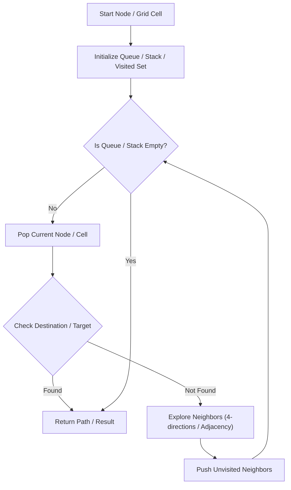

# Clone Graph

<div style="display:flex; gap:0.5rem; margin-bottom:1.5rem; align-items:center;">
  <span style="background:#f59e0b22; color:#f59e0b; padding:2px 10px; borderRadius:12px; fontWeight:600; fontSize:0.85rem;">Medium</span>
  <span style="color:#64748b; fontSize:0.85rem;">Day 6 • Striver Blind 75</span>
</div>

## 📌 Problem Overview

Return a deep copy (clone) of a connected undirected graph. Each node contains a value and a list of its neighbors.

### Examples & Constraints
**Example 1:**
- **Input:** `adjList = [[2,4],[1,3],[2,4],[1,3]]`
- **Output:** `[[2,4],[1,3],[2,4],[1,3]]`


**Example 2:**
- **Input:** `adjList = [[]]`
- **Output:** `[[]]`


**Constraints:**
- `0 ≤ nodes ≤ 100`
- `Node.val is unique.`

---

## 💡 Approach & Intuition

Tests deep copy of complex graph structures while handling cycles.

### 🎯 Pattern Recognition
**Pattern: Deep Copy with Map**

Use a hash map to track already-cloned nodes. Handle cycles by returning existing clones.

---

## 📊 Step-by-Step Execution (Mermaid Diagram)



---

## 🐢 Brute Force Solution

### Code
```javascript
// Must traverse graph, no brute force
```

- **Time Complexity:** `O(V+E)`
- **Space Complexity:** `O(V)`
- **Explanation:** DFS with visited map.

---

## ⚡ Optimized Solution

### Code
```javascript
function cloneGraph(node) {
  if (!node) return null;
  const visited = new Map();
  function dfs(node) {
    if (visited.has(node)) return visited.get(node);
    const clone = new Node(node.val);
    visited.set(node, clone);
    for (const neighbor of node.neighbors) {
      clone.neighbors.push(dfs(neighbor));
    }
    return clone;
  }
  return dfs(node);
}
```

- **Time Complexity:** `O(V+E)`
- **Space Complexity:** `O(V)`
- **Explanation:** DFS with a visited map to handle cycles.

---

## 🐾 Step-by-Step Walkthrough

1. **Initialize State:** Setup necessary pointers, dynamic programming arrays, or hash maps.
2. **Iterate & Evaluate:** Process the input according to the boundary conditions.
3. **Update & Return:** Compute the optimal answer and return early or at termination.

### 🎙️ FAANG Interview Pitch
1. Cycles make naive recursion infinite loop
2. Use hash map: original → clone
3. Check map before recursing on neighbors

---

## 💡 Progressive Hints

1. Use a hash map for cloned nodes.
2. If a node is already cloned, return the clone (handles cycles).
3. Recursively clone neighbors.

---

## ⚡ Interactive Practice
👉 **[Solve this problem interactively in the DSA Lab](/DSA-Notes-Problems/dsa/problems/clone-graph)**
