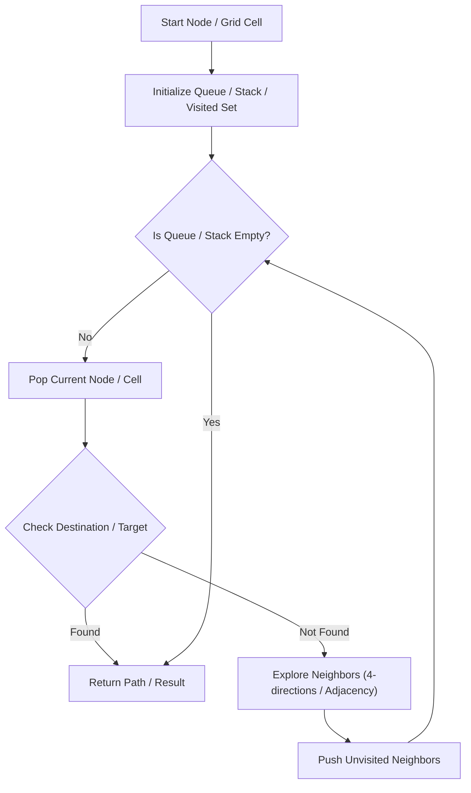

# Course Schedule

<div style="display:flex; gap:0.5rem; margin-bottom:1.5rem; align-items:center;">
  <span style="background:#f59e0b22; color:#f59e0b; padding:2px 10px; borderRadius:12px; fontWeight:600; fontSize:0.85rem;">Medium</span>
  <span style="color:#64748b; fontSize:0.85rem;">Day 6 • Striver Blind 75</span>
</div>

## 📌 Problem Overview

Determine if you can finish all `numCourses` given prerequisite pairs `[a, b]`.

### Examples & Constraints
**Example 1:**
- **Input:** `numCourses = 2, prerequisites = [[1,0]]`
- **Output:** `true`


**Constraints:**
- `1 <= numCourses <= 2000`

---

## 💡 Approach & Intuition

Detect cycles in directed graph using DFS or Topological Sort.

### 🎯 Pattern Recognition
Graph Cycle Detection / Topological Sort

---

## 📊 Step-by-Step Execution (Mermaid Diagram)



---

## 🐢 Brute Force Solution

### Code
```javascript
function canFinish(numCourses, prerequisites) {
  const adj = Array.from({length: numCourses}, () => []);
  for (let [a, b] of prerequisites) adj[b].push(a);
  const visited = new Array(numCourses).fill(0);
  function dfs(node) {
    if (visited[node] === 1) return true;
    if (visited[node] === 2) return false;
    visited[node] = 1;
    for (let neighbor of adj[node]) {
      if (dfs(neighbor)) return true;
    }
    visited[node] = 2;
    return false;
  }
  for (let i = 0; i < numCourses; i++) {
    if (dfs(i)) return false;
  }
  return true;
}
```

- **Time Complexity:** `O(V + E)`
- **Space Complexity:** `O(V + E)`
- **Explanation:** DFS directed cycle check.

---

## ⚡ Optimized Solution

### Code
```javascript
function canFinish(numCourses, prerequisites) {
  const adj = Array.from({length: numCourses}, () => []);
  for (let [a, b] of prerequisites) adj[b].push(a);
  const visited = new Array(numCourses).fill(0);
  function dfs(node) {
    if (visited[node] === 1) return true;
    if (visited[node] === 2) return false;
    visited[node] = 1;
    for (let neighbor of adj[node]) {
      if (dfs(neighbor)) return true;
    }
    visited[node] = 2;
    return false;
  }
  for (let i = 0; i < numCourses; i++) {
    if (dfs(i)) return false;
  }
  return true;
}
```

- **Time Complexity:** `O(V + E)`
- **Space Complexity:** `O(V + E)`
- **Explanation:** DFS directed cycle check.

---

## 🐾 Step-by-Step Walkthrough

1. **Initialize State:** Setup necessary pointers, dynamic programming arrays, or hash maps.
2. **Iterate & Evaluate:** Process the input according to the boundary conditions.
3. **Update & Return:** Compute the optimal answer and return early or at termination.

### 🎙️ FAANG Interview Pitch
Construct graph and run DFS to verify no back-edges (cycles) exist.

---

## 💡 Progressive Hints

1. Build adjacency list and check for directed cycles.

---

## ⚡ Interactive Practice
👉 **[Solve this problem interactively in the DSA Lab](/DSA-Notes-Problems/dsa/problems/course-schedule)**
