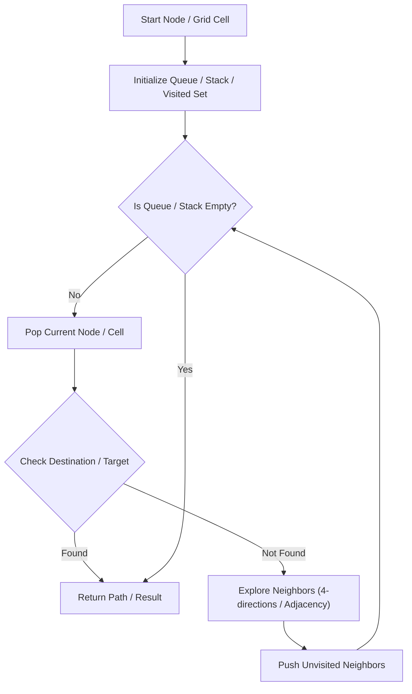

# Graph Valid Tree

<div style="display:flex; gap:0.5rem; margin-bottom:1.5rem; align-items:center;">
  <span style="background:#f59e0b22; color:#f59e0b; padding:2px 10px; borderRadius:12px; fontWeight:600; fontSize:0.85rem;">Medium</span>
  <span style="color:#64748b; fontSize:0.85rem;">Day 7 • Striver Blind 75</span>
</div>

## 📌 Problem Overview

Given `n` nodes labeled from `0` to `n - 1` and a list of undirected edges, check if these edges form a valid tree (connected, no cycles).

### Examples & Constraints
**Example 1:**
- **Input:** `n = 5, edges = [[0,1],[0,2],[0,3],[1,4]]`
- **Output:** `true`


**Constraints:**
- `1 <= n <= 2000`

---

## 💡 Approach & Intuition

A graph is a valid tree if it has exactly `n - 1` edges and is fully connected (no cycles).

### 🎯 Pattern Recognition
Union-Find / DFS Connectivity & Cycle Check

---

## 📊 Step-by-Step Execution (Mermaid Diagram)



---

## 🐢 Brute Force Solution

### Code
```javascript
function validTree(n, edges) {
  if (edges.length !== n - 1) return false;
  const adj = Array.from({length: n}, () => []);
  for (let [u, v] of edges) { adj[u].push(v); adj[v].push(u); }
  const visited = new Set();
  function dfs(node) {
    visited.add(node);
    for (let neighbor of adj[node]) if (!visited.has(neighbor)) dfs(neighbor);
  }
  dfs(0);
  return visited.size === n;
}
```

- **Time Complexity:** `O(V + E)`
- **Space Complexity:** `O(V + E)`
- **Explanation:** Graph connectivity check.

---

## ⚡ Optimized Solution

### Code
```javascript
function validTree(n, edges) {
  if (edges.length !== n - 1) return false;
  const parent = Array.from({length: n}, (_, i) => i);
  function find(i) { if (parent[i] === i) return i; return parent[i] = find(parent[i]); }
  for (let [u, v] of edges) {
    let r1 = find(u), r2 = find(v);
    if (r1 === r2) return false;
    parent[r1] = r2;
  }
  return true;
}
```

- **Time Complexity:** `O(V alpha(V))`
- **Space Complexity:** `O(V)`
- **Explanation:** Union-Find cycle & edge count.

---

## 🐾 Step-by-Step Walkthrough

1. **Initialize State:** Setup necessary pointers, dynamic programming arrays, or hash maps.
2. **Iterate & Evaluate:** Process the input according to the boundary conditions.
3. **Update & Return:** Compute the optimal answer and return early or at termination.

### 🎙️ FAANG Interview Pitch
A valid tree must have n-1 edges and no cycles.

---

## 💡 Progressive Hints

1. Check if edges.length === n - 1 and all nodes are connected.

---

## ⚡ Interactive Practice
👉 **[Solve this problem interactively in the DSA Lab](/DSA-Notes-Problems/dsa/problems/graph-valid-tree)**
