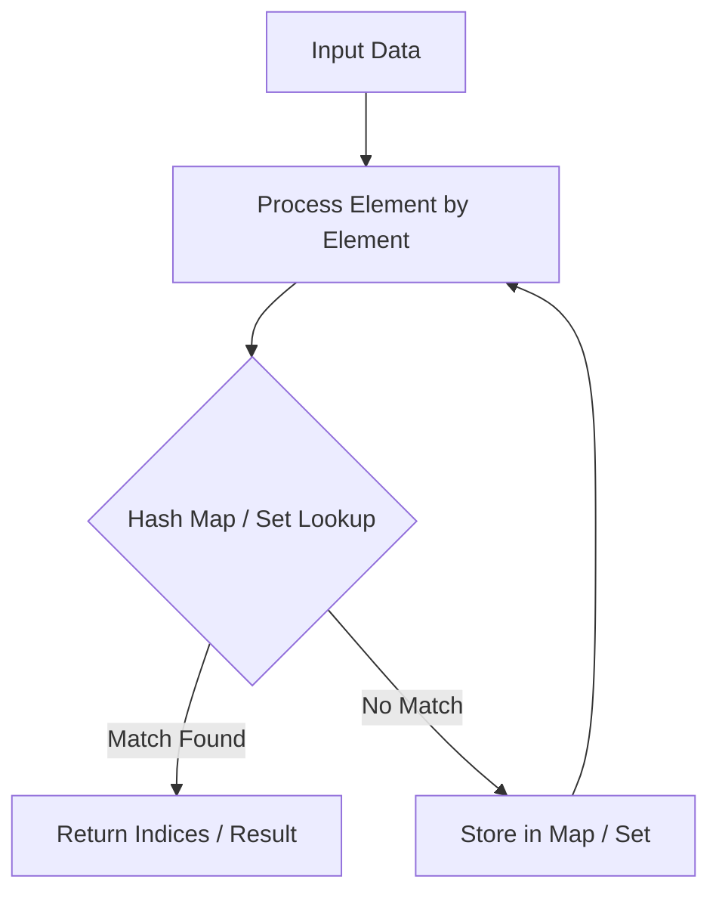

# Longest Consecutive Sequence

<div style="display:flex; gap:0.5rem; margin-bottom:1.5rem; align-items:center;">
  <span style="background:#f59e0b22; color:#f59e0b; padding:2px 10px; borderRadius:12px; fontWeight:600; fontSize:0.85rem;">Medium</span>
  <span style="color:#64748b; fontSize:0.85rem;">Day 7 • Striver Blind 75</span>
</div>

## 📌 Problem Overview

Given an unsorted array of integers `nums`, return the length of the longest consecutive elements sequence.

You must write an algorithm that runs in **O(n)** time.

### Examples & Constraints
**Example 1:**
- **Input:** `nums = [100,4,200,1,3,2]`
- **Output:** `4`
- **Explanation:** The longest consecutive sequence is [1,2,3,4].

**Example 2:**
- **Input:** `nums = [0,3,7,2,5,8,4,6,0,1]`
- **Output:** `9`


**Constraints:**
- `0 ≤ nums.length ≤ 10⁵`
- `-10⁹ ≤ nums[i] ≤ 10⁹`

---

## 💡 Approach & Intuition

Longest Consecutive Sequence tests whether you can avoid an O(n log n) sort by using a hash set to detect sequence starts and walk runs in O(n) total.

### 🎯 Pattern Recognition
**Pattern: Sequence-Start Detection**

Put all elements in a hash set. Only start walking a run from numbers where `num - 1` is absent, so each number is visited at most twice overall.

---

## 📊 Step-by-Step Execution (Mermaid Diagram)



---

## 🐢 Brute Force Solution

### Code
```javascript
function longestConsecutive(nums) {
  const sorted = [...new Set(nums)].sort((a, b) => a - b);
  let longest = 0, current = 1;
  for (let i = 1; i < sorted.length; i++) {
    if (sorted[i] === sorted[i - 1] + 1) current++;
    else current = 1;
    longest = Math.max(longest, current);
  }
  return sorted.length === 0 ? 0 : Math.max(longest, current);
}
```

- **Time Complexity:** `O(n log n)`
- **Space Complexity:** `O(n)`
- **Explanation:** Sort and scan for consecutive runs.

---

## ⚡ Optimized Solution

### Code
```javascript
function longestConsecutive(nums) {
  const set = new Set(nums);
  let longest = 0;
  for (const num of set) {
    if (!set.has(num - 1)) {
      let length = 1;
      while (set.has(num + length)) length++;
      longest = Math.max(longest, length);
    }
  }
  return longest;
}
```

- **Time Complexity:** `O(n)`
- **Space Complexity:** `O(n)`
- **Explanation:** Only walk runs starting from a sequence start, giving amortized O(n).

---

## 🐾 Step-by-Step Walkthrough

1. **Initialize State:** Setup necessary pointers, dynamic programming arrays, or hash maps.
2. **Iterate & Evaluate:** Process the input according to the boundary conditions.
3. **Update & Return:** Compute the optimal answer and return early or at termination.

### 🎙️ FAANG Interview Pitch
1. Sorting first gives an easy O(n log n) solution
2. To reach O(n), use a hash set for O(1) membership checks
3. Only begin a walk from numbers that are the start of a run (num - 1 absent)
4. Each number gets visited at most twice, so total work is linear

---

## 💡 Progressive Hints

1. Sorting works but costs O(n log n) — can you avoid it?
2. Put every number in a Set for O(1) lookups.
3. Only start counting a run from a number whose predecessor (num - 1) is not in the set.

---

## ⚡ Interactive Practice
👉 **[Solve this problem interactively in the DSA Lab](/DSA-Notes-Problems/dsa/problems/longest-consecutive-sequence)**
