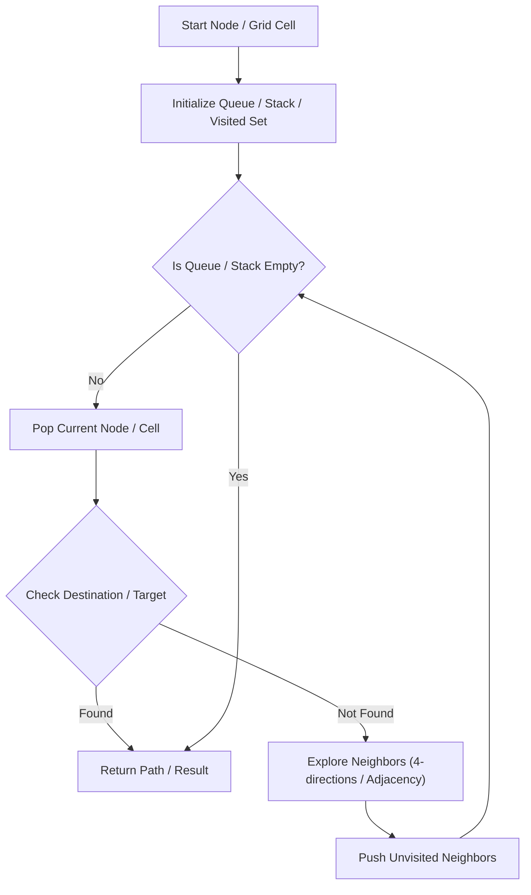

# Number of Connected Components in an Undirected Graph

<div style="display:flex; gap:0.5rem; margin-bottom:1.5rem; align-items:center;">
  <span style="background:#f59e0b22; color:#f59e0b; padding:2px 10px; borderRadius:12px; fontWeight:600; fontSize:0.85rem;">Medium</span>
  <span style="color:#64748b; fontSize:0.85rem;">Day 7 • Striver Blind 75</span>
</div>

## 📌 Problem Overview

Given `n` nodes and undirected `edges`, return the number of connected components.

### Examples & Constraints
**Example 1:**
- **Input:** `n = 5, edges = [[0,1],[1,2],[3,4]]`
- **Output:** `2`


**Constraints:**
- `1 <= n <= 2000`

---

## 💡 Approach & Intuition

Union-Find or DFS starting from unvisited nodes.

### 🎯 Pattern Recognition
Union-Find Disjoint Set

---

## 📊 Step-by-Step Execution (Mermaid Diagram)



---

## 🐢 Brute Force Solution

### Code
```javascript
function countComponents(n, edges) {
  const parent = Array.from({length: n}, (_, i) => i);
  let res = n;
  function find(i) { return parent[i] === i ? i : (parent[i] = find(parent[i])); }
  for (let [u, v] of edges) {
    let r1 = find(u), r2 = find(v);
    if (r1 !== r2) { parent[r1] = r2; res--; }
  }
  return res;
}
```

- **Time Complexity:** `O(V)`
- **Space Complexity:** `O(V)`
- **Explanation:** Union-Find counting.

---

## ⚡ Optimized Solution

### Code
```javascript
function countComponents(n, edges) {
  const parent = Array.from({length: n}, (_, i) => i);
  let res = n;
  function find(i) { return parent[i] === i ? i : (parent[i] = find(parent[i])); }
  for (let [u, v] of edges) {
    let r1 = find(u), r2 = find(v);
    if (r1 !== r2) { parent[r1] = r2; res--; }
  }
  return res;
}
```

- **Time Complexity:** `O(V)`
- **Space Complexity:** `O(V)`
- **Explanation:** Disjoint Set Union.

---

## 🐾 Step-by-Step Walkthrough

1. **Initialize State:** Setup necessary pointers, dynamic programming arrays, or hash maps.
2. **Iterate & Evaluate:** Process the input according to the boundary conditions.
3. **Update & Return:** Compute the optimal answer and return early or at termination.

### 🎙️ FAANG Interview Pitch
Start with count = n and decrement count whenever two distinct components are joined.

---

## 💡 Progressive Hints

1. Start with n components, decrement each successful union.

---

## ⚡ Interactive Practice
👉 **[Solve this problem interactively in the DSA Lab](/DSA-Notes-Problems/dsa/problems/number-of-connected-components)**
