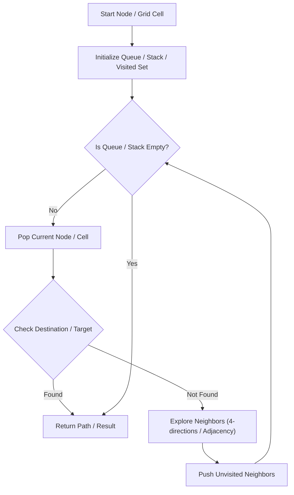

# Number of Islands

<div style="display:flex; gap:0.5rem; margin-bottom:1.5rem; align-items:center;">
  <span style="background:#f59e0b22; color:#f59e0b; padding:2px 10px; borderRadius:12px; fontWeight:600; fontSize:0.85rem;">Medium</span>
  <span style="color:#64748b; fontSize:0.85rem;">Day 6 • Striver Blind 75</span>
</div>

## 📌 Problem Overview

Given an m x n 2D binary grid of '1's (land) and '0's (water), return the number of islands. An island is surrounded by water and formed by connecting adjacent lands horizontally or vertically.

### Examples & Constraints
**Example 1:**
- **Input:** `grid = [["1","1","1","1","0"],["1","1","0","1","0"],["1","1","0","0","0"],["0","0","0","0","0"]]`
- **Output:** `1`


**Example 2:**
- **Input:** `grid = [["1","1","0","0","0"],["1","1","0","0","0"],["0","0","1","0","0"],["0","0","0","1","1"]]`
- **Output:** `3`


**Constraints:**
- `1 ≤ m, n ≤ 300`

---

## 💡 Approach & Intuition

The quintessential graph traversal problem testing connected component counting in a grid.

### 🎯 Pattern Recognition
**Pattern: Grid DFS**

Iterate through every cell. When you find unvisited land, start a DFS to mark the entire island. Increment count.

---

## 📊 Step-by-Step Execution (Mermaid Diagram)



---

## 🐢 Brute Force Solution

### Code
```javascript
// BFS/DFS with visited set
```

- **Time Complexity:** `O(m×n)`
- **Space Complexity:** `O(m×n)`
- **Explanation:** DFS with a separate visited array.

---

## ⚡ Optimized Solution

### Code
```javascript
function numIslands(grid) {
  if (!grid || !grid.length) return 0;
  const rows = grid.length, cols = grid[0].length;
  let count = 0;
  function dfs(r, c) {
    if (r < 0 || r >= rows || c < 0 || c >= cols || grid[r][c] === '0') return;
    grid[r][c] = '0';
    dfs(r+1, c); dfs(r-1, c); dfs(r, c+1); dfs(r, c-1);
  }
  for (let r = 0; r < rows; r++)
    for (let c = 0; c < cols; c++)
      if (grid[r][c] === '1') { count++; dfs(r, c); }
  return count;
}
```

- **Time Complexity:** `O(m×n)`
- **Space Complexity:** `O(m×n)`
- **Explanation:** DFS with in-place marking (sinking islands).

---

## 🐾 Step-by-Step Walkthrough

1. **Initialize State:** Setup necessary pointers, dynamic programming arrays, or hash maps.
2. **Iterate & Evaluate:** Process the input according to the boundary conditions.
3. **Update & Return:** Compute the optimal answer and return early or at termination.

### 🎙️ FAANG Interview Pitch
1. Frame as counting connected components
2. DFS from each unvisited land cell
3. Sink the island (mark as '0') to save space

---

## 💡 Progressive Hints

1. Iterate every cell.
2. When you find '1', increment count and DFS to mark all connected land.
3. Mark visited cells by changing '1' to '0'.

---

## ⚡ Interactive Practice
👉 **[Solve this problem interactively in the DSA Lab](/DSA-Notes-Problems/dsa/problems/number-of-islands)**
