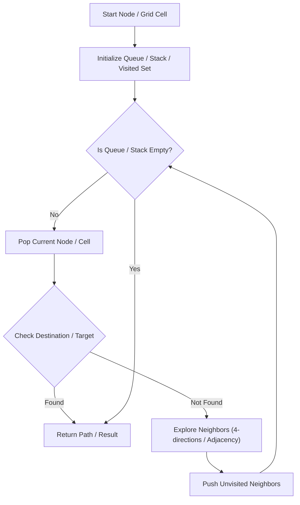

# Pacific Atlantic Water Flow

<div style="display:flex; gap:0.5rem; margin-bottom:1.5rem; align-items:center;">
  <span style="background:#f59e0b22; color:#f59e0b; padding:2px 10px; borderRadius:12px; fontWeight:600; fontSize:0.85rem;">Medium</span>
  <span style="color:#64748b; fontSize:0.85rem;">Day 6 • Striver Blind 75</span>
</div>

## 📌 Problem Overview

Return grid coordinates where water can flow to **both** Pacific and Atlantic oceans.

### Examples & Constraints
**Example 1:**
- **Input:** `heights = [[1,2,2,3,5],[3,2,3,4,4],[2,4,5,3,1],[6,7,1,4,5],[5,1,1,2,4]]`
- **Output:** `7 cells`


**Constraints:**
- `1 <= m, n <= 200`

---

## 💡 Approach & Intuition

Run DFS/BFS inward from Pacific and Atlantic borders separately, then intersect.

### 🎯 Pattern Recognition
Reverse Graph Search / Flood Fill

---

## 📊 Step-by-Step Execution (Mermaid Diagram)



---

## 🐢 Brute Force Solution

### Code
```javascript
function pacificAtlantic(heights) {
  const m = heights.length, n = heights[0].length;
  const pac = Array.from({length: m}, () => new Array(n).fill(false));
  const atl = Array.from({length: m}, () => new Array(n).fill(false));
  function dfs(r, c, visit, prev) {
    if (r<0||c<0||r>=m||c>=n||visit[r][c]||heights[r][c]<prev) return;
    visit[r][c] = true;
    dfs(r+1,c,visit,heights[r][c]); dfs(r-1,c,visit,heights[r][c]);
    dfs(r,c+1,visit,heights[r][c]); dfs(r,c-1,visit,heights[r][c]);
  }
  for (let i = 0; i < m; i++) { dfs(i, 0, pac, heights[i][0]); dfs(i, n-1, atl, heights[i][n-1]); }
  for (let j = 0; j < n; j++) { dfs(0, j, pac, heights[0][j]); dfs(m-1, j, atl, heights[m-1][j]); }
  const res = [];
  for (let i = 0; i < m; i++) for (let j = 0; j < n; j++) if (pac[i][j] && atl[i][j]) res.push([i,j]);
  return res;
}
```

- **Time Complexity:** `O(m*n)`
- **Space Complexity:** `O(m*n)`
- **Explanation:** Flood fill from Pacific and Atlantic borders.

---

## ⚡ Optimized Solution

### Code
```javascript
function pacificAtlantic(heights) {
  const m = heights.length, n = heights[0].length;
  const pac = Array.from({length: m}, () => new Array(n).fill(false));
  const atl = Array.from({length: m}, () => new Array(n).fill(false));
  function dfs(r, c, visit, prev) {
    if (r<0||c<0||r>=m||c>=n||visit[r][c]||heights[r][c]<prev) return;
    visit[r][c] = true;
    dfs(r+1,c,visit,heights[r][c]); dfs(r-1,c,visit,heights[r][c]);
    dfs(r,c+1,visit,heights[r][c]); dfs(r,c-1,visit,heights[r][c]);
  }
  for (let i = 0; i < m; i++) { dfs(i, 0, pac, heights[i][0]); dfs(i, n-1, atl, heights[i][n-1]); }
  for (let j = 0; j < n; j++) { dfs(0, j, pac, heights[0][j]); dfs(m-1, j, atl, heights[m-1][j]); }
  const res = [];
  for (let i = 0; i < m; i++) for (let j = 0; j < n; j++) if (pac[i][j] && atl[i][j]) res.push([i,j]);
  return res;
}
```

- **Time Complexity:** `O(m*n)`
- **Space Complexity:** `O(m*n)`
- **Explanation:** Flood fill from Pacific and Atlantic borders.

---

## 🐾 Step-by-Step Walkthrough

1. **Initialize State:** Setup necessary pointers, dynamic programming arrays, or hash maps.
2. **Iterate & Evaluate:** Process the input according to the boundary conditions.
3. **Update & Return:** Compute the optimal answer and return early or at termination.

### 🎙️ FAANG Interview Pitch
Start DFS from ocean borders going uphill; cells reached by both oceans are in the result.

---

## 💡 Progressive Hints

1. Search upwards/inwards from oceans rather than downwards from every cell.

---

## ⚡ Interactive Practice
👉 **[Solve this problem interactively in the DSA Lab](/DSA-Notes-Problems/dsa/problems/pacific-atlantic-water-flow)**
