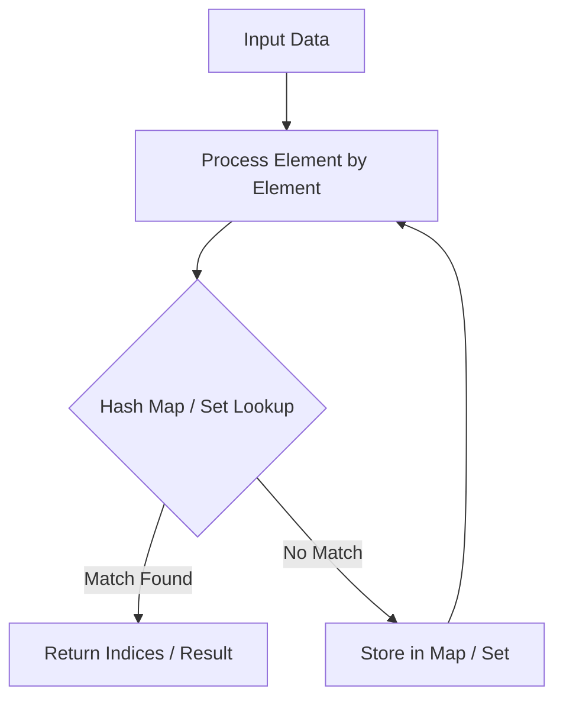

# Insert Interval

<div style="display:flex; gap:0.5rem; margin-bottom:1.5rem; align-items:center;">
  <span style="background:#f59e0b22; color:#f59e0b; padding:2px 10px; borderRadius:12px; fontWeight:600; fontSize:0.85rem;">Medium</span>
  <span style="color:#64748b; fontSize:0.85rem;">Day 8 • Striver Blind 75</span>
</div>

## 📌 Problem Overview

Insert `newInterval` into `intervals` (sorted non-overlapping) and merge if necessary.

### Examples & Constraints
**Example 1:**
- **Input:** `intervals = [[1,3],[6,9]], newInterval = [2,5]`
- **Output:** `[[1,5],[6,9]]`


**Constraints:**
- `0 <= intervals.length <= 10^4`

---

## 💡 Approach & Intuition

Three phases: add non-overlapping before, merge overlapping in middle, add non-overlapping after.

### 🎯 Pattern Recognition
Interval Manipulation

---

## 📊 Step-by-Step Execution (Mermaid Diagram)



---

## 🐢 Brute Force Solution

### Code
```javascript
function insert(intervals, newInterval) {
  const res = [];
  let i = 0;
  while (i < intervals.length && intervals[i][1] < newInterval[0]) {
    res.push(intervals[i++]);
  }
  while (i < intervals.length && intervals[i][0] <= newInterval[1]) {
    newInterval[0] = Math.min(newInterval[0], intervals[i][0]);
    newInterval[1] = Math.max(newInterval[1], intervals[i][1]);
    i++;
  }
  res.push(newInterval);
  while (i < intervals.length) res.push(intervals[i++]);
  return res;
}
```

- **Time Complexity:** `O(n)`
- **Space Complexity:** `O(n)`
- **Explanation:** Single pass interval merging.

---

## ⚡ Optimized Solution

### Code
```javascript
function insert(intervals, newInterval) {
  const res = [];
  let i = 0;
  while (i < intervals.length && intervals[i][1] < newInterval[0]) {
    res.push(intervals[i++]);
  }
  while (i < intervals.length && intervals[i][0] <= newInterval[1]) {
    newInterval[0] = Math.min(newInterval[0], intervals[i][0]);
    newInterval[1] = Math.max(newInterval[1], intervals[i][1]);
    i++;
  }
  res.push(newInterval);
  while (i < intervals.length) res.push(intervals[i++]);
  return res;
}
```

- **Time Complexity:** `O(n)`
- **Space Complexity:** `O(n)`
- **Explanation:** O(n) linear sweep.

---

## 🐾 Step-by-Step Walkthrough

1. **Initialize State:** Setup necessary pointers, dynamic programming arrays, or hash maps.
2. **Iterate & Evaluate:** Process the input according to the boundary conditions.
3. **Update & Return:** Compute the optimal answer and return early or at termination.

### 🎙️ FAANG Interview Pitch
Push left non-overlapping, expand newInterval with overlapping, push right non-overlapping.

---

## 💡 Progressive Hints

1. Iterate through intervals and merge when overlap occurs.

---

## ⚡ Interactive Practice
👉 **[Solve this problem interactively in the DSA Lab](/DSA-Notes-Problems/dsa/problems/insert-interval)**
