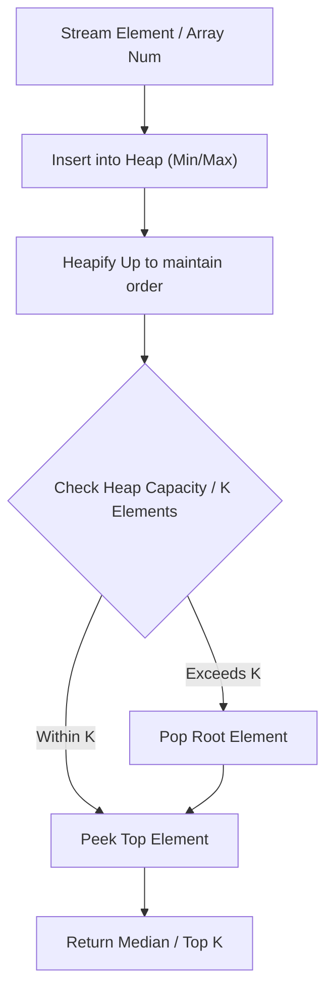

# Meeting Rooms II

<div style="display:flex; gap:0.5rem; margin-bottom:1.5rem; align-items:center;">
  <span style="background:#f59e0b22; color:#f59e0b; padding:2px 10px; borderRadius:12px; fontWeight:600; fontSize:0.85rem;">Medium</span>
  <span style="color:#64748b; fontSize:0.85rem;">Day 8 • Striver Blind 75</span>
</div>

## 📌 Problem Overview

Given an array of meeting time intervals, return the minimum number of conference rooms required.

### Examples & Constraints
**Example 1:**
- **Input:** `intervals = [[0,30],[5,10],[15,20]]`
- **Output:** `2`


**Constraints:**
- `0 <= intervals.length <= 10^4`

---

## 💡 Approach & Intuition

Separate start and end times, sort both, use two pointers to count active overlapping meetings.

### 🎯 Pattern Recognition
Two Pointers / Min Heap Overlap Counter

---

## 📊 Step-by-Step Execution (Mermaid Diagram)



---

## 🐢 Brute Force Solution

### Code
```javascript
function minMeetingRooms(intervals) {
  const starts = intervals.map(i => i[0]).sort((a, b) => a - b);
  const ends = intervals.map(i => i[1]).sort((a, b) => a - b);
  let rooms = 0, endIdx = 0;
  for (let i = 0; i < starts.length; i++) {
    if (starts[i] < ends[endIdx]) rooms++;
    else endIdx++;
  }
  return rooms;
}
```

- **Time Complexity:** `O(n log n)`
- **Space Complexity:** `O(n)`
- **Explanation:** Two pointers on sorted starts and ends.

---

## ⚡ Optimized Solution

### Code
```javascript
function minMeetingRooms(intervals) {
  const starts = intervals.map(i => i[0]).sort((a, b) => a - b);
  const ends = intervals.map(i => i[1]).sort((a, b) => a - b);
  let rooms = 0, endIdx = 0;
  for (let i = 0; i < starts.length; i++) {
    if (starts[i] < ends[endIdx]) rooms++;
    else endIdx++;
  }
  return rooms;
}
```

- **Time Complexity:** `O(n log n)`
- **Space Complexity:** `O(n)`
- **Explanation:** Chrono start/end pointer scanning.

---

## 🐾 Step-by-Step Walkthrough

1. **Initialize State:** Setup necessary pointers, dynamic programming arrays, or hash maps.
2. **Iterate & Evaluate:** Process the input according to the boundary conditions.
3. **Update & Return:** Compute the optimal answer and return early or at termination.

### 🎙️ FAANG Interview Pitch
If a meeting starts before the earliest ending meeting finishes, we need an extra room.

---

## 💡 Progressive Hints

1. Sort start times and end times independently.

---

## ⚡ Interactive Practice
👉 **[Solve this problem interactively in the DSA Lab](/DSA-Notes-Problems/dsa/problems/meeting-rooms-ii)**
