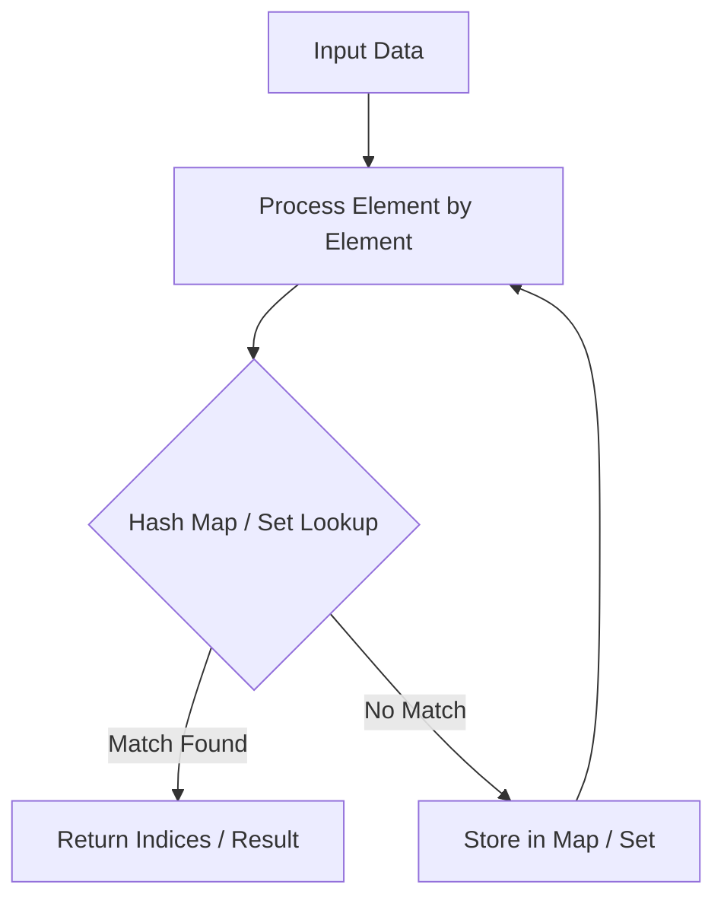

# Meeting Rooms

<div style="display:flex; gap:0.5rem; margin-bottom:1.5rem; align-items:center;">
  <span style="background:#22c55e22; color:#22c55e; padding:2px 10px; borderRadius:12px; fontWeight:600; fontSize:0.85rem;">Easy</span>
  <span style="color:#64748b; fontSize:0.85rem;">Day 8 • Striver Blind 75</span>
</div>

## 📌 Problem Overview

Given an array of meeting time intervals `[[start, end]]`, determine if a person could attend all meetings.

### Examples & Constraints
**Example 1:**
- **Input:** `intervals = [[0,30],[5,10],[15,20]]`
- **Output:** `false`


**Example 2:**
- **Input:** `intervals = [[7,10],[2,4]]`
- **Output:** `true`


**Constraints:**
- `0 <= intervals.length <= 10^4`

---

## 💡 Approach & Intuition

Sort by start time, check if `intervals[i][0] < intervals[i-1][1]`.

### 🎯 Pattern Recognition
Interval Sorting Overlap Check

---

## 📊 Step-by-Step Execution (Mermaid Diagram)



---

## 🐢 Brute Force Solution

### Code
```javascript
function canAttendMeetings(intervals) {
  intervals.sort((a, b) => a[0] - b[0]);
  for (let i = 1; i < intervals.length; i++) {
    if (intervals[i][0] < intervals[i-1][1]) return false;
  }
  return true;
}
```

- **Time Complexity:** `O(n log n)`
- **Space Complexity:** `O(1)`
- **Explanation:** Sort and adjacent check.

---

## ⚡ Optimized Solution

### Code
```javascript
function canAttendMeetings(intervals) {
  intervals.sort((a, b) => a[0] - b[0]);
  for (let i = 1; i < intervals.length; i++) {
    if (intervals[i][0] < intervals[i-1][1]) return false;
  }
  return true;
}
```

- **Time Complexity:** `O(n log n)`
- **Space Complexity:** `O(1)`
- **Explanation:** Sort by start time.

---

## 🐾 Step-by-Step Walkthrough

1. **Initialize State:** Setup necessary pointers, dynamic programming arrays, or hash maps.
2. **Iterate & Evaluate:** Process the input according to the boundary conditions.
3. **Update & Return:** Compute the optimal answer and return early or at termination.

### 🎙️ FAANG Interview Pitch
If any meeting starts before the previous one ends, attending all is impossible.

---

## 💡 Progressive Hints

1. Sort intervals by start time.

---

## ⚡ Interactive Practice
👉 **[Solve this problem interactively in the DSA Lab](/DSA-Notes-Problems/dsa/problems/meeting-rooms)**
