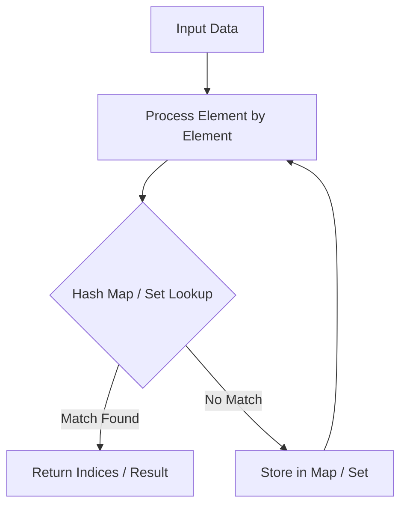

# Merge Intervals

<div style="display:flex; gap:0.5rem; margin-bottom:1.5rem; align-items:center;">
  <span style="background:#f59e0b22; color:#f59e0b; padding:2px 10px; borderRadius:12px; fontWeight:600; fontSize:0.85rem;">Medium</span>
  <span style="color:#64748b; fontSize:0.85rem;">Day 8 • Striver Blind 75</span>
</div>

## 📌 Problem Overview

Given an array of `intervals`, merge all overlapping intervals.

### Examples & Constraints
**Example 1:**
- **Input:** `intervals = [[1,3],[2,6],[8,10],[15,18]]`
- **Output:** `[[1,6],[8,10],[15,18]]`


**Constraints:**
- `1 <= intervals.length <= 10^4`

---

## 💡 Approach & Intuition

Sort intervals by start time, then merge adjacent intervals if `curr.start <= prev.end`.

### 🎯 Pattern Recognition
Sorting + Greedy Interval Merge

---

## 📊 Step-by-Step Execution (Mermaid Diagram)



---

## 🐢 Brute Force Solution

### Code
```javascript
function merge(intervals) {
  intervals.sort((a, b) => a[0] - b[0]);
  const res = [intervals[0]];
  for (let i = 1; i < intervals.length; i++) {
    let last = res[res.length - 1];
    if (intervals[i][0] <= last[1]) last[1] = Math.max(last[1], intervals[i][1]);
    else res.push(intervals[i]);
  }
  return res;
}
```

- **Time Complexity:** `O(n log n)`
- **Space Complexity:** `O(n)`
- **Explanation:** Sort and merge.

---

## ⚡ Optimized Solution

### Code
```javascript
function merge(intervals) {
  intervals.sort((a, b) => a[0] - b[0]);
  const res = [intervals[0]];
  for (let i = 1; i < intervals.length; i++) {
    let last = res[res.length - 1];
    if (intervals[i][0] <= last[1]) last[1] = Math.max(last[1], intervals[i][1]);
    else res.push(intervals[i]);
  }
  return res;
}
```

- **Time Complexity:** `O(n log n)`
- **Space Complexity:** `O(n)`
- **Explanation:** Sort by start time and linear merge.

---

## 🐾 Step-by-Step Walkthrough

1. **Initialize State:** Setup necessary pointers, dynamic programming arrays, or hash maps.
2. **Iterate & Evaluate:** Process the input according to the boundary conditions.
3. **Update & Return:** Compute the optimal answer and return early or at termination.

### 🎙️ FAANG Interview Pitch
Sorting ensures overlapping intervals are contiguous in the list.

---

## 💡 Progressive Hints

1. Sort by start time first.

---

## ⚡ Interactive Practice
👉 **[Solve this problem interactively in the DSA Lab](/DSA-Notes-Problems/dsa/problems/merge-intervals)**
