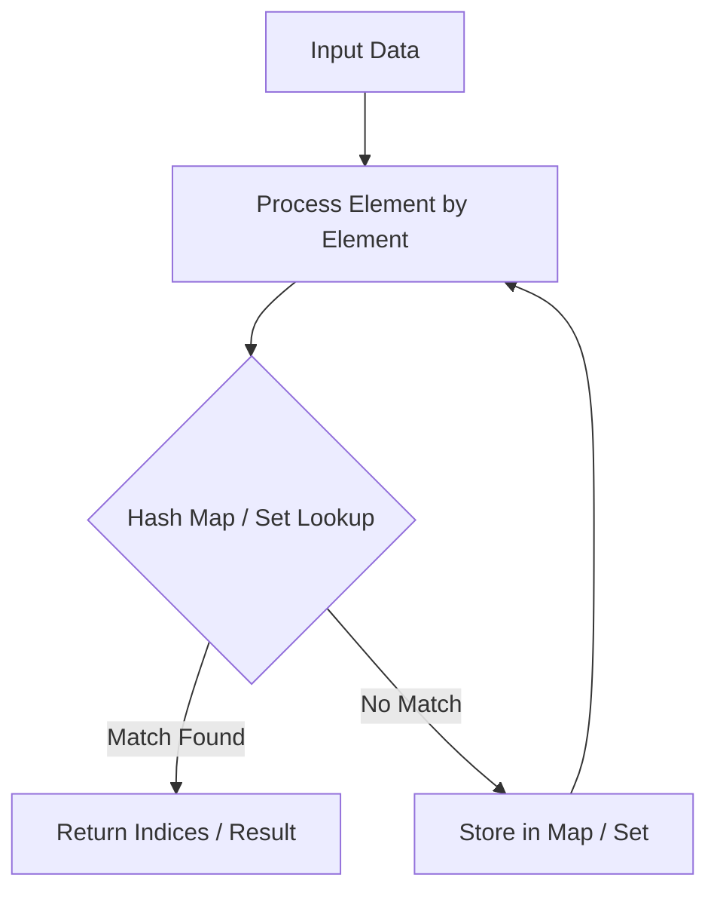

# Non-overlapping Intervals

<div style="display:flex; gap:0.5rem; margin-bottom:1.5rem; align-items:center;">
  <span style="background:#f59e0b22; color:#f59e0b; padding:2px 10px; borderRadius:12px; fontWeight:600; fontSize:0.85rem;">Medium</span>
  <span style="color:#64748b; fontSize:0.85rem;">Day 8 • Striver Blind 75</span>
</div>

## 📌 Problem Overview

Return the minimum number of intervals you need to remove to make the rest non-overlapping.

### Examples & Constraints
**Example 1:**
- **Input:** `intervals = [[1,2],[2,3],[3,4],[1,3]]`
- **Output:** `1`


**Constraints:**
- `1 <= intervals.length <= 10^5`

---

## 💡 Approach & Intuition

Greedy scheduling problem: sort by end time, pick interval with earliest end time.

### 🎯 Pattern Recognition
Interval Scheduling / Greedy Choice

---

## 📊 Step-by-Step Execution (Mermaid Diagram)



---

## 🐢 Brute Force Solution

### Code
```javascript
function eraseOverlapIntervals(intervals) {
  intervals.sort((a, b) => a[1] - b[1]);
  let count = 0, prevEnd = intervals[0][1];
  for (let i = 1; i < intervals.length; i++) {
    if (intervals[i][0] < prevEnd) count++;
    else prevEnd = intervals[i][1];
  }
  return count;
}
```

- **Time Complexity:** `O(n log n)`
- **Space Complexity:** `O(1)`
- **Explanation:** Greedy choice by end time.

---

## ⚡ Optimized Solution

### Code
```javascript
function eraseOverlapIntervals(intervals) {
  intervals.sort((a, b) => a[1] - b[1]);
  let count = 0, prevEnd = intervals[0][1];
  for (let i = 1; i < intervals.length; i++) {
    if (intervals[i][0] < prevEnd) count++;
    else prevEnd = intervals[i][1];
  }
  return count;
}
```

- **Time Complexity:** `O(n log n)`
- **Space Complexity:** `O(1)`
- **Explanation:** Earliest end time greedy sorting.

---

## 🐾 Step-by-Step Walkthrough

1. **Initialize State:** Setup necessary pointers, dynamic programming arrays, or hash maps.
2. **Iterate & Evaluate:** Process the input according to the boundary conditions.
3. **Update & Return:** Compute the optimal answer and return early or at termination.

### 🎙️ FAANG Interview Pitch
Sorting by end time leaves maximum room for future non-overlapping intervals.

---

## 💡 Progressive Hints

1. Sort intervals by end time.

---

## ⚡ Interactive Practice
👉 **[Solve this problem interactively in the DSA Lab](/DSA-Notes-Problems/dsa/problems/non-overlapping-intervals)**
