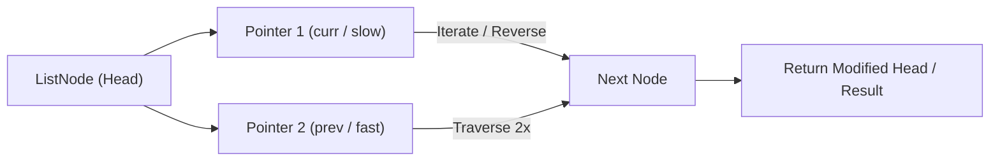

# Linked List Cycle

<div style="display:flex; gap:0.5rem; margin-bottom:1.5rem; align-items:center;">
  <span style="background:#22c55e22; color:#22c55e; padding:2px 10px; borderRadius:12px; fontWeight:600; fontSize:0.85rem;">Easy</span>
  <span style="color:#64748b; fontSize:0.85rem;">Day 9 • Striver Blind 75</span>
</div>

## 📌 Problem Overview

Given the `head` of a linked list, determine if the linked list has a cycle in it. `pos` denotes the index the tail connects back to (`-1` means no cycle). Return `true` if there is a cycle, or `false` otherwise.

### Examples & Constraints
**Example 1:**
- **Input:** `values = [3,2,0,-4], pos = 1`
- **Output:** `true`


**Example 2:**
- **Input:** `values = [1], pos = -1`
- **Output:** `false`


**Constraints:**
- `The number of nodes is in the range [0, 10⁴]`
- `-10⁵ ≤ Node.val ≤ 10⁵`

---

## 💡 Approach & Intuition

Linked List Cycle is the canonical Floyd's cycle detection problem, using two pointers moving at different speeds to detect a loop in O(1) space.

### 🎯 Pattern Recognition
**Pattern: Fast & Slow Pointers**

Move one pointer one step at a time and another two steps at a time. If they ever meet, there's a cycle; if the fast pointer reaches the end, there isn't.

---

## 📊 Step-by-Step Execution (Mermaid Diagram)



---

## 🐢 Brute Force Solution

### Code
```javascript
// A visited Set works but uses O(n) space
function hasCycle(values, pos) {
  const head = buildList(values, pos);
  const seen = new Set();
  let curr = head;
  while (curr) {
    if (seen.has(curr)) return true;
    seen.add(curr);
    curr = curr.next;
  }
  return false;
}
```

- **Time Complexity:** `O(n)`
- **Space Complexity:** `O(n)`
- **Explanation:** Track visited nodes in a Set.

---

## ⚡ Optimized Solution

### Code
```javascript
function hasCycle(values, pos) {
  const head = buildList(values, pos);
  let slow = head, fast = head;
  while (fast && fast.next) {
    slow = slow.next;
    fast = fast.next.next;
    if (slow === fast) return true;
  }
  return false;
}
```

- **Time Complexity:** `O(n)`
- **Space Complexity:** `O(1)`
- **Explanation:** Floyd's slow/fast pointer cycle detection.

---

## 🐾 Step-by-Step Walkthrough

1. **Initialize State:** Setup necessary pointers, dynamic programming arrays, or hash maps.
2. **Iterate & Evaluate:** Process the input according to the boundary conditions.
3. **Update & Return:** Compute the optimal answer and return early or at termination.

### 🎙️ FAANG Interview Pitch
**How to explain:**
1. Start with a visited Set — O(n) space
2. Introduce Floyd's tortoise-and-hare for O(1) space
3. Explain why the fast pointer must lap the slow one if a cycle exists
4. Stopping condition: fast or fast.next becomes null

---

## 💡 Progressive Hints

1. Use two pointers moving at different speeds.
2. If they ever meet, there's a cycle.
3. If the fast pointer reaches null, there's no cycle.

---

## ⚡ Interactive Practice
👉 **[Solve this problem interactively in the DSA Lab](/DSA-Notes-Problems/dsa/problems/linked-list-cycle)**
