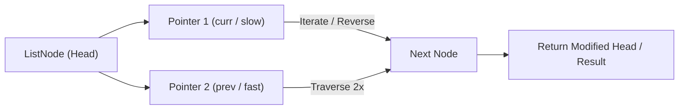

# Merge k Sorted Lists

<div style="display:flex; gap:0.5rem; margin-bottom:1.5rem; align-items:center;">
  <span style="background:#ef444422; color:#ef4444; padding:2px 10px; borderRadius:12px; fontWeight:600; fontSize:0.85rem;">Hard</span>
  <span style="color:#64748b; fontSize:0.85rem;">Day 9 • Striver Blind 75</span>
</div>

## 📌 Problem Overview

You are given an array of `k` linked lists, each sorted in ascending order. Merge all the linked lists into one sorted linked list and return it.

### Examples & Constraints
**Example 1:**
- **Input:** `lists = [[1,4,5],[1,3,4],[2,6]]`
- **Output:** `[1,1,2,3,4,4,5,6]`


**Example 2:**
- **Input:** `lists = []`
- **Output:** `[]`


**Constraints:**
- `k == lists.length`
- `0 ≤ k ≤ 10⁴`
- `0 ≤ lists[i].length ≤ 500`
- `-10⁴ ≤ lists[i][j] ≤ 10⁴`

---

## 💡 Approach & Intuition

Merge k Sorted Lists extends Merge Two Sorted Lists to k lists, testing divide-and-conquer or heap-based merging to avoid O(k*n) repeated pairwise merges.

### 🎯 Pattern Recognition
**Pattern: Divide and Conquer Merge**

Repeatedly merge lists in pairs, halving the number of lists each round, until only one list remains — O(log k) rounds of O(n) work each.

---

## 📊 Step-by-Step Execution (Mermaid Diagram)



---

## 🐢 Brute Force Solution

### Code
```javascript
function mergeTwoLists(a, b) {
  const dummy = new ListNode(0);
  let t = dummy;
  while (a && b) { if (a.val <= b.val) { t.next = a; a = a.next; } else { t.next = b; b = b.next; } t = t.next; }
  t.next = a || b;
  return dummy.next;
}
function mergeKLists(lists) {
  const heads = lists.map(buildList);
  let result = null;
  for (const head of heads) result = mergeTwoLists(result, head);
  return toArray(result);
}
```

- **Time Complexity:** `O(k * n)`
- **Space Complexity:** `O(1)`
- **Explanation:** Merge lists one at a time into a growing accumulator.

---

## ⚡ Optimized Solution

### Code
```javascript
function mergeTwoLists(a, b) {
  const dummy = new ListNode(0);
  let t = dummy;
  while (a && b) { if (a.val <= b.val) { t.next = a; a = a.next; } else { t.next = b; b = b.next; } t = t.next; }
  t.next = a || b;
  return dummy.next;
}
function mergeKLists(lists) {
  let heads = lists.map(buildList);
  if (heads.length === 0) return [];
  while (heads.length > 1) {
    const merged = [];
    for (let i = 0; i < heads.length; i += 2) {
      const l1 = heads[i];
      const l2 = i + 1 < heads.length ? heads[i + 1] : null;
      merged.push(mergeTwoLists(l1, l2));
    }
    heads = merged;
  }
  return toArray(heads[0]);
}
```

- **Time Complexity:** `O(n log k)`
- **Space Complexity:** `O(log k) recursion/iteration state`
- **Explanation:** Merge lists in pairs, halving the count each round.

---

## 🐾 Step-by-Step Walkthrough

1. **Initialize State:** Setup necessary pointers, dynamic programming arrays, or hash maps.
2. **Iterate & Evaluate:** Process the input according to the boundary conditions.
3. **Update & Return:** Compute the optimal answer and return early or at termination.

### 🎙️ FAANG Interview Pitch
1. Merging one list at a time into an accumulator is O(k*n)
2. Merge lists in pairs instead, halving the list count each round
3. This does O(log k) rounds, each doing O(n) total work — O(n log k)
4. A min-heap of the k front nodes is an alternative achieving the same complexity

---

## 💡 Progressive Hints

1. Merging lists one at a time into an accumulator is O(k*n) total.
2. Instead, merge lists in pairs and repeat on the resulting half-sized set.
3. Reuse a mergeTwoLists helper for each pairwise merge.

---

## ⚡ Interactive Practice
👉 **[Solve this problem interactively in the DSA Lab](/DSA-Notes-Problems/dsa/problems/merge-k-sorted-lists)**
