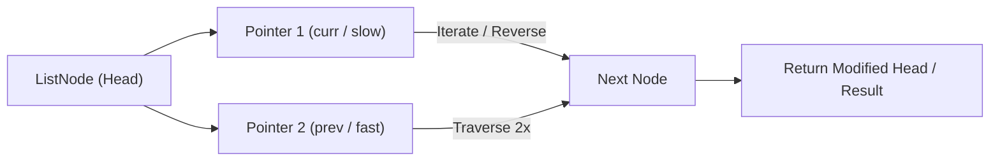

# Merge Two Sorted Lists

<div style="display:flex; gap:0.5rem; margin-bottom:1.5rem; align-items:center;">
  <span style="background:#22c55e22; color:#22c55e; padding:2px 10px; borderRadius:12px; fontWeight:600; fontSize:0.85rem;">Easy</span>
  <span style="color:#64748b; fontSize:0.85rem;">Day 9 • Striver Blind 75</span>
</div>

## 📌 Problem Overview

You are given the heads of two sorted linked lists. Merge them into one sorted list.

### Examples & Constraints
**Example 1:**
- **Input:** `list1 = [1,2,4], list2 = [1,3,4]`
- **Output:** `[1,1,2,3,4,4]`


**Example 2:**
- **Input:** `list1 = [], list2 = [0]`
- **Output:** `[0]`


**Constraints:**
- `0 ≤ list length ≤ 50`

---

## 💡 Approach & Intuition

Tests your ability to merge sorted data — a fundamental divide-and-conquer pattern.

### 🎯 Pattern Recognition
**Pattern: Two-Pointer Merge**

Compare elements from both lists using two pointers. Take the smaller one and advance. Use a dummy head.

---

## 📊 Step-by-Step Execution (Mermaid Diagram)



---

## 🐢 Brute Force Solution

### Code
```javascript
function mergeTwoLists(l1, l2) { const arr=[]; while(l1){arr.push(l1.val);l1=l1.next} while(l2){arr.push(l2.val);l2=l2.next} arr.sort((a,b)=>a-b); const d=new ListNode(); let c=d; for(const v of arr){c.next=new ListNode(v);c=c.next} return d.next; }
```

- **Time Complexity:** `O((n+m) log(n+m))`
- **Space Complexity:** `O(n+m)`
- **Explanation:** Extract values, sort, rebuild.

---

## ⚡ Optimized Solution

### Code
```javascript
function mergeTwoLists(l1, l2) {
  const dummy = new ListNode();
  let curr = dummy;
  while (l1 && l2) {
    if (l1.val <= l2.val) { curr.next = l1; l1 = l1.next; }
    else { curr.next = l2; l2 = l2.next; }
    curr = curr.next;
  }
  curr.next = l1 || l2;
  return dummy.next;
}
```

- **Time Complexity:** `O(n+m)`
- **Space Complexity:** `O(1)`
- **Explanation:** Dummy head + two-pointer merge.

---

## 🐾 Step-by-Step Walkthrough

1. **Initialize State:** Setup necessary pointers, dynamic programming arrays, or hash maps.
2. **Iterate & Evaluate:** Process the input according to the boundary conditions.
3. **Update & Return:** Compute the optimal answer and return early or at termination.

### 🎙️ FAANG Interview Pitch
1. Use dummy node to avoid null checks
2. Compare and attach smaller element
3. Attach remainder when one list ends

---

## 💡 Progressive Hints

1. Use a dummy node.
2. Compare and attach the smaller node.
3. Attach remaining nodes when one list is exhausted.

---

## ⚡ Interactive Practice
👉 **[Solve this problem interactively in the DSA Lab](/DSA-Notes-Problems/dsa/problems/merge-two-sorted-lists)**
