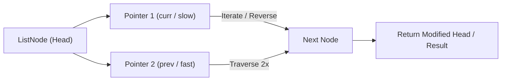

# Remove Nth Node From End of List

<div style="display:flex; gap:0.5rem; margin-bottom:1.5rem; align-items:center;">
  <span style="background:#f59e0b22; color:#f59e0b; padding:2px 10px; borderRadius:12px; fontWeight:600; fontSize:0.85rem;">Medium</span>
  <span style="color:#64748b; fontSize:0.85rem;">Day 9 • Striver Blind 75</span>
</div>

## 📌 Problem Overview

Given the `head` of a linked list, remove the `n`th node from the end of the list and return its head.

### Examples & Constraints
**Example 1:**
- **Input:** `values = [1,2,3,4,5], n = 2`
- **Output:** `[1,2,3,5]`


**Example 2:**
- **Input:** `values = [1], n = 1`
- **Output:** `[]`


**Constraints:**
- `The number of nodes is in the range [1, 30]`
- `0 ≤ Node.val ≤ 100`
- `1 ≤ n ≤ size of the list`

---

## 💡 Approach & Intuition

Remove Nth Node From End tests the two-pointer gap technique to locate a position relative to the end in a single pass, without knowing the list's length up front.

### 🎯 Pattern Recognition
**Pattern: Two Pointers with a Fixed Gap**

Advance one pointer n steps ahead first, then move both together — when the lead pointer hits the end, the trailing pointer is positioned exactly at the target.

---

## 📊 Step-by-Step Execution (Mermaid Diagram)



---

## 🐢 Brute Force Solution

### Code
```javascript
// Two passes: first count the length, then walk to the node before the target
function removeNthFromEnd(values, n) {
  const dummy = new ListNode(0, buildList(values));
  let length = 0;
  let curr = dummy.next;
  while (curr) { length++; curr = curr.next; }
  let prev = dummy;
  for (let i = 0; i < length - n; i++) prev = prev.next;
  prev.next = prev.next.next;
  return toArray(dummy.next);
}
```

- **Time Complexity:** `O(n)`
- **Space Complexity:** `O(1)`
- **Explanation:** Count the length first, then remove in a second pass.

---

## ⚡ Optimized Solution

### Code
```javascript
function removeNthFromEnd(values, n) {
  const dummy = new ListNode(0, buildList(values));
  let fast = dummy, slow = dummy;
  for (let i = 0; i < n; i++) fast = fast.next;
  while (fast.next) { fast = fast.next; slow = slow.next; }
  slow.next = slow.next.next;
  return toArray(dummy.next);
}
```

- **Time Complexity:** `O(n)`
- **Space Complexity:** `O(1)`
- **Explanation:** Single pass with a fixed-gap two-pointer technique.

---

## 🐾 Step-by-Step Walkthrough

1. **Initialize State:** Setup necessary pointers, dynamic programming arrays, or hash maps.
2. **Iterate & Evaluate:** Process the input according to the boundary conditions.
3. **Update & Return:** Compute the optimal answer and return early or at termination.

### 🎙️ FAANG Interview Pitch
1. Two-pass approach counts length then removes — simple but two traversals
2. One-pass approach keeps a fixed gap of n between two pointers
3. A dummy node before head simplifies removing the actual head node
4. When fast reaches the last node, slow is right before the node to remove

---

## 💡 Progressive Hints

1. Use a dummy node before the head to simplify removing the true head.
2. Advance a fast pointer n steps ahead of a slow pointer.
3. Move both forward together until fast reaches the last node.

---

## ⚡ Interactive Practice
👉 **[Solve this problem interactively in the DSA Lab](/DSA-Notes-Problems/dsa/problems/remove-nth-node-from-end)**
