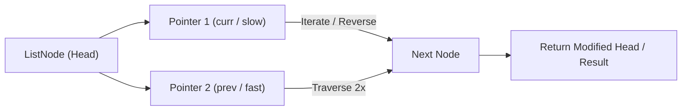

# Reorder List

<div style="display:flex; gap:0.5rem; margin-bottom:1.5rem; align-items:center;">
  <span style="background:#f59e0b22; color:#f59e0b; padding:2px 10px; borderRadius:12px; fontWeight:600; fontSize:0.85rem;">Medium</span>
  <span style="color:#64748b; fontSize:0.85rem;">Day 9 • Striver Blind 75</span>
</div>

## 📌 Problem Overview

Given the head of a singly linked list, reorder it to be on the form: `L0 -> Ln -> L1 -> Ln-1 -> L2 -> Ln-2 -> ...`. You may not modify node values, only the nodes themselves.

### Examples & Constraints
**Example 1:**
- **Input:** `values = [1,2,3,4]`
- **Output:** `[1,4,2,3]`


**Example 2:**
- **Input:** `values = [1,2,3,4,5]`
- **Output:** `[1,5,2,4,3]`


**Constraints:**
- `The number of nodes is in the range [1, 5 × 10⁴]`
- `1 ≤ Node.val ≤ 1000`

---

## 💡 Approach & Intuition

Reorder List combines three linked-list fundamentals: finding the middle, reversing a sublist, and merging two lists by alternation.

### 🎯 Pattern Recognition
**Pattern: Split, Reverse, Merge**

Find the middle with slow/fast pointers, reverse the second half, then weave the two halves together node by node.

---

## 📊 Step-by-Step Execution (Mermaid Diagram)



---

## 🐢 Brute Force Solution

### Code
```javascript
// Copying values into an array and rebuilding by index also works but isn't true pointer manipulation
function reorderList(values) {
  const head = buildList(values);
  const arr = toArray(head);
  const result = [];
  let left = 0, right = arr.length - 1;
  while (left <= right) {
    result.push(arr[left++]);
    if (left <= right) result.push(arr[right--]);
  }
  return result;
}
```

- **Time Complexity:** `O(n)`
- **Space Complexity:** `O(n)`
- **Explanation:** Use an array and two pointers to build the reordered sequence.

---

## ⚡ Optimized Solution

### Code
```javascript
function reorderList(values) {
  const head = buildList(values);
  if (!head || !head.next) return toArray(head);
  let slow = head, fast = head;
  while (fast.next && fast.next.next) { slow = slow.next; fast = fast.next.next; }
  let second = slow.next;
  slow.next = null;
  let prev = null;
  while (second) { const next = second.next; second.next = prev; prev = second; second = next; }
  let first = head, secondHead = prev;
  while (secondHead) {
    const n1 = first.next, n2 = secondHead.next;
    first.next = secondHead;
    secondHead.next = n1;
    first = n1; secondHead = n2;
  }
  return toArray(head);
}
```

- **Time Complexity:** `O(n)`
- **Space Complexity:** `O(1)`
- **Explanation:** Split, reverse the second half, and merge in place.

---

## 🐾 Step-by-Step Walkthrough

1. **Initialize State:** Setup necessary pointers, dynamic programming arrays, or hash maps.
2. **Iterate & Evaluate:** Process the input according to the boundary conditions.
3. **Update & Return:** Compute the optimal answer and return early or at termination.

### 🎙️ FAANG Interview Pitch
1. An array-based rebuild is simple but uses O(n) extra space
2. True O(1) space: find middle, reverse second half, merge alternately
3. Careful pointer bookkeeping is needed during the merge step
4. Handle odd/even length lists (middle node ends up last in first half)

---

## 💡 Progressive Hints

1. Find the middle of the list with slow/fast pointers.
2. Reverse the second half in place.
3. Merge the two halves by alternating nodes.

---

## ⚡ Interactive Practice
👉 **[Solve this problem interactively in the DSA Lab](/DSA-Notes-Problems/dsa/problems/reorder-list)**
