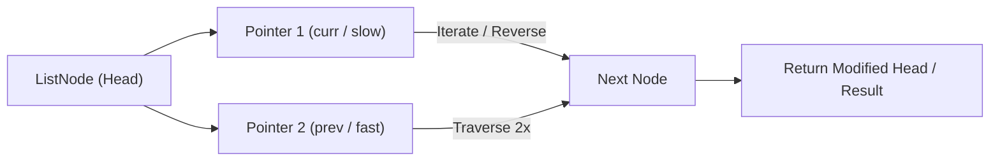

# Reverse Linked List

<div style="display:flex; gap:0.5rem; margin-bottom:1.5rem; align-items:center;">
  <span style="background:#22c55e22; color:#22c55e; padding:2px 10px; borderRadius:12px; fontWeight:600; fontSize:0.85rem;">Easy</span>
  <span style="color:#64748b; fontSize:0.85rem;">Day 9 • Striver Blind 75</span>
</div>

## 📌 Problem Overview

Given the `head` of a singly linked list, reverse the list, and return the reversed list.

### Examples & Constraints
**Example 1:**
- **Input:** `head = [1,2,3,4,5]`
- **Output:** `[5,4,3,2,1]`


**Example 2:**
- **Input:** `head = [1,2]`
- **Output:** `[2,1]`


**Constraints:**
- `0 ≤ list length ≤ 5000`

---

## 💡 Approach & Intuition

Reverse Linked List is the foundational linked list problem testing pointer manipulation.

### 🎯 Pattern Recognition
**Pattern: Pointer Reversal**

Use three pointers: previous, current, and next. Save the next node before breaking the link.

---

## 📊 Step-by-Step Execution (Mermaid Diagram)



---

## 🐢 Brute Force Solution

### Code
```javascript
// Iterative is optimal
```

- **Time Complexity:** `O(n)`
- **Space Complexity:** `O(1)`
- **Explanation:** The standard iterative approach.

---

## ⚡ Optimized Solution

### Code
```javascript
function reverseList(head) {
  let prev = null, curr = head;
  while (curr !== null) {
    const nextTemp = curr.next;
    curr.next = prev;
    prev = curr;
    curr = nextTemp;
  }
  return prev;
}
```

- **Time Complexity:** `O(n)`
- **Space Complexity:** `O(1)`
- **Explanation:** Three-pointer iterative reversal.

---

## 🐾 Step-by-Step Walkthrough

1. **Initialize State:** Setup necessary pointers, dynamic programming arrays, or hash maps.
2. **Iterate & Evaluate:** Process the input according to the boundary conditions.
3. **Update & Return:** Compute the optimal answer and return early or at termination.

### 🎙️ FAANG Interview Pitch
1. Draw a simple list and show pointer reversal
2. Explain prev, curr, nextTemp
3. Walk through one iteration

---

## 💡 Progressive Hints

1. Use three pointers: prev, curr, nextTemp.
2. Save the next node before redirecting.
3. Return prev as the new head.

---

## ⚡ Interactive Practice
👉 **[Solve this problem interactively in the DSA Lab](/DSA-Notes-Problems/dsa/problems/reverse-linked-list)**
