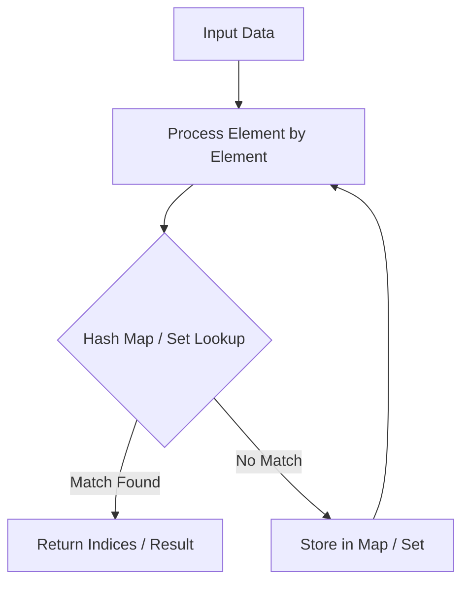

# Rotate Image

<div style="display:flex; gap:0.5rem; margin-bottom:1.5rem; align-items:center;">
  <span style="background:#f59e0b22; color:#f59e0b; padding:2px 10px; borderRadius:12px; fontWeight:600; fontSize:0.85rem;">Medium</span>
  <span style="color:#64748b; fontSize:0.85rem;">Day 10 • Striver Blind 75</span>
</div>

## 📌 Problem Overview

Rotate an `n x n` 2D matrix 90 degrees clockwise **in-place**.

### Examples & Constraints
**Example 1:**
- **Input:** `matrix = [[1,2,3],[4,5,6],[7,8,9]]`
- **Output:** `[[7,4,1],[8,5,2],[9,6,3]]`


**Constraints:**
- `n == matrix.length`
- `1 <= n <= 20`

---

## 💡 Approach & Intuition

Transpose matrix (swap `matrix[i][j]` with `matrix[j][i]`), then reverse each row.

### 🎯 Pattern Recognition
Transpose + Reverse Rows

---

## 📊 Step-by-Step Execution (Mermaid Diagram)



---

## 🐢 Brute Force Solution

### Code
```javascript
function rotate(matrix) {
  const n = matrix.length;
  for (let i = 0; i < n; i++) {
    for (let j = i + 1; j < n; j++) {
      [matrix[i][j], matrix[j][i]] = [matrix[j][i], matrix[i][j]];
    }
  }
  for (let i = 0; i < n; i++) matrix[i].reverse();
  return matrix;
}
```

- **Time Complexity:** `O(n^2)`
- **Space Complexity:** `O(1)`
- **Explanation:** In-place transpose and row reverse.

---

## ⚡ Optimized Solution

### Code
```javascript
function rotate(matrix) {
  const n = matrix.length;
  for (let i = 0; i < n; i++) {
    for (let j = i + 1; j < n; j++) {
      [matrix[i][j], matrix[j][i]] = [matrix[j][i], matrix[i][j]];
    }
  }
  for (let i = 0; i < n; i++) matrix[i].reverse();
  return matrix;
}
```

- **Time Complexity:** `O(n^2)`
- **Space Complexity:** `O(1)`
- **Explanation:** Transpose matrix diagonally, then flip rows horizontally.

---

## 🐾 Step-by-Step Walkthrough

1. **Initialize State:** Setup necessary pointers, dynamic programming arrays, or hash maps.
2. **Iterate & Evaluate:** Process the input according to the boundary conditions.
3. **Update & Return:** Compute the optimal answer and return early or at termination.

### 🎙️ FAANG Interview Pitch
Rotate 90 deg clockwise = Transpose matrix + Reverse rows.

---

## 💡 Progressive Hints

1. Transpose then reverse each row.

---

## ⚡ Interactive Practice
👉 **[Solve this problem interactively in the DSA Lab](/DSA-Notes-Problems/dsa/problems/rotate-image)**
