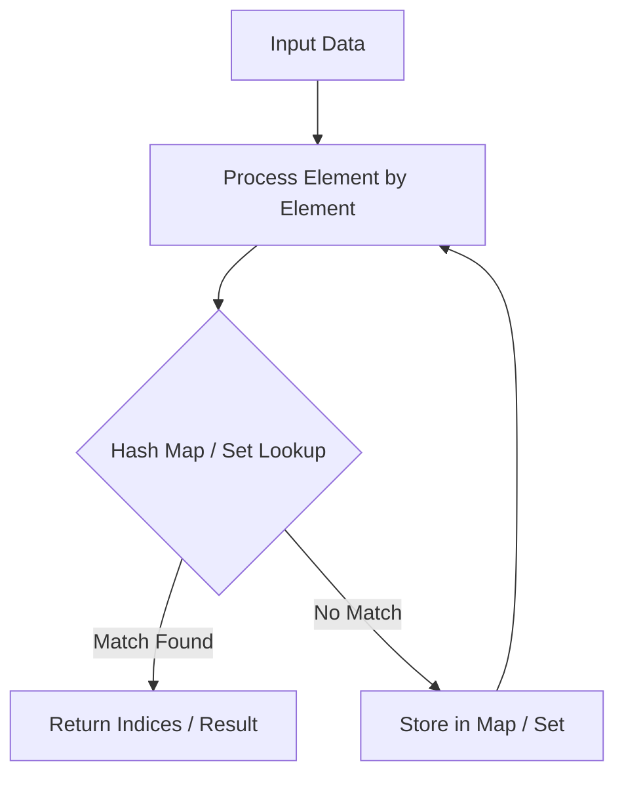

# Set Matrix Zeroes

<div style="display:flex; gap:0.5rem; margin-bottom:1.5rem; align-items:center;">
  <span style="background:#f59e0b22; color:#f59e0b; padding:2px 10px; borderRadius:12px; fontWeight:600; fontSize:0.85rem;">Medium</span>
  <span style="color:#64748b; fontSize:0.85rem;">Day 10 • Striver Blind 75</span>
</div>

## 📌 Problem Overview

Given an `m x n` integer matrix, if an element is `0`, set its entire row and column to `0` **in-place**.

### Examples & Constraints
**Example 1:**
- **Input:** `matrix = [[1,1,1],[1,0,1],[1,1,1]]`
- **Output:** `[[1,0,1],[0,0,0],[1,0,1]]`


**Constraints:**
- `1 <= m, n <= 200`

---

## 💡 Approach & Intuition

Use first row and first column as markers for zero setting.

### 🎯 Pattern Recognition
In-Place Matrix State Marking

---

## 📊 Step-by-Step Execution (Mermaid Diagram)



---

## 🐢 Brute Force Solution

### Code
```javascript
function setZeroes(matrix) {
  const m = matrix.length, n = matrix[0].length;
  let row0 = false;
  for (let r = 0; r < m; r++) {
    for (let c = 0; c < n; c++) {
      if (matrix[r][c] === 0) {
        matrix[0][c] = 0;
        if (r > 0) matrix[r][0] = 0; else row0 = true;
      }
    }
  }
  for (let r = 1; r < m; r++) {
    for (let c = 1; c < n; c++) {
      if (matrix[0][c] === 0 || matrix[r][0] === 0) matrix[r][c] = 0;
    }
  }
  if (matrix[0][0] === 0) for (let r = 0; r < m; r++) matrix[r][0] = 0;
  if (row0) for (let c = 0; c < n; c++) matrix[0][c] = 0;
  return matrix;
}
```

- **Time Complexity:** `O(m*n)`
- **Space Complexity:** `O(1)`
- **Explanation:** O(1) space matrix modification.

---

## ⚡ Optimized Solution

### Code
```javascript
function setZeroes(matrix) {
  const m = matrix.length, n = matrix[0].length;
  let row0 = false;
  for (let r = 0; r < m; r++) {
    for (let c = 0; c < n; c++) {
      if (matrix[r][c] === 0) {
        matrix[0][c] = 0;
        if (r > 0) matrix[r][0] = 0; else row0 = true;
      }
    }
  }
  for (let r = 1; r < m; r++) {
    for (let c = 1; c < n; c++) {
      if (matrix[0][c] === 0 || matrix[r][0] === 0) matrix[r][c] = 0;
    }
  }
  if (matrix[0][0] === 0) for (let r = 0; r < m; r++) matrix[r][0] = 0;
  if (row0) for (let c = 0; c < n; c++) matrix[0][c] = 0;
  return matrix;
}
```

- **Time Complexity:** `O(m*n)`
- **Space Complexity:** `O(1)`
- **Explanation:** In-place zeroing using 1st row/col as markers.

---

## 🐾 Step-by-Step Walkthrough

1. **Initialize State:** Setup necessary pointers, dynamic programming arrays, or hash maps.
2. **Iterate & Evaluate:** Process the input according to the boundary conditions.
3. **Update & Return:** Compute the optimal answer and return early or at termination.

### 🎙️ FAANG Interview Pitch
Store row/col zero status in first row and first column to achieve O(1) space.

---

## 💡 Progressive Hints

1. Use first row/column as storage.

---

## ⚡ Interactive Practice
👉 **[Solve this problem interactively in the DSA Lab](/DSA-Notes-Problems/dsa/problems/set-matrix-zeroes)**
