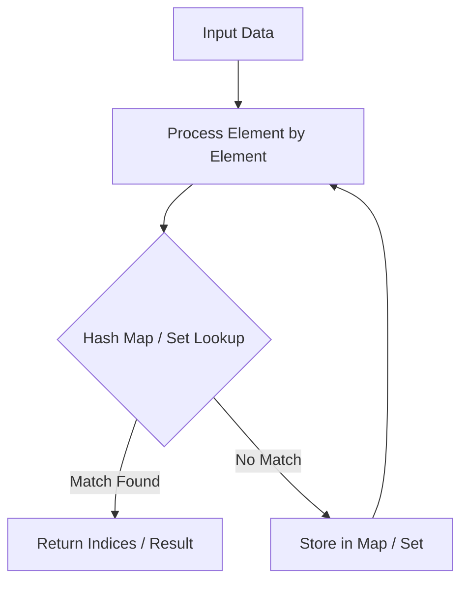

# Spiral Matrix

<div style="display:flex; gap:0.5rem; margin-bottom:1.5rem; align-items:center;">
  <span style="background:#f59e0b22; color:#f59e0b; padding:2px 10px; borderRadius:12px; fontWeight:600; fontSize:0.85rem;">Medium</span>
  <span style="color:#64748b; fontSize:0.85rem;">Day 10 • Striver Blind 75</span>
</div>

## 📌 Problem Overview

Given an `m x n` matrix, return all elements of the matrix in spiral order.

### Examples & Constraints
**Example 1:**
- **Input:** `matrix = [[1,2,3],[4,5,6],[7,8,9]]`
- **Output:** `[1,2,3,6,9,8,7,4,5]`


**Constraints:**
- `1 <= m, n <= 10`

---

## 💡 Approach & Intuition

4 boundaries (top, bottom, left, right) narrowed after each traversal leg.

### 🎯 Pattern Recognition
Matrix Boundary Shrinking

---

## 📊 Step-by-Step Execution (Mermaid Diagram)



---

## 🐢 Brute Force Solution

### Code
```javascript
function spiralOrder(matrix) {
  const res = [];
  let top = 0, bottom = matrix.length - 1, left = 0, right = matrix[0].length - 1;
  while (top <= bottom && left <= right) {
    for (let c = left; c <= right; c++) res.push(matrix[top][c]); top++;
    for (let r = top; r <= bottom; r++) res.push(matrix[r][right]); right--;
    if (top <= bottom) { for (let c = right; c >= left; c--) res.push(matrix[bottom][c]); bottom--; }
    if (left <= right) { for (let r = bottom; r >= top; r--) res.push(matrix[r][left]); left++; }
  }
  return res;
}
```

- **Time Complexity:** `O(m*n)`
- **Space Complexity:** `O(1)`
- **Explanation:** Boundary contraction.

---

## ⚡ Optimized Solution

### Code
```javascript
function spiralOrder(matrix) {
  const res = [];
  let top = 0, bottom = matrix.length - 1, left = 0, right = matrix[0].length - 1;
  while (top <= bottom && left <= right) {
    for (let c = left; c <= right; c++) res.push(matrix[top][c]); top++;
    for (let r = top; r <= bottom; r++) res.push(matrix[r][right]); right--;
    if (top <= bottom) { for (let c = right; c >= left; c--) res.push(matrix[bottom][c]); bottom--; }
    if (left <= right) { for (let r = bottom; r >= top; r--) res.push(matrix[r][left]); left++; }
  }
  return res;
}
```

- **Time Complexity:** `O(m*n)`
- **Space Complexity:** `O(1)`
- **Explanation:** Layer-by-layer boundary shrinking traversal.

---

## 🐾 Step-by-Step Walkthrough

1. **Initialize State:** Setup necessary pointers, dynamic programming arrays, or hash maps.
2. **Iterate & Evaluate:** Process the input according to the boundary conditions.
3. **Update & Return:** Compute the optimal answer and return early or at termination.

### 🎙️ FAANG Interview Pitch
Traverse right, down, left, up while shrinking top/bottom/left/right boundary bounds.

---

## 💡 Progressive Hints

1. Maintain top, bottom, left, right boundaries.

---

## ⚡ Interactive Practice
👉 **[Solve this problem interactively in the DSA Lab](/DSA-Notes-Problems/dsa/problems/spiral-matrix)**
