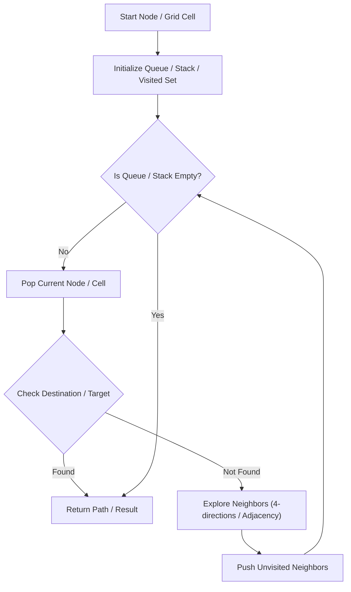

# Word Search

<div style="display:flex; gap:0.5rem; margin-bottom:1.5rem; align-items:center;">
  <span style="background:#f59e0b22; color:#f59e0b; padding:2px 10px; borderRadius:12px; fontWeight:600; fontSize:0.85rem;">Medium</span>
  <span style="color:#64748b; fontSize:0.85rem;">Day 10 • Striver Blind 75</span>
</div>

## 📌 Problem Overview

Given an `m x n` grid of characters `board` and a string `word`, return `true` if `word` exists in the grid.

### Examples & Constraints
**Example 1:**
- **Input:** `board = [["A","B","C","E"],["S","F","C","S"],["A","D","E","E"]], word = "ABCCED"`
- **Output:** `true`


**Constraints:**
- `1 <= m, n <= 6`
- `1 <= word.length <= 15`

---

## 💡 Approach & Intuition

DFS backtracking from each grid cell, marking visited cells temporarily.

### 🎯 Pattern Recognition
2D Grid DFS Backtracking

---

## 📊 Step-by-Step Execution (Mermaid Diagram)



---

## 🐢 Brute Force Solution

### Code
```javascript
function exist(board, word) {
  const m = board.length, n = board[0].length;
  function dfs(r, c, i) {
    if (i === word.length) return true;
    if (r < 0 || c < 0 || r >= m || c >= n || board[r][c] !== word[i]) return false;
    const temp = board[r][c]; board[r][c] = '#';
    const res = dfs(r+1,c,i+1) || dfs(r-1,c,i+1) || dfs(r,c+1,i+1) || dfs(r,c-1,i+1);
    board[r][c] = temp;
    return res;
  }
  for (let r = 0; r < m; r++) for (let c = 0; c < n; c++) if (dfs(r, c, 0)) return true;
  return false;
}
```

- **Time Complexity:** `O(N * 4^L)`
- **Space Complexity:** `O(L)`
- **Explanation:** Recursive DFS backtracking.

---

## ⚡ Optimized Solution

### Code
```javascript
function exist(board, word) {
  const m = board.length, n = board[0].length;
  function dfs(r, c, i) {
    if (i === word.length) return true;
    if (r < 0 || c < 0 || r >= m || c >= n || board[r][c] !== word[i]) return false;
    const temp = board[r][c]; board[r][c] = '#';
    const res = dfs(r+1,c,i+1) || dfs(r-1,c,i+1) || dfs(r,c+1,i+1) || dfs(r,c-1,i+1);
    board[r][c] = temp;
    return res;
  }
  for (let r = 0; r < m; r++) for (let c = 0; c < n; c++) if (dfs(r, c, 0)) return true;
  return false;
}
```

- **Time Complexity:** `O(N * 4^L)`
- **Space Complexity:** `O(L)`
- **Explanation:** Backtracking with in-place cell marking.

---

## 🐾 Step-by-Step Walkthrough

1. **Initialize State:** Setup necessary pointers, dynamic programming arrays, or hash maps.
2. **Iterate & Evaluate:** Process the input according to the boundary conditions.
3. **Update & Return:** Compute the optimal answer and return early or at termination.

### 🎙️ FAANG Interview Pitch
Start DFS at matching cells; temporarily mutate cell value to '#' to prevent reusing.

---

## 💡 Progressive Hints

1. Backtracking DFS from each cell.

---

## ⚡ Interactive Practice
👉 **[Solve this problem interactively in the DSA Lab](/DSA-Notes-Problems/dsa/problems/word-search)**
