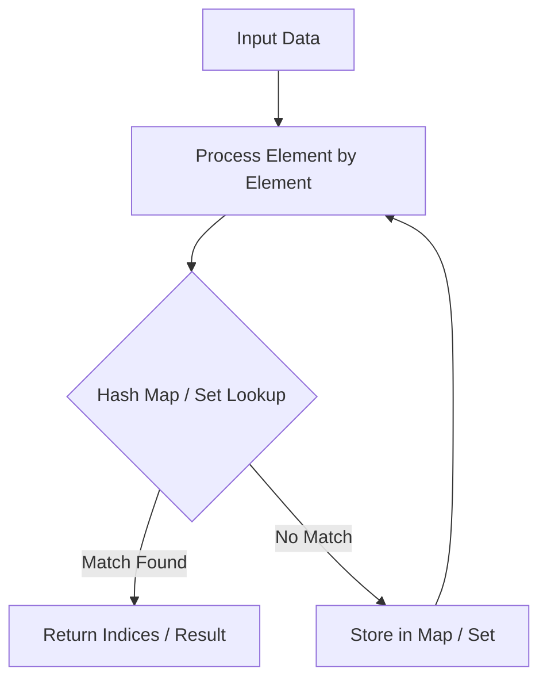

# Encode and Decode Strings

<div style="display:flex; gap:0.5rem; margin-bottom:1.5rem; align-items:center;">
  <span style="background:#f59e0b22; color:#f59e0b; padding:2px 10px; borderRadius:12px; fontWeight:600; fontSize:0.85rem;">Medium</span>
  <span style="color:#64748b; fontSize:0.85rem;">Day 12 • Striver Blind 75</span>
</div>

## 📌 Problem Overview

Design an algorithm to encode a list of strings to a single string, and decode it back.

### Examples & Constraints
**Example 1:**
- **Input:** `strs = ["leet","code","love","you"]`
- **Output:** `["leet","code","love","you"]`


**Constraints:**
- `0 <= strs.length <= 200`

---

## 💡 Approach & Intuition

Prefix each string with length and a delimiter (e.g., `4#leet4#code`).

### 🎯 Pattern Recognition
Length Prefix Framing

---

## 📊 Step-by-Step Execution (Mermaid Diagram)



---

## 🐢 Brute Force Solution

### Code
```javascript
function encode(strs) {
  return strs.map(s => s.length + '#' + s).join('');
}
function decode(s) {
  const res = [];
  let i = 0;
  while (i < s.length) {
    let j = s.indexOf('#', i);
    let len = parseInt(s.substring(i, j));
    res.push(s.substring(j + 1, j + 1 + len));
    i = j + 1 + len;
  }
  return res;
}
function encodeDecode(strs) {
  return decode(encode(strs));
}
```

- **Time Complexity:** `O(N)`
- **Space Complexity:** `O(N)`
- **Explanation:** Length-delimited framing.

---

## ⚡ Optimized Solution

### Code
```javascript
function encode(strs) {
  return strs.map(s => s.length + '#' + s).join('');
}
function decode(s) {
  const res = [];
  let i = 0;
  while (i < s.length) {
    let j = s.indexOf('#', i);
    let len = parseInt(s.substring(i, j));
    res.push(s.substring(j + 1, j + 1 + len));
    i = j + 1 + len;
  }
  return res;
}
function encodeDecode(strs) {
  return decode(encode(strs));
}
```

- **Time Complexity:** `O(N)`
- **Space Complexity:** `O(N)`
- **Explanation:** Chunk length prefix encoding.

---

## 🐾 Step-by-Step Walkthrough

1. **Initialize State:** Setup necessary pointers, dynamic programming arrays, or hash maps.
2. **Iterate & Evaluate:** Process the input according to the boundary conditions.
3. **Update & Return:** Compute the optimal answer and return early or at termination.

### 🎙️ FAANG Interview Pitch
Prefixing length before delimiter makes parsing unambiguous regardless of internal string characters.

---

## 💡 Progressive Hints

1. Format each string as length + '#' + string.

---

## ⚡ Interactive Practice
👉 **[Solve this problem interactively in the DSA Lab](/DSA-Notes-Problems/dsa/problems/encode-and-decode-strings)**
