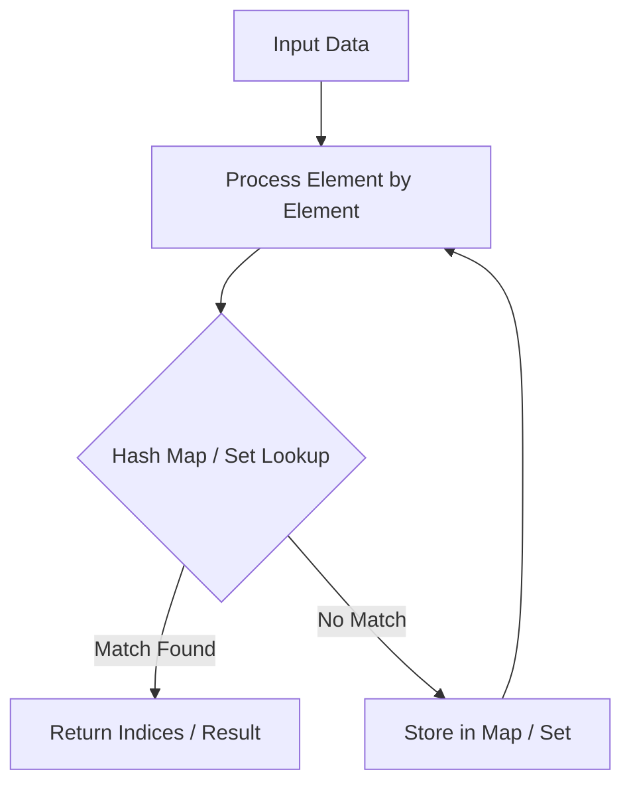

# Group Anagrams

<div style="display:flex; gap:0.5rem; margin-bottom:1.5rem; align-items:center;">
  <span style="background:#f59e0b22; color:#f59e0b; padding:2px 10px; borderRadius:12px; fontWeight:600; fontSize:0.85rem;">Medium</span>
  <span style="color:#64748b; fontSize:0.85rem;">Day 11 • Striver Blind 75</span>
</div>

## 📌 Problem Overview

Given an array of strings `strs`, group the **anagrams** together. You can return the answer in **any order**.

### Examples & Constraints
**Example 1:**
- **Input:** `strs = ["eat","tea","tan","ate","nat","bat"]`
- **Output:** `[["bat"],["nat","tan"],["ate","eat","tea"]]`


**Example 2:**
- **Input:** `strs = [""]`
- **Output:** `[[""]]`


**Constraints:**
- `1 ≤ strs.length ≤ 10⁴`
- `0 ≤ strs[i].length ≤ 100`
- `strs[i] consists of lowercase English letters only`

---

## 💡 Approach & Intuition

Group Anagrams builds on Valid Anagram by using a canonical signature (sorted string) as a hash map key to bucket similar strings together.

### 🎯 Pattern Recognition
**Pattern: Canonical Key Hashing**

When grouping items that are equivalent under some transformation, map each item to a canonical form and use it as a hash map key.

---

## 📊 Step-by-Step Execution (Mermaid Diagram)



---

## 🐢 Brute Force Solution

### Code
```javascript
function groupAnagrams(strs) {
  const groups = [];
  const used = new Array(strs.length).fill(false);
  for (let i = 0; i < strs.length; i++) {
    if (used[i]) continue;
    const group = [strs[i]];
    used[i] = true;
    for (let j = i + 1; j < strs.length; j++) {
      if (!used[j] && [...strs[i]].sort().join('') === [...strs[j]].sort().join('')) {
        group.push(strs[j]);
        used[j] = true;
      }
    }
    groups.push(group);
  }
  return groups;
}
```

- **Time Complexity:** `O(n² k log k)`
- **Space Complexity:** `O(n k)`
- **Explanation:** Compare every pair of strings by their sorted form.

---

## ⚡ Optimized Solution

### Code
```javascript
function groupAnagrams(strs) {
  const map = new Map();
  for (const s of strs) {
    const key = [...s].sort().join('');
    if (!map.has(key)) map.set(key, []);
    map.get(key).push(s);
  }
  return [...map.values()];
}
```

- **Time Complexity:** `O(n k log k)`
- **Space Complexity:** `O(n k)`
- **Explanation:** Hash map keyed by sorted string signature.

---

## 🐾 Step-by-Step Walkthrough

1. **Initialize State:** Setup necessary pointers, dynamic programming arrays, or hash maps.
2. **Iterate & Evaluate:** Process the input according to the boundary conditions.
3. **Update & Return:** Compute the optimal answer and return early or at termination.

### 🎙️ FAANG Interview Pitch
1. Recognize anagrams share a sorted form
2. Use the sorted string as a hash map key
3. Explain the O(n k log k) cost of sorting each string
4. Mention the 26-count array as a faster key alternative

---

## 💡 Progressive Hints

1. Two strings are anagrams if their sorted forms match.
2. Use the sorted string as a hash map key.
3. Group original strings under their canonical key.

---

## ⚡ Interactive Practice
👉 **[Solve this problem interactively in the DSA Lab](/DSA-Notes-Problems/dsa/problems/group-anagrams)**
