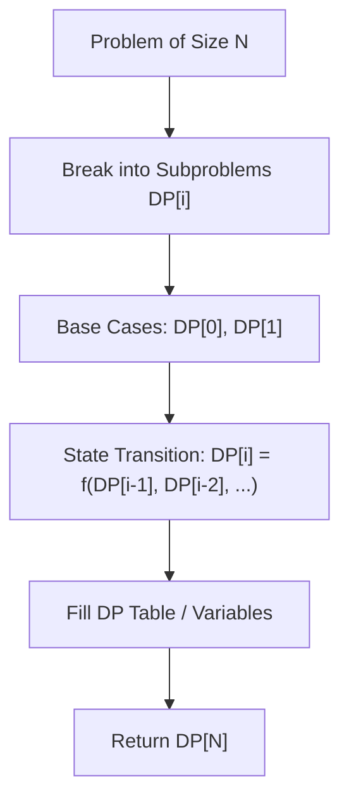

# Longest Palindromic Substring

<div style="display:flex; gap:0.5rem; margin-bottom:1.5rem; align-items:center;">
  <span style="background:#f59e0b22; color:#f59e0b; padding:2px 10px; borderRadius:12px; fontWeight:600; fontSize:0.85rem;">Medium</span>
  <span style="color:#64748b; fontSize:0.85rem;">Day 12 • Striver Blind 75</span>
</div>

## 📌 Problem Overview

Given a string `s`, return the longest palindromic substring in `s`.

### Examples & Constraints
**Example 1:**
- **Input:** `s = "babad"`
- **Output:** `"bab"`
- **Explanation:** "aba" is also a valid answer.

**Constraints:**
- `1 <= s.length <= 1000`

---

## 💡 Approach & Intuition

Expand around center for both odd and even length palindromes.

### 🎯 Pattern Recognition
Expand Around Center

---

## 📊 Step-by-Step Execution (Mermaid Diagram)



---

## 🐢 Brute Force Solution

### Code
```javascript
function longestPalindrome(s) {
  let res = "";
  function expand(l, r) {
    while (l >= 0 && r < s.length && s[l] === s[r]) { l--; r++; }
    if (r - l - 1 > res.length) res = s.substring(l + 1, r);
  }
  for (let i = 0; i < s.length; i++) {
    expand(i, i);
    expand(i, i + 1);
  }
  return res;
}
```

- **Time Complexity:** `O(n^2)`
- **Space Complexity:** `O(1)`
- **Explanation:** Expand around center.

---

## ⚡ Optimized Solution

### Code
```javascript
function longestPalindrome(s) {
  let res = "";
  function expand(l, r) {
    while (l >= 0 && r < s.length && s[l] === s[r]) { l--; r++; }
    if (r - l - 1 > res.length) res = s.substring(l + 1, r);
  }
  for (let i = 0; i < s.length; i++) {
    expand(i, i);
    expand(i, i + 1);
  }
  return res;
}
```

- **Time Complexity:** `O(n^2)`
- **Space Complexity:** `O(1)`
- **Explanation:** Expand around all n centers.

---

## 🐾 Step-by-Step Walkthrough

1. **Initialize State:** Setup necessary pointers, dynamic programming arrays, or hash maps.
2. **Iterate & Evaluate:** Process the input according to the boundary conditions.
3. **Update & Return:** Compute the optimal answer and return early or at termination.

### 🎙️ FAANG Interview Pitch
Treat each character (and pair of characters) as center of a potential palindrome.

---

## 💡 Progressive Hints

1. Expand outwards from every index i as center.

---

## ⚡ Interactive Practice
👉 **[Solve this problem interactively in the DSA Lab](/DSA-Notes-Problems/dsa/problems/longest-palindromic-substring)**
