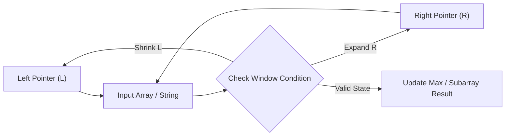

# Longest Repeating Character Replacement

<div style="display:flex; gap:0.5rem; margin-bottom:1.5rem; align-items:center;">
  <span style="background:#f59e0b22; color:#f59e0b; padding:2px 10px; borderRadius:12px; fontWeight:600; fontSize:0.85rem;">Medium</span>
  <span style="color:#64748b; fontSize:0.85rem;">Day 11 • Striver Blind 75</span>
</div>

## 📌 Problem Overview

You are given a string `s` and an integer `k`. You can choose any character and change it to any other uppercase English character, at most `k` times.

Return the length of the longest substring containing the same letter after performing the above operations.

### Examples & Constraints
**Example 1:**
- **Input:** `s = "ABAB", k = 2`
- **Output:** `4`


**Example 2:**
- **Input:** `s = "AABABBA", k = 1`
- **Output:** `4`


**Constraints:**
- `1 ≤ s.length ≤ 10⁵`
- `s consists of only uppercase English letters`
- `0 ≤ k ≤ s.length`

---

## 💡 Approach & Intuition

Longest Repeating Character Replacement tests variable-size sliding window combined with tracking the max character frequency inside it.

### 🎯 Pattern Recognition
**Pattern: Sliding Window with Max Frequency**

A window is achievable with at most k replacements when windowSize - maxFreq ≤ k. Track maxFreq as the window grows; shrink only when the condition breaks.

---

## 📊 Step-by-Step Execution (Mermaid Diagram)



---

## 🐢 Brute Force Solution

### Code
```javascript
function characterReplacement(s, k) {
  let longest = 0;
  for (let i = 0; i < s.length; i++) {
    const counts = {};
    let maxFreq = 0;
    for (let j = i; j < s.length; j++) {
      counts[s[j]] = (counts[s[j]] || 0) + 1;
      maxFreq = Math.max(maxFreq, counts[s[j]]);
      if (j - i + 1 - maxFreq <= k) longest = Math.max(longest, j - i + 1);
    }
  }
  return longest;
}
```

- **Time Complexity:** `O(n²)`
- **Space Complexity:** `O(1)`
- **Explanation:** Check every substring's validity directly.

---

## ⚡ Optimized Solution

### Code
```javascript
function characterReplacement(s, k) {
  const counts = {};
  let left = 0, maxFreq = 0, longest = 0;
  for (let right = 0; right < s.length; right++) {
    counts[s[right]] = (counts[s[right]] || 0) + 1;
    maxFreq = Math.max(maxFreq, counts[s[right]]);
    while (right - left + 1 - maxFreq > k) {
      counts[s[left]]--;
      left++;
    }
    longest = Math.max(longest, right - left + 1);
  }
  return longest;
}
```

- **Time Complexity:** `O(n)`
- **Space Complexity:** `O(1)`
- **Explanation:** Sliding window tracking maxFreq, shrinking only when needed.

---

## 🐾 Step-by-Step Walkthrough

1. **Initialize State:** Setup necessary pointers, dynamic programming arrays, or hash maps.
2. **Iterate & Evaluate:** Process the input according to the boundary conditions.
3. **Update & Return:** Compute the optimal answer and return early or at termination.

### 🎙️ FAANG Interview Pitch
1. Brute force recomputes validity per substring — O(n²) or worse
2. Slide a window, tracking character counts and maxFreq
3. A window is valid when windowSize - maxFreq ≤ k
4. Shrink from the left only when the window becomes invalid

---

## 💡 Progressive Hints

1. Track a frequency count of characters in the current window.
2. Track maxFreq, the count of the most frequent character seen so far.
3. If windowSize - maxFreq > k, shrink the window from the left.

---

## ⚡ Interactive Practice
👉 **[Solve this problem interactively in the DSA Lab](/DSA-Notes-Problems/dsa/problems/longest-repeating-character-replacement)**
