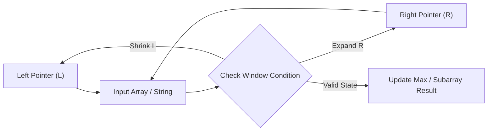

# Longest Substring Without Repeating Characters

<div style="display:flex; gap:0.5rem; margin-bottom:1.5rem; align-items:center;">
  <span style="background:#f59e0b22; color:#f59e0b; padding:2px 10px; borderRadius:12px; fontWeight:600; fontSize:0.85rem;">Medium</span>
  <span style="color:#64748b; fontSize:0.85rem;">Day 11 • Striver Blind 75</span>
</div>

## 📌 Problem Overview

Given a string `s`, find the length of the **longest substring** without repeating characters.

### Examples & Constraints
**Example 1:**
- **Input:** `s = "abcabcbb"`
- **Output:** `3`
- **Explanation:** The answer is "abc", with the length of 3.

**Example 2:**
- **Input:** `s = "bbbbb"`
- **Output:** `1`
- **Explanation:** The answer is "b", with the length of 1.

**Example 3:**
- **Input:** `s = "pwwkew"`
- **Output:** `3`
- **Explanation:** The answer is "wke", with the length of 3.

**Example 4:**
- **Input:** `s = ""`
- **Output:** `0`


**Constraints:**
- `0 ≤ s.length ≤ 5 × 10⁴`
- `s consists of English letters, digits, symbols, and spaces.`

---

## 💡 Approach & Intuition

**Why this problem exists:**
This is the quintessential sliding window problem. It teaches the expand-contract pattern for finding optimal subarrays/substrings.

**What it teaches:**
• Sliding window technique
• Using a hash map/set to track window state
• Expanding right bound, contracting left bound on conflict

**Interview relevance:**
The most important sliding window problem. Master this to unlock all sliding window patterns.

### 🎯 Pattern Recognition
**Pattern: Sliding Window**

Use two pointers (left, right) to maintain a window. Expand the right pointer, and when a conflict (duplicate) is found, shrink from the left until resolved.

**When to use this pattern:**
• Finding optimal subarrays/substrings
• Problems with constraints on window contents
• Maximum/minimum window that satisfies a condition

---

## 📊 Step-by-Step Execution (Mermaid Diagram)



---

## 🐢 Brute Force Solution

### Code
```javascript
function lengthOfLongestSubstring(s) {
  let maxLen = 0;
  for (let i = 0; i < s.length; i++) {
    const seen = new Set();
    for (let j = i; j < s.length; j++) {
      if (seen.has(s[j])) break;
      seen.add(s[j]);
      maxLen = Math.max(maxLen, j - i + 1);
    }
  }
  return maxLen;
}
```

- **Time Complexity:** `O(n²)`
- **Space Complexity:** `O(min(m, n))`
- **Explanation:** Check every possible starting position and extend until a duplicate is found — O(n²) worst case.

---

## ⚡ Optimized Solution

### Code
```javascript
function lengthOfLongestSubstring(s) {
  let left = 0, maxLen = 0;
  const charMap = new Map();
  
  for (let right = 0; right < s.length; right++) {
    const char = s[right];
    
    if (charMap.has(char) && charMap.get(char) >= left) {
      left = charMap.get(char) + 1;
    }
    
    charMap.set(char, right);
    maxLen = Math.max(maxLen, right - left + 1);
  }
  
  return maxLen;
}
```

- **Time Complexity:** `O(n)`
- **Space Complexity:** `O(min(m, n))`
- **Explanation:** Sliding window with a hash map. Right pointer expands, left pointer jumps past the last occurrence of a duplicate char. O(n) — each character processed once.

---

## 🐾 Step-by-Step Walkthrough

1. **Initialize State:** Setup necessary pointers, dynamic programming arrays, or hash maps.
2. **Iterate & Evaluate:** Process the input according to the boundary conditions.
3. **Update & Return:** Compute the optimal answer and return early or at termination.

### 🎙️ FAANG Interview Pitch
**How to explain:**
1. Brute force: check all substrings O(n²)
2. Optimize with sliding window: maintain [left, right) with no repeats
3. When right sees a duplicate in the window, jump left past the previous occurrence
4. Use a hash map to store the last seen index of each character

**Follow-ups:**
• "What about longest substring with at most k distinct characters?" → Same sliding window, different shrink condition
• "What about longest substring with at least k repeating characters?" → Divide and conquer with sliding window
• "What if you need to return the substring, not the length?" → Track the maxLen start/end indices

---

## 💡 Progressive Hints

1. Use two pointers: left and right to maintain the current window.
2. Use a Set or Map to track characters in the current window.
3. When a duplicate is found, move left forward until the duplicate is removed.

---

## ⚡ Interactive Practice
👉 **[Solve this problem interactively in the DSA Lab](/DSA-Notes-Problems/dsa/problems/longest-substring-without-repeating)**
