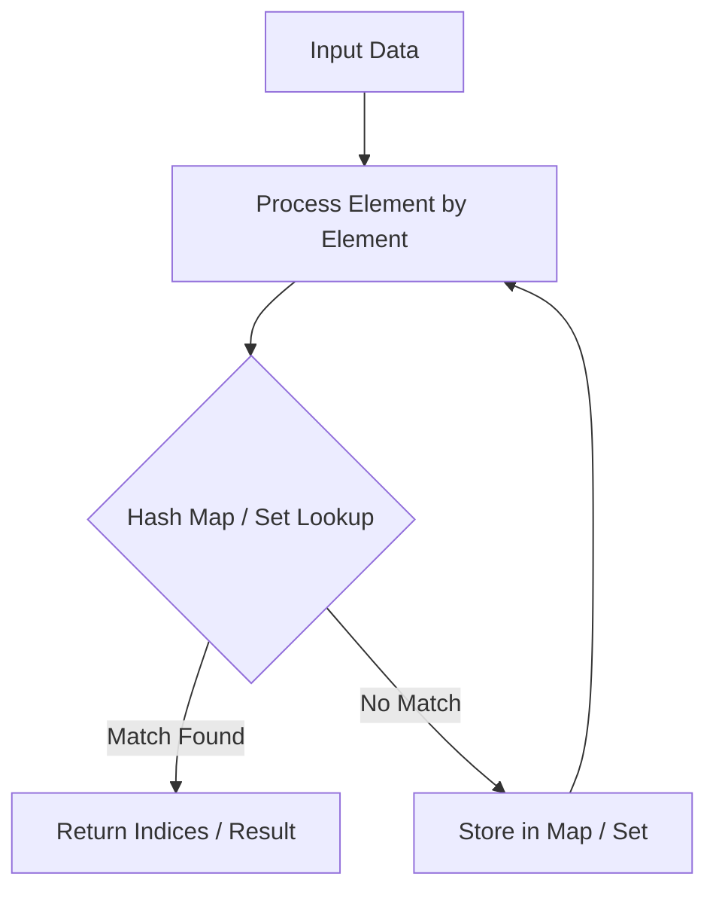

# Minimum Window Substring

<div style="display:flex; gap:0.5rem; margin-bottom:1.5rem; align-items:center;">
  <span style="background:#ef444422; color:#ef4444; padding:2px 10px; borderRadius:12px; fontWeight:600; fontSize:0.85rem;">Hard</span>
  <span style="color:#64748b; fontSize:0.85rem;">Day 11 • Striver Blind 75</span>
</div>

## 📌 Problem Overview

Given two strings `s` and `t`, return the minimum window substring of `s` such that every character in `t` (including duplicates) is included in the window. If no such substring exists, return the empty string `""`. The answer is guaranteed to be unique.

### Examples & Constraints
**Example 1:**
- **Input:** `s = "ADOBECODEBANC", t = "ABC"`
- **Output:** `"BANC"`


**Example 2:**
- **Input:** `s = "a", t = "a"`
- **Output:** `"a"`


**Constraints:**
- `m == s.length`
- `n == t.length`
- `1 ≤ m, n ≤ 10⁵`
- `s and t consist of uppercase and lowercase English letters`

---

## 💡 Approach & Intuition

Minimum Window Substring is the hardest classic sliding window problem: a variable-size window that expands to satisfy a constraint and shrinks to minimize.

### 🎯 Pattern Recognition
**Pattern: Variable Window, Expand-Then-Shrink**

Expand the window until it satisfies the constraint (contains all of t), then greedily shrink from the left while it still satisfies the constraint, recording the best window at each valid state.

---

## 📊 Step-by-Step Execution (Mermaid Diagram)



---

## 🐢 Brute Force Solution

### Code
```javascript
// Checking every substring against t's requirements is O(n^2) or worse
```

- **Time Complexity:** `O(n²)`
- **Space Complexity:** `O(n)`
- **Explanation:** Check every substring for containing all characters of t.

---

## ⚡ Optimized Solution

### Code
```javascript
function minWindow(s, t) {
  if (!s || !t) return '';
  const need = new Map();
  for (const c of t) need.set(c, (need.get(c) || 0) + 1);
  const required = need.size;
  let formed = 0;
  const windowCounts = new Map();
  let left = 0, bestLen = Infinity, bestStart = 0;
  for (let right = 0; right < s.length; right++) {
    const c = s[right];
    windowCounts.set(c, (windowCounts.get(c) || 0) + 1);
    if (need.has(c) && windowCounts.get(c) === need.get(c)) formed++;
    while (formed === required) {
      if (right - left + 1 < bestLen) {
        bestLen = right - left + 1;
        bestStart = left;
      }
      const lc = s[left];
      windowCounts.set(lc, windowCounts.get(lc) - 1);
      if (need.has(lc) && windowCounts.get(lc) < need.get(lc)) formed--;
      left++;
    }
  }
  return bestLen === Infinity ? '' : s.slice(bestStart, bestStart + bestLen);
}
```

- **Time Complexity:** `O(m + n)`
- **Space Complexity:** `O(m + n)`
- **Explanation:** Expand right to satisfy the window, shrink left to minimize it.

---

## 🐾 Step-by-Step Walkthrough

1. **Initialize State:** Setup necessary pointers, dynamic programming arrays, or hash maps.
2. **Iterate & Evaluate:** Process the input according to the boundary conditions.
3. **Update & Return:** Compute the optimal answer and return early or at termination.

### 🎙️ FAANG Interview Pitch
1. Build required character counts from t
2. Expand right pointer, tracking when the window fully satisfies t (formed === required)
3. Once valid, shrink from the left greedily, recording the smallest valid window
4. Continue until right reaches the end of s

---

## 💡 Progressive Hints

1. Build a frequency count of characters needed from t.
2. Expand the window with a right pointer until all of t's characters are satisfied.
3. Once valid, shrink from the left as much as possible while tracking the smallest valid window.

---

## ⚡ Interactive Practice
👉 **[Solve this problem interactively in the DSA Lab](/DSA-Notes-Problems/dsa/problems/minimum-window-substring)**
