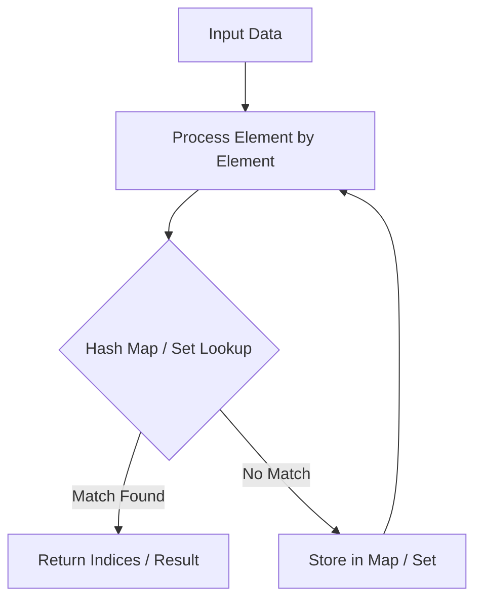

# Valid Anagram

<div style="display:flex; gap:0.5rem; margin-bottom:1.5rem; align-items:center;">
  <span style="background:#22c55e22; color:#22c55e; padding:2px 10px; borderRadius:12px; fontWeight:600; fontSize:0.85rem;">Easy</span>
  <span style="color:#64748b; fontSize:0.85rem;">Day 11 • Striver Blind 75</span>
</div>

## 📌 Problem Overview

Given two strings `s` and `t`, return `true` if `t` is an anagram of `s`, and `false` otherwise.

An anagram is a word or phrase formed by rearranging the letters of a different word or phrase, typically using all the original letters exactly once.

### Examples & Constraints
**Example 1:**
- **Input:** `s = "anagram", t = "nagaram"`
- **Output:** `true`


**Example 2:**
- **Input:** `s = "rat", t = "car"`
- **Output:** `false`


**Constraints:**
- `1 ≤ s.length, t.length ≤ 5 × 10⁴`
- `s and t consist of lowercase English letters`

---

## 💡 Approach & Intuition

Valid Anagram tests your ability to compare character frequencies efficiently using a hash map or fixed-size counting array.

### 🎯 Pattern Recognition
**Pattern: Frequency Counting**

When comparing whether two collections contain the same elements (ignoring order), count occurrences of each element and compare the counts.

---

## 📊 Step-by-Step Execution (Mermaid Diagram)



---

## 🐢 Brute Force Solution

### Code
```javascript
function isAnagram(s, t) {
  return s.split('').sort().join('') === t.split('').sort().join('');
}
```

- **Time Complexity:** `O(n log n)`
- **Space Complexity:** `O(n)`
- **Explanation:** Sort both strings and compare.

---

## ⚡ Optimized Solution

### Code
```javascript
function isAnagram(s, t) {
  if (s.length !== t.length) return false;
  const counts = new Map();
  for (const c of s) counts.set(c, (counts.get(c) || 0) + 1);
  for (const c of t) {
    if (!counts.get(c)) return false;
    counts.set(c, counts.get(c) - 1);
  }
  return true;
}
```

- **Time Complexity:** `O(n)`
- **Space Complexity:** `O(1)`
- **Explanation:** Count characters in one pass, decrement in the other.

---

## 🐾 Step-by-Step Walkthrough

1. **Initialize State:** Setup necessary pointers, dynamic programming arrays, or hash maps.
2. **Iterate & Evaluate:** Process the input according to the boundary conditions.
3. **Update & Return:** Compute the optimal answer and return early or at termination.

### 🎙️ FAANG Interview Pitch
**How to explain:**
1. Start with sorting-based comparison
2. Point out sorting costs O(n log n)
3. Move to frequency counting with a hash map for O(n)
4. Early exit on length mismatch

---

## 💡 Progressive Hints

1. If the lengths differ, they can't be anagrams.
2. Count the frequency of each character in both strings.
3. A hash map or a 26-element array works well for lowercase letters.

---

## ⚡ Interactive Practice
👉 **[Solve this problem interactively in the DSA Lab](/DSA-Notes-Problems/dsa/problems/valid-anagram)**
