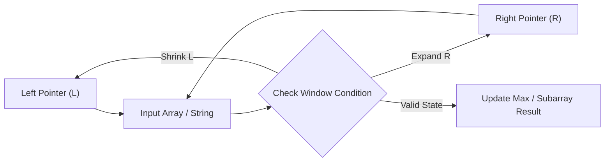

# Valid Palindrome

<div style="display:flex; gap:0.5rem; margin-bottom:1.5rem; align-items:center;">
  <span style="background:#22c55e22; color:#22c55e; padding:2px 10px; borderRadius:12px; fontWeight:600; fontSize:0.85rem;">Easy</span>
  <span style="color:#64748b; fontSize:0.85rem;">Day 12 • Striver Blind 75</span>
</div>

## 📌 Problem Overview

A phrase is a **palindrome** if, after converting all uppercase letters to lowercase and removing all non-alphanumeric characters, it reads the same forward and backward.

Given a string `s`, return `true` if it is a **palindrome**, or `false` otherwise.

### Examples & Constraints
**Example 1:**
- **Input:** `s = "A man, a plan, a canal: Panama"`
- **Output:** `true`
- **Explanation:** "amanaplanacanalpanama" is a palindrome.

**Example 2:**
- **Input:** `s = "race a car"`
- **Output:** `false`
- **Explanation:** "raceacar" is not a palindrome.

**Example 3:**
- **Input:** `s = " "`
- **Output:** `true`
- **Explanation:** s is an empty string "" after removing non-alphanumeric characters.

**Constraints:**
- `1 ≤ s.length ≤ 2 × 10⁵`
- `s consists only of printable ASCII characters.`

---

## 💡 Approach & Intuition

**Why this problem exists:**
Valid Palindrome is the gateway problem for the two-pointer technique. It's often the first problem taught in the two-pointer pattern.

**What it teaches:**
• Two-pointer technique on strings
• Character validation (alphanumeric checking)
• In-place string processing without extra space

**Interview relevance:**
A warm-up problem that establishes the two-pointer pattern used in harder problems like 3Sum and container with most water.

### 🎯 Pattern Recognition
**Pattern: Two Pointers from Ends**

Place one pointer at the start and one at the end. Move them toward each other, comparing characters as you go. Skip non-alphanumeric characters.

**When to use this pattern:**
• Checking palindromes
• Reversing arrays/strings in-place
• Finding pairs that satisfy a condition in a sorted array

---

## 📊 Step-by-Step Execution (Mermaid Diagram)



---

## 🐢 Brute Force Solution

### Code
```javascript
function isPalindrome(s) {
  const cleaned = s.toLowerCase().replace(/[^a-z0-9]/g, '');
  return cleaned === cleaned.split('').reverse().join('');
}
```

- **Time Complexity:** `O(n)`
- **Space Complexity:** `O(n)`
- **Explanation:** Clean the string, reverse it, compare. O(n) time but O(n) extra space for the reversed string.

---

## ⚡ Optimized Solution

### Code
```javascript
function isPalindrome(s) {
  let left = 0, right = s.length - 1;
  
  while (left < right) {
    while (left < right && !/[a-zA-Z0-9]/.test(s[left])) left++;
    while (left < right && !/[a-zA-Z0-9]/.test(s[right])) right--;
    
    if (s[left].toLowerCase() !== s[right].toLowerCase()) return false;
    left++;
    right--;
  }
  
  return true;
}
```

- **Time Complexity:** `O(n)`
- **Space Complexity:** `O(1)`
- **Explanation:** Two pointers from ends. Skip non-alphanumeric characters, compare the letters (case-insensitive), and move inward. No extra space needed.

---

## 🐾 Step-by-Step Walkthrough

1. **Initialize State:** Setup necessary pointers, dynamic programming arrays, or hash maps.
2. **Iterate & Evaluate:** Process the input according to the boundary conditions.
3. **Update & Return:** Compute the optimal answer and return early or at termination.

### 🎙️ FAANG Interview Pitch
**How to explain:**
1. Start with the naive approach: clean, reverse, compare
2. Note the O(n) space is not ideal
3. Two-pointer approach: left and right moving inward, skipping non-alphanumeric characters
4. Only O(1) extra space

**Follow-ups:**
• "What if you need to find the longest palindromic substring?" → Expand from center (O(n²))
• "What if the string is very long?" → Two-pointer is already optimal
• "What about ignoring spaces only?" → Adjust the skip condition

---

## 💡 Progressive Hints

1. Use two pointers: one starting from the left, one from the right.
2. Skip non-alphanumeric characters using regex or charCodeAt checks.
3. Compare characters after converting to lowercase.

---

## ⚡ Interactive Practice
👉 **[Solve this problem interactively in the DSA Lab](/DSA-Notes-Problems/dsa/problems/valid-palindrome)**
