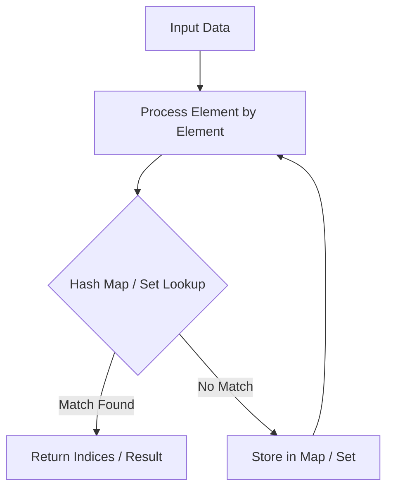

# Valid Parentheses

<div style="display:flex; gap:0.5rem; margin-bottom:1.5rem; align-items:center;">
  <span style="background:#22c55e22; color:#22c55e; padding:2px 10px; borderRadius:12px; fontWeight:600; fontSize:0.85rem;">Easy</span>
  <span style="color:#64748b; fontSize:0.85rem;">Day 12 • Striver Blind 75</span>
</div>

## 📌 Problem Overview

Given a string `s` containing just the characters `(`, `)`, `{`, `}`, `[` and `]`, determine if the input string is valid.

### Examples & Constraints
**Example 1:**
- **Input:** `s = "()"`
- **Output:** `true`


**Example 2:**
- **Input:** `s = "()[]{}"`
- **Output:** `true`


**Example 3:**
- **Input:** `s = "(]"`
- **Output:** `false`


**Example 4:**
- **Input:** `s = "([)]"`
- **Output:** `false`


**Example 5:**
- **Input:** `s = "{[]}"`
- **Output:** `true`


**Constraints:**
- `1 ≤ s.length ≤ 10⁴`

---

## 💡 Approach & Intuition

Tests your understanding of the stack data structure and its LIFO property.

### 🎯 Pattern Recognition
**Pattern: Stack for Matching**

Use a stack to match paired elements in nested structures.

---

## 📊 Step-by-Step Execution (Mermaid Diagram)



---

## 🐢 Brute Force Solution

### Code
```javascript
// Stack is the standard approach
```

- **Time Complexity:** `O(n)`
- **Space Complexity:** `O(n)`
- **Explanation:** Use a stack with a hash map for bracket matching.

---

## ⚡ Optimized Solution

### Code
```javascript
function isValid(s) {
  const stack = [];
  const pairs = { ')': '(', '}': '{', ']': '[' };
  for (const char of s) {
    if (!pairs[char]) { stack.push(char); }
    else { if (stack.pop() !== pairs[char]) return false; }
  }
  return stack.length === 0;
}
```

- **Time Complexity:** `O(n)`
- **Space Complexity:** `O(n)`
- **Explanation:** Push opening brackets, pop and match on closing brackets.

---

## 🐾 Step-by-Step Walkthrough

1. **Initialize State:** Setup necessary pointers, dynamic programming arrays, or hash maps.
2. **Iterate & Evaluate:** Process the input according to the boundary conditions.
3. **Update & Return:** Compute the optimal answer and return early or at termination.

### 🎙️ FAANG Interview Pitch
1. Recognize as a stack problem
2. Use LIFO property for nesting
3. Use a hash map for bracket pairs

---

## 💡 Progressive Hints

1. Use a stack to track opening brackets.
2. When you see a closing bracket, check if it matches the top of the stack.
3. Use a hash map to pair brackets.

---

## ⚡ Interactive Practice
👉 **[Solve this problem interactively in the DSA Lab](/DSA-Notes-Problems/dsa/problems/valid-parentheses)**
