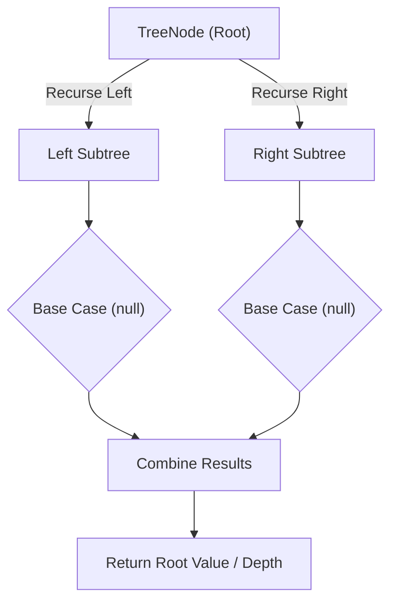

# Binary Tree Level Order Traversal

<div style="display:flex; gap:0.5rem; margin-bottom:1.5rem; align-items:center;">
  <span style="background:#f59e0b22; color:#f59e0b; padding:2px 10px; borderRadius:12px; fontWeight:600; fontSize:0.85rem;">Medium</span>
  <span style="color:#64748b; fontSize:0.85rem;">Day 13 • Striver Blind 75</span>
</div>

## 📌 Problem Overview

Given the `root` of a binary tree, return the level order traversal of its nodes' values (left to right, level by level), as an array of arrays.

### Examples & Constraints
**Example 1:**
- **Input:** `root = [3,9,20,null,null,15,7]`
- **Output:** `[[3],[9,20],[15,7]]`


**Example 2:**
- **Input:** `root = [1]`
- **Output:** `[[1]]`


**Constraints:**
- `The number of nodes is in the range [0, 2000]`
- `-1000 ≤ Node.val ≤ 1000`

---

## 💡 Approach & Intuition

Level Order Traversal is the canonical BFS-on-a-tree problem, processing one full level at a time using a queue snapshot.

### 🎯 Pattern Recognition
**Pattern: BFS by Level**

At each iteration, capture the current queue size (that level's node count), process exactly that many nodes, and push their children for the next round.

---

## 📊 Step-by-Step Execution (Mermaid Diagram)



---

## 🐢 Brute Force Solution

### Code
```javascript
// A DFS with depth tracking also works, appending to the depth-th array
function levelOrder(values) {
  const root = buildTree(values);
  const result = [];
  function dfs(node, depth) {
    if (!node) return;
    if (!result[depth]) result[depth] = [];
    result[depth].push(node.val);
    dfs(node.left, depth + 1);
    dfs(node.right, depth + 1);
  }
  dfs(root, 0);
  return result;
}
```

- **Time Complexity:** `O(n)`
- **Space Complexity:** `O(n)`
- **Explanation:** DFS while tracking depth, grouping values by depth.

---

## ⚡ Optimized Solution

### Code
```javascript
class TreeNode {
  constructor(val, left = null, right = null) { this.val = val; this.left = left; this.right = right; }
}
function buildTree(values) {
  if (!values.length || values[0] === null) return null;
  const root = new TreeNode(values[0]);
  const queue = [root];
  let i = 1;
  while (queue.length && i < values.length) {
    const node = queue.shift();
    if (i < values.length) { const lv = values[i++]; if (lv !== null) { node.left = new TreeNode(lv); queue.push(node.left); } }
    if (i < values.length) { const rv = values[i++]; if (rv !== null) { node.right = new TreeNode(rv); queue.push(node.right); } }
  }
  return root;
}
function levelOrder(values) {
  const root = buildTree(values);
  if (!root) return [];
  const result = [];
  let queue = [root];
  while (queue.length) {
    const level = [], next = [];
    for (const node of queue) {
      level.push(node.val);
      if (node.left) next.push(node.left);
      if (node.right) next.push(node.right);
    }
    result.push(level);
    queue = next;
  }
  return result;
}
```

- **Time Complexity:** `O(n)`
- **Space Complexity:** `O(n)`
- **Explanation:** Standard BFS, processing one level per iteration.

---

## 🐾 Step-by-Step Walkthrough

1. **Initialize State:** Setup necessary pointers, dynamic programming arrays, or hash maps.
2. **Iterate & Evaluate:** Process the input according to the boundary conditions.
3. **Update & Return:** Compute the optimal answer and return early or at termination.

### 🎙️ FAANG Interview Pitch
1. DFS with depth tracking works but is less intuitive for 'by level' output
2. BFS naturally processes nodes in level order
3. Snapshot the queue size before processing to know where a level ends
4. Push children into a fresh array for the next level

---

## 💡 Progressive Hints

1. Use a queue starting with the root.
2. At each iteration, capture the current queue size — that's the current level's node count.
3. Process exactly that many nodes, collecting values and pushing children for the next level.

---

## ⚡ Interactive Practice
👉 **[Solve this problem interactively in the DSA Lab](/DSA-Notes-Problems/dsa/problems/binary-tree-level-order-traversal)**
