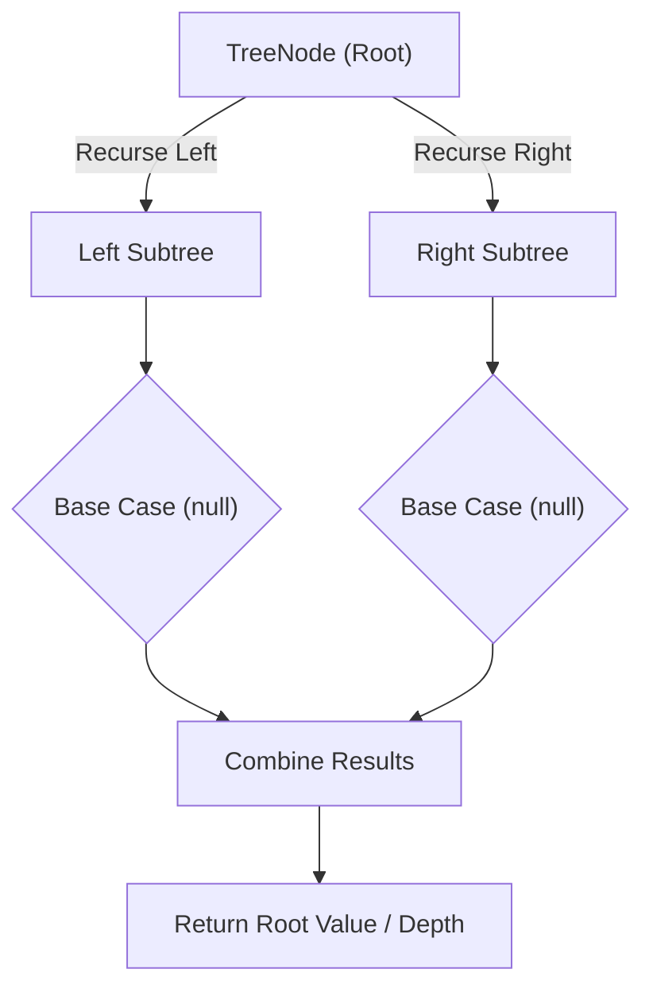

# Binary Tree Maximum Path Sum

<div style="display:flex; gap:0.5rem; margin-bottom:1.5rem; align-items:center;">
  <span style="background:#ef444422; color:#ef4444; padding:2px 10px; borderRadius:12px; fontWeight:600; fontSize:0.85rem;">Hard</span>
  <span style="color:#64748b; fontSize:0.85rem;">Day 13 • Striver Blind 75</span>
</div>

## 📌 Problem Overview

A path in a binary tree is a sequence of nodes connected by edges, with no node repeated. Given the `root` of a binary tree, return the maximum path sum of any non-empty path (it need not pass through the root).

### Examples & Constraints
**Example 1:**
- **Input:** `root = [1,2,3]`
- **Output:** `6`


**Example 2:**
- **Input:** `root = [-10,9,20,null,null,15,7]`
- **Output:** `42`


**Constraints:**
- `The number of nodes is in the range [1, 3 × 10⁴]`
- `-1000 ≤ Node.val ≤ 1000`

---

## 💡 Approach & Intuition

Binary Tree Maximum Path Sum is the hardest classic tree DFS problem: distinguishing between a path returned to the parent (must be one-directional) and the best path bending through a node (can use both children).

### 🎯 Pattern Recognition
**Pattern: Post-Order DFS with Two Return Concepts**

Each call returns the best downward extension for its parent (clamped to 0 if negative), while a global max separately considers the node acting as a bend point using both children.

---

## 📊 Step-by-Step Execution (Mermaid Diagram)



---

## 🐢 Brute Force Solution

### Code
```javascript
// Enumerating every possible path explicitly is exponential and impractical
// The DFS-with-two-concepts approach below is the standard efficient solution
function maxPathSum(values) {
  const root = buildTree(values);
  let best = -Infinity;
  function dfs(node) {
    if (!node) return 0;
    const l = Math.max(dfs(node.left), 0);
    const r = Math.max(dfs(node.right), 0);
    best = Math.max(best, node.val + l + r);
    return node.val + Math.max(l, r);
  }
  dfs(root);
  return best;
}
```

- **Time Complexity:** `O(n)`
- **Space Complexity:** `O(h)`
- **Explanation:** There's no simpler correct approach than the linear DFS below.

---

## ⚡ Optimized Solution

### Code
```javascript
class TreeNode {
  constructor(val, left = null, right = null) { this.val = val; this.left = left; this.right = right; }
}
function buildTree(values) {
  if (!values.length || values[0] === null) return null;
  const root = new TreeNode(values[0]);
  const queue = [root];
  let i = 1;
  while (queue.length && i < values.length) {
    const node = queue.shift();
    if (i < values.length) { const lv = values[i++]; if (lv !== null) { node.left = new TreeNode(lv); queue.push(node.left); } }
    if (i < values.length) { const rv = values[i++]; if (rv !== null) { node.right = new TreeNode(rv); queue.push(node.right); } }
  }
  return root;
}
function maxPathSum(values) {
  const root = buildTree(values);
  let best = -Infinity;
  function dfs(node) {
    if (!node) return 0;
    const l = Math.max(dfs(node.left), 0);
    const r = Math.max(dfs(node.right), 0);
    best = Math.max(best, node.val + l + r);
    return node.val + Math.max(l, r);
  }
  dfs(root);
  return best;
}
```

- **Time Complexity:** `O(n)`
- **Space Complexity:** `O(h)`
- **Explanation:** Single post-order DFS tracking both a return value and a global best.

---

## 🐾 Step-by-Step Walkthrough

1. **Initialize State:** Setup necessary pointers, dynamic programming arrays, or hash maps.
2. **Iterate & Evaluate:** Process the input according to the boundary conditions.
3. **Update & Return:** Compute the optimal answer and return early or at termination.

### 🎙️ FAANG Interview Pitch
1. The key insight: what a node returns to its parent differs from the best path through it
2. A node can only pass ONE direction upward (can't fork after returning)
3. But the global best CAN fork at any node, using both children
4. Clamp negative subtree contributions to 0 — never worth including a net-negative branch

---

## 💡 Progressive Hints

1. A negative subtree contribution should be clamped to 0 (skip it).
2. Track a global max considering node.val + leftGain + rightGain (a bend through this node).
3. Return to the parent only node.val + max(leftGain, rightGain), since a path passed up can extend in only one direction.

---

## ⚡ Interactive Practice
👉 **[Solve this problem interactively in the DSA Lab](/DSA-Notes-Problems/dsa/problems/binary-tree-maximum-path-sum)**
