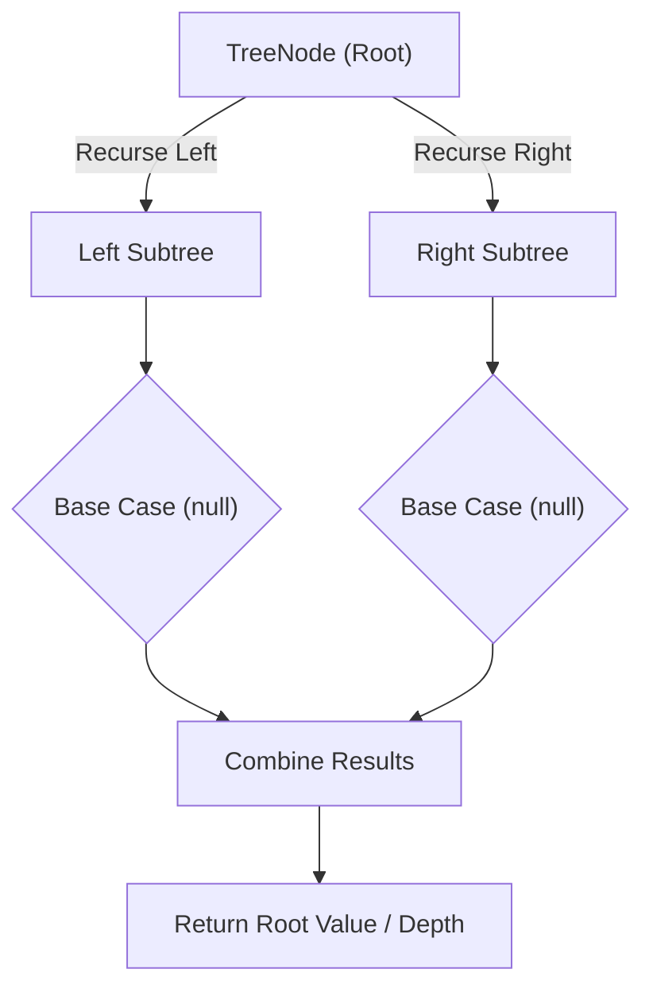

# Construct Binary Tree from Preorder and Inorder Traversal

<div style="display:flex; gap:0.5rem; margin-bottom:1.5rem; align-items:center;">
  <span style="background:#f59e0b22; color:#f59e0b; padding:2px 10px; borderRadius:12px; fontWeight:600; fontSize:0.85rem;">Medium</span>
  <span style="color:#64748b; fontSize:0.85rem;">Day 14 • Striver Blind 75</span>
</div>

## 📌 Problem Overview

Given two integer arrays `preorder` and `inorder` representing the preorder and inorder traversal of a binary tree, construct and return the binary tree, returned here as its level-order array.

### Examples & Constraints
**Example 1:**
- **Input:** `preorder = [3,9,20,15,7], inorder = [9,3,15,20,7]`
- **Output:** `[3,9,20,null,null,15,7]`


**Example 2:**
- **Input:** `preorder = [-1], inorder = [-1]`
- **Output:** `[-1]`


**Constraints:**
- `1 ≤ preorder.length ≤ 3000`
- `inorder.length == preorder.length`
- `Both arrays consist of unique values`

---

## 💡 Approach & Intuition

Construct Binary Tree from Preorder and Inorder tests using the structural properties of preorder (root-first) and inorder (left-root-right) to rebuild a tree uniquely.

### 🎯 Pattern Recognition
**Pattern: Recursive Split by Root**

The first element of preorder is always the current subtree's root. Find it in inorder — everything to its left is the left subtree, everything to its right is the right subtree.

---

## 📊 Step-by-Step Execution (Mermaid Diagram)



---

## 🐢 Brute Force Solution

### Code
```javascript
// Slicing arrays at every recursive call works but adds O(n) overhead per call
function buildTreeFromTraversals(preorder, inorder) {
  if (!preorder.length) return treeToArray(null);
  function build(pre, ino) {
    if (!pre.length) return null;
    const rootVal = pre[0];
    const node = new TreeNode(rootVal);
    const mid = ino.indexOf(rootVal);
    node.left = build(pre.slice(1, mid + 1), ino.slice(0, mid));
    node.right = build(pre.slice(mid + 1), ino.slice(mid + 1));
    return node;
  }
  return treeToArray(build(preorder, inorder));
}
```

- **Time Complexity:** `O(n²)`
- **Space Complexity:** `O(n²)`
- **Explanation:** Slice preorder/inorder arrays at every recursive call.

---

## ⚡ Optimized Solution

### Code
```javascript
class TreeNode {
  constructor(val, left = null, right = null) { this.val = val; this.left = left; this.right = right; }
}
function treeToArray(root) {
  if (!root) return [];
  const result = [];
  const queue = [root];
  while (queue.length) {
    const node = queue.shift();
    if (node === null) { result.push(null); continue; }
    result.push(node.val);
    queue.push(node.left);
    queue.push(node.right);
  }
  while (result.length && result[result.length - 1] === null) result.pop();
  return result;
}
function buildTreeFromTraversals(preorder, inorder) {
  const inorderIndex = new Map();
  inorder.forEach((v, i) => inorderIndex.set(v, i));
  let preIdx = 0;
  function build(left, right) {
    if (left > right) return null;
    const rootVal = preorder[preIdx++];
    const node = new TreeNode(rootVal);
    const mid = inorderIndex.get(rootVal);
    node.left = build(left, mid - 1);
    node.right = build(mid + 1, right);
    return node;
  }
  return treeToArray(build(0, inorder.length - 1));
}
```

- **Time Complexity:** `O(n)`
- **Space Complexity:** `O(n)`
- **Explanation:** Hash map for O(1) split lookups, shared index instead of slicing.

---

## 🐾 Step-by-Step Walkthrough

1. **Initialize State:** Setup necessary pointers, dynamic programming arrays, or hash maps.
2. **Iterate & Evaluate:** Process the input according to the boundary conditions.
3. **Update & Return:** Compute the optimal answer and return early or at termination.

### 🎙️ FAANG Interview Pitch
1. Slicing arrays at every call is correct but adds quadratic overhead
2. Use a hash map from value to inorder index for instant split-point lookup
3. Track a shared preorder index instead of slicing that array too
4. Recurse using index ranges (left, right) rather than new array copies

---

## 💡 Progressive Hints

1. The first element of preorder is always the root of the current subtree.
2. Find that value's position in inorder to split left/right subtrees.
3. Use a hash map from value to inorder index for O(1) lookups, and a shared preorder index to avoid slicing arrays.

---

## ⚡ Interactive Practice
👉 **[Solve this problem interactively in the DSA Lab](/DSA-Notes-Problems/dsa/problems/construct-binary-tree-preorder-inorder)**
