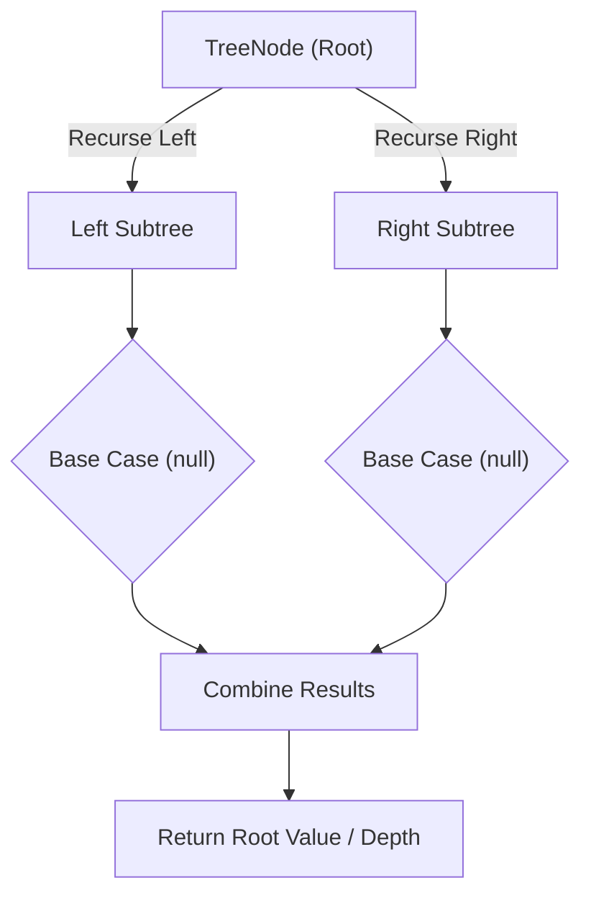

# Invert Binary Tree

<div style="display:flex; gap:0.5rem; margin-bottom:1.5rem; align-items:center;">
  <span style="background:#22c55e22; color:#22c55e; padding:2px 10px; borderRadius:12px; fontWeight:600; fontSize:0.85rem;">Easy</span>
  <span style="color:#64748b; fontSize:0.85rem;">Day 13 • Striver Blind 75</span>
</div>

## 📌 Problem Overview

Invert a binary tree by swapping the left and right children of every node.

### Examples & Constraints
**Example 1:**
- **Input:** `root = [4,2,7,1,3,6,9]`
- **Output:** `[4,7,2,9,6,3,1]`


**Example 2:**
- **Input:** `root = [2,1,3]`
- **Output:** `[2,3,1]`


**Constraints:**
- `0 ≤ tree nodes ≤ 100`

---

## 💡 Approach & Intuition

Tests recursive tree transformation. Made famous by a Google interview story.

### 🎯 Pattern Recognition
**Pattern: Tree Transformation**

Solve for children first (post-order), then transform the current node.

---

## 📊 Step-by-Step Execution (Mermaid Diagram)



---

## 🐢 Brute Force Solution

### Code
```javascript
// Recursive is standard
```

- **Time Complexity:** `O(n)`
- **Space Complexity:** `O(h)`
- **Explanation:** Recursive post-order swap.

---

## ⚡ Optimized Solution

### Code
```javascript
function invertTree(root) {
  if (!root) return null;
  const temp = root.left;
  root.left = invertTree(root.right);
  root.right = invertTree(temp);
  return root;
}
```

- **Time Complexity:** `O(n)`
- **Space Complexity:** `O(h)`
- **Explanation:** Recursive post-order inversion.

---

## 🐾 Step-by-Step Walkthrough

1. **Initialize State:** Setup necessary pointers, dynamic programming arrays, or hash maps.
2. **Iterate & Evaluate:** Process the input according to the boundary conditions.
3. **Update & Return:** Compute the optimal answer and return early or at termination.

### 🎙️ FAANG Interview Pitch
1. Go down to leaves first (post-order)
2. Swap at each level as you return
3. Tree remains valid — just mirrored

---

## 💡 Progressive Hints

1. Swap left and right children.
2. Recursively invert subtrees before swapping.
3. Base case: null returns null.

---

## ⚡ Interactive Practice
👉 **[Solve this problem interactively in the DSA Lab](/DSA-Notes-Problems/dsa/problems/invert-binary-tree)**
